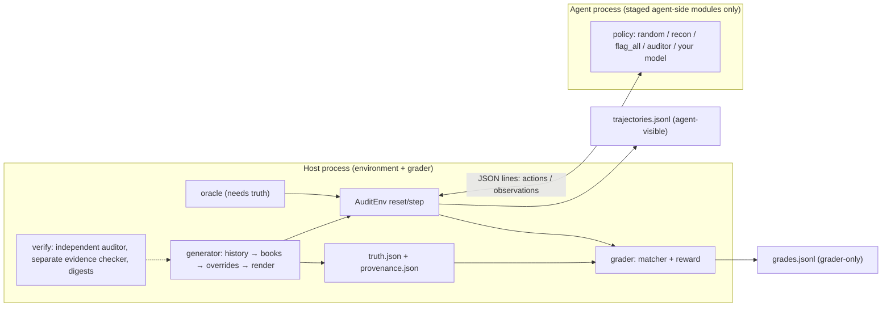

# auditgym

A reproducible RL environment for training and evaluating financial-audit agents: synthetic companies, a narrow investigation tool interface, errors with a recorded causal change and a verified answer key, and a shared reward. Offline, standard library only, Python 3.11 (CI also runs 3.12 and 3.13 on ubuntu).

[Русская версия](README.ru.md) · [Design note](docs/DESIGN.md) · [Check report](runs/check/report.md) · [Case](docs/CASE.md) · [Demo viewer](viewer/index.html) (open the file in a browser, works offline)

Excerpt of the output at commit `cd7794b` (Windows 10, Python 3.11.4):

```text
$ python -m auditgym check
auditgym 0.3.0 check (offline, Python 3.11.4); episodes: public master string auditgym-check-v1
A. unit tests
fuzz: 3000 in-process + 300 piped, 0 invariant violations, 0 schema/env disagreements
  [PASS] unittest: 590 run, 579 passed, 11 skipped
B. committed train/dev episodes
  [PASS] train/t01_clean_small regenerates byte-identically
  ...
summary: A_unit_tests 1/1, B_committed_episodes 40/40, B_replay 10/10, C_data 22/22, C_reward 465/465, D_paired 133/133, E_leaks 3/3, F_contract 20/20 (694 named checks of 83 kinds)
PASS in 371 s; report: runs/check/report.md
```

> **Кратко по-русски.** Среда для обучения ИИ-аудитора: генератор синтетических компаний, четыре типа ошибок с записанной причиной, два сценария взаимодействующих ошибок, чистые компании и отвлекающие случаи. Агент работает через пять инструментов в отдельном процессе; награда `clip(2·F1 − 1 − 0.002·шаги)`. Ключ ответов проверяют независимый аудитор и отдельная проверка доказательств. Проверка одной командой: `python -m auditgym check`. Подробности и ограничения: [README.ru.md](README.ru.md).

## Case → solution

| Case requirement | How auditgym does it | Where |
|---|---|---|
| "First build a consistent hidden company history, then the documents, then the errors with a recorded causal change" | Hidden history, then clean books, then errors as booking overrides re-posted by the same engine; provenance is an exact record diff with clean and final digests | [history.py](auditgym/history.py), [books.py](auditgym/books.py), [inject.py](auditgym/inject.py), [render.py](auditgym/render.py) · [DESIGN §1](docs/DESIGN.md#1-generation-history-first-errors-last) |
| "At least four independently configurable types" | Four types (duplicate invoice, unallocated payment, wrong FX rate, wrong period), each with variants, each requestable alone | [config.py](auditgym/config.py) · [DESIGN §3](docs/DESIGN.md#3-errors-variants-scenarios-distractors) |
| "Interacting errors. Two scenarios" | `boundary_fx_payment` (partial foreign receipt at the period boundary) and `fx_invoice_partial_allocation` (wrong-rate invoice, partly unallocated receipt) | [inject.py](auditgym/inject.py) · [DESIGN §3](docs/DESIGN.md#3-errors-variants-scenarios-distractors) |
| "Clean companies and plausible correct distractors" | Line-identical invoice pairs of both sides, recurring monthly invoices, split and multi-invoice payments, underpayments, overpayment and refund, receipts that credit 2900 without an error, postings booked at another moment inside their period, boundary and weekend FX documents, a twin with opposite answers; `check` requires a false positive on every distractor | [history.py](auditgym/history.py), [splits.json](configs/splits.json), [check_battery.py](auditgym/check_battery.py) · [DESIGN §3](docs/DESIGN.md#3-errors-variants-scenarios-distractors), [§8](docs/DESIGN.md#8-reproducibility-and-paired-checks) |
| "The answer key must describe the real discrepancy and the available evidence" | An independent auditor (standard library only, its own integer FX arithmetic) reproduces the key; a separate evidence checker re-derives each finding from its evidence set alone (for `unallocated_payment` it also reads the ledger to see that the set holds every 1100 row of the invoice); for `unallocated_payment` the cited set shows the invoice's open balance (relief by earlier part payments included), and `verify` also checks, from all public records, that no other receipt settled the invoice and that the set holds every 1100 row of it; `verify DIR` cross-checks each injection's recorded change against the records | [auditor.py](auditgym/auditor.py), [evidence_check.py](auditgym/evidence_check.py), [verify.py](auditgym/verify.py) · [DESIGN §7](docs/DESIGN.md#7-verification-of-data-and-answer-key) |
| "The answer key must not be guessable from surface features" | 60 document rules and 17 episode rules measured on 1000 generated episodes (170,058 documents, 3,799 in the answer key); none of the 60 document rules reaches precision 0.24 (the best one reaches 0.231 against a base rate of 0.022; the one pair-count document rule reaches 0.252) or has both precision 0.5 and recall 0.3; no episode rule beats its base rate by more than 0.03 except three that follow the size mix of the check set | [tells.py](auditgym/tells.py), [test_tells.py](tests/test_tells.py), [runs/tells/summary.md](runs/tells/summary.md) · [DESIGN §3](docs/DESIGN.md#3-errors-variants-scenarios-distractors) |
| "reset(seed, config) … step(action)", five actions, 50-row pages, 100 steps | Gymnasium-style JSON contract with four read-only actions and `submit`; schemas kept in agreement with the environment by a fuzzer; `F_contract` runs 20 named checks | [env.py](auditgym/env.py), [schemas/](schemas), [contract_battery.py](auditgym/contract_battery.py), [test_contract_fuzz.py](tests/test_contract_fuzz.py) · [DESIGN §4](docs/DESIGN.md#4-environment-contract) |
| "The grader runs outside the agent's process" | Policy in a child process over JSON lines, with a staged copy of the agent-side modules; grader, oracle and generator are not importable there; the image runs the policy as uid 10002; on Windows the child lowers itself to Low integrity before any policy code loads, so it cannot read the host's memory (measured) | [protocol.py](auditgym/protocol.py), [agent.py](auditgym/agent.py), [Dockerfile](Dockerfile) · [DESIGN §5](docs/DESIGN.md#5-isolation-and-leaks) |
| "Matching … One-to-one", "Publish the normalization code, tolerance rules, and the tie-breaking rule" | Kuhn maximum matching, published normalization, ID aliases (doc_id ↔ invoice_id/payment_id), tolerance 2 minor units | [matcher.py](auditgym/matcher.py) · [DESIGN §6](docs/DESIGN.md#6-matcher-and-reward) |
| "Terminal reward = clip(2·F1 − 1 − 0.002·inspection_steps, −1, 1)" | Exact fractions; the experimental soft reward has its own columns and never replaces the common reward | [reward.py](auditgym/reward.py), [grader.py](auditgym/grader.py), [diagnostics.py](auditgym/diagnostics.py) · [DESIGN §6](docs/DESIGN.md#6-matcher-and-reward) |
| "Four baseline policy adapters" | random, recon, flag_all and oracle (grader side only), plus silent and a scripted auditor; any `module.path:ClassName` runs under the same isolation | [policies/](auditgym/policies), [examples/custom_policy.py](examples/custom_policy.py) · [DESIGN §5](docs/DESIGN.md#5-isolation-and-leaks) |
| "Identical seed, config, version, and actions must reproduce …", paired checks | Portable PRNG, integer and `Decimal` arithmetic, byte-identical regeneration, replay of recorded actions, five paired transforms (permutation, ID remap, timestamp re-rendering, renaming, a 28-year date shift) | [rng.py](auditgym/rng.py), [transform.py](auditgym/transform.py), [check.py](auditgym/check.py) · [DESIGN §8](docs/DESIGN.md#8-reproducibility-and-paired-checks) |
| 10 train + 10 dev episodes, trajectories.jsonl | Source histories split first; dev on held-out regimes; committed trajectories are regenerated and compared in CI | [episodes/](episodes), [runs/train_dev/trajectories.jsonl](runs/train_dev/trajectories.jsonl) · [DESIGN §8](docs/DESIGN.md#8-reproducibility-and-paired-checks) |
| Official check without network, single command | `python -m auditgym check`; the Dockerfile runs the same command with `--network none`; both run in CI | [check.py](auditgym/check.py), [Dockerfile](Dockerfile), [CI workflow](.github/workflows/check.yml) · [DESIGN §13](docs/DESIGN.md#13-continuous-integration) |

## Quick start

No keys, no network, nothing to install. Python 3.11:

```bash
python -m auditgym check
```

`check` prints one line per named check, rewrites [runs/check/report.md](runs/check/report.md) and `report.json`, and exits 0 only if every check passes.

Version 0.3.0 changes every episode: `GENERATOR_VERSION` follows the package version and enters `episode_id`, so a seed and config that gave one episode under 0.2.0 give another. The 20 committed episodes, their IDs and every record under `runs/` except the CI excerpts in `runs/ci` were regenerated for it.

At commit `cd7794b` it runs **694 named checks of 83 kinds** (a kind is one property; most run on every episode they apply to). One of them runs the **590 unit tests**. The report header carries a code stamp ([DESIGN §8](docs/DESIGN.md#8-reproducibility-and-paired-checks)). Measured runs (the local row and the CI rows are at `cd7794b`; CI run 44891150721, 590 tests, cited in [runs/ci/44891150721.txt](runs/ci/44891150721.txt)):

| Where | Unit tests passed / skipped | `check` result |
|---|---|---|
| Windows 10, Python 3.11.4 (local, the committed report) | 579 / 11 | `PASS in 371 s` |
| CI windows-latest, Python 3.11 | 579 / 11 | `PASS in 143 s` |
| CI ubuntu, Python 3.11 / 3.12 / 3.13 | 567 / 23 | `PASS in` 188 / 223 / 218 s |
| CI macOS, Python 3.11 | 564 / 26 | `PASS in 185 s` |
| CI container (`--network none`, 2 CPU, 4 GB); the same in strict mode | 572 / 18 | `PASS in 247 s`; strict mode `PASS in 251 s` |
| CI container, `--user 10001` | 566 / 24 | `PASS in 243 s` |
| CI container, `--cap-drop ALL` | 564 / 26 | `PASS in 240 s` |
| CI container, closed path (mounted seeds file, strict mode) | not run | `PASS in 4 s` |
| CI container, strict mode with `--cap-drop ALL` | not run | exit 2 with one `error:` line |
| CI container, a custom policy next to an answer key under `--cap-drop ALL` | not run | exit 2 with one `error: custom policy` line |

Skips depend on the platform and the container mode; the list is in [DESIGN §13](docs/DESIGN.md#13-continuous-integration). CI run 44891150721 on `cd7794b` (590 tests) is the latest and is green on all six jobs. The container steps of the official check, strict mode and the closed path print the report line `Policy isolation: separate user (uid 10002).`, so the report written in the image shows that the policy ran as a separate user.

The cited lines are in [runs/ci/44891150721.txt](runs/ci/44891150721.txt), made with [tools/ci_excerpt.py](tools/ci_excerpt.py); the conclusion of every job and step is in [runs/ci/44891150721.jobs.json](runs/ci/44891150721.jobs.json). The `PASS in` times are the check's own, and whole jobs take longer. The container job also runs `python -m auditgym.redteam --parent` in three modes (default image, `--user 10001`, `--cap-drop ALL`). The full log is not committed.

```bash
python -m auditgym demo
```

`demo` runs the scripted auditor and the recon baseline on one episode in an isolated process and prints every step and the grader's verdict.

```bash
python -m auditgym viewer
```

`viewer` rebuilds [viewer/index.html](viewer/index.html), an offline page for people (English or Russian, dark or light).

Container, offline after the build (CI builds and runs it with the same flags plus `--pids-limit 512`):

```bash
docker build -t auditgym .
docker run --rm --network none --cpus 2 --memory 4g auditgym
```

The report is written at `/app/runs/check/report.md` inside the image. The copy-out commands (named container, `docker cp`, `docker rm`) were not run locally; CI runs that pattern with `--name official` and `--pids-limit 512` ([DESIGN §5](docs/DESIGN.md#5-isolation-and-leaks), [§13](docs/DESIGN.md#13-continuous-integration)).

## See it in two minutes

1. Run `python -m auditgym demo`. On episode `ep_4d3a8d611652a99a` the auditor reads 22 pages through `list_records`, submits 5 findings at step 23, and the grader reports reward **+0.956** with TP 5, FP 0, FN 0. The recon baseline on the same episode gets **−0.680** with TP 2, FP 15, FN 3.
2. Open [viewer/index.html](viewer/index.html) and pick `d08_both_interacting_kzt` in the sidebar to see the answer key (grader view). Click an error for its documents and journal rows, open **Graph** for the whole evidence network, then open a recorded run to replay it step by step ([screenshot](docs/media/viewer_run.png)).

   
3. Run `python -m auditgym verify episodes/dev/d08_both_interacting_kzt`: nine named checks, all `PASS`, then the declared discrepancies.
4. Read [runs/check/report.md](runs/check/report.md) for the baselines on the hidden-like set.

## For judges

The check groups its named checks in five rubric groups. The grouping is `RUBRIC` in [auditgym/check.py](auditgym/check.py); the section keys in `report.json` are unchanged. Each row names the check sections that run in `python -m auditgym check`, the unit tests that cover the same claim, and a command you can run yourself. The report header states the coverage (694 named checks of 83 kinds) and whether the policy ran as a separate user.

| Rubric (points) | Check sections in `check` | Main unit tests | Verify it yourself |
|---|---|---|---|
| 1. Contract and isolation (25) | `F_contract`: 20 named contract checks in process (reset and observation keys, 50-row pages, record keys in order, the same cursor twice and again after a fresh reset, unknown ID and action, calculator limits, submit and finished episodes, truncation at step 100 and not before, frozen-clock time limit, eval hides the reward, −1 for invalid and foreign submissions, observation schema, a 300-action seeded fuzz); `E_leaks`: the 1920 observations of this run's hidden-like baselines hold only the allowed fields and no answer-key marker; oracle trajectories are never published | `test_contract_battery`, `test_env`, `test_schemas`, `test_contract_fuzz` (seeded fuzzer, in-process and piped), `test_isolation`, `test_noninterference` (five policies, shuffled or replaced answer keys, byte-identical observations), `test_redteam`, `test_linux_hardening` (Linux host hardening), `test_windows_hardening` (the Windows child at Low integrity cannot open the host; a control at the host's level can), `test_entrypoints` (both entry points harden the host before they read `--secret-env`), `test_container` (inside the image, must not skip in CI) | `python -m auditgym check`; `python -m auditgym.redteam` (hostile probes: floods, stalls, grandchildren; not part of `check`); `python -m auditgym.redteam --parent` (what a policy of the same user reads about its parent); `AUDITGYM_REQUIRE_AGENT_USER=1 python -m auditgym check` exits 2 outside the image (strict isolation) |
| 2. Data and answer key (25) | `B_committed_episodes`: all 20 committed episodes regenerate byte for byte and verify; `C_data`: hidden-like set verifies, with resampling rates | `test_verify` (directory mode checks stored digests, malformed provenance, retargeted injections, each injection's recorded change against the records, that no other receipt settled an unallocated payment's invoice (earlier part payments aside) and that its cited set holds every 1100 row of it; the auditor imports no generator code and its arithmetic matches `money.py`), `test_generator`, `test_tells` (shortcut rules), `test_regen_examples`, `test_cli` (an invalid `truth.json` exits 2) | `python -m auditgym verify episodes/dev/d08_both_interacting_kzt`; `python -m auditgym build-splits` followed by `git diff --exit-code -- episodes`; `python -m auditgym.tells --n 1000 --master auditgym-tells-v1 --out runs/tells` (about 3 minutes; rewrites [runs/tells/summary.md](runs/tells/summary.md) byte for byte) |
| 3. Reward reliability (25) | `C_reward`: oracle reaches 1.0, flag-everything and random score poorly, the scripted auditor closes every episode and beats the silent baseline; attack battery on every error episode (type shotgun, amount ladder, junk padding, evidence stuffing, wrong real ID, one false accusation per distractor built from the real records, which costs exactly one false positive) and on every clean episode (the same accusations score −1, below silence); each accusation must match a decoy key that states exactly its claim and no decoy that differs in one criterion | `test_reward`, `test_matcher` (Kuhn matching, tolerance, aliases, wrong type, invalid structures), `test_check_battery` (the same constructors score true positives on real issues; a matcher that ignores one criterion fails), `test_diagnostics` | `python -m auditgym grade --episode episodes/train/t03_duplicate --findings examples/findings_t03_correct.json --steps 14` (reward 0.972) |
| 4. Reproducibility (15) | `B_replay`: recorded actions replayed in a fresh environment give JSON-equal observations and the same terminal reward; `D_paired`: same seed and config give identical records and answer key; same actions give identical transitions; isolated and in-process runs agree; oracle answer and reward survive permutation, ID remap, timestamp re-rendering, renaming of the company and invoice wording, and a 28-year date shift (+28, else −28, else a skip) | `test_isolation`, `test_generator` (regeneration under two `PYTHONHASHSEED` values), `test_contract_fuzz` (committed schemas byte-equal to the generated ones), `test_transform_rename`, `test_transform_shift` (weekdays, leap days and DST rule dates survive the shift; dates outside 1901-03-01 .. 2099-12-31 are refused) | `python -m auditgym transform --in DIR --out DIR2 --permute-seed 1 --remap-seed 2 --ts-repr utc --rename-seed 3 --shift-years 28` then `python -m auditgym verify DIR2`; CI diffs episodes, schemas and trajectories after a regeneration |
| 5. Engineering and explanation (10) | `A_unit_tests`: the whole unit suite, reported as run, passed and skipped; inside it, `test_mutation_smoke` fails when the recorded mutation run no longer matches the mutant list or a test module changed after the recording | every `tests/test_*.py`, `test_cli`, `test_timeutil`, `test_calculator`; [runs/mutation/summary.md](runs/mutation/summary.md): 180 of 180 one-line mutants of the core are killed: 132 by the test modules listed for them, and the other 48 pass those and are killed by `test_mutation_survivors`, written for them | `python -m unittest discover -s tests -t .`; `python tools/mutation_smoke.py OUT_DIR --jobs 4` (more than 10 min); CI matrix on ubuntu (Python 3.11, 3.12, 3.13), windows and macOS (Python 3.11) |

Limits of this map: the hidden-like set and the closed path are described under [Limitations](#limitations) and [For organizers](#for-organizers).

## For organizers

Organizer episodes come in as a seeds file; closed runs never write `runs/check`.

```bash
# official check on your own closed set; the host secret is read from an environment variable
export AUDITGYM_SECRET='<your secret>'
python -m auditgym check --seeds-file FILE --secret-env AUDITGYM_SECRET --out DIR
```

- **Run closed episodes inside the container.** Outside a container the policy runs as your OS user and can read what that user can read. Mount seeds files and episode folders under `/app`; the commands and measured limits are in [DESIGN §5](docs/DESIGN.md#5-isolation-and-leaks).
- `FILE` is JSON `{"split": "<label>", "episodes": [{"name": "...", "seed": <int>, "config": {...}}]}`; see [examples/closed_seeds_example.json](examples/closed_seeds_example.json). Checks that need error or clean episodes the file lacks are `SKIP`. Default output is `runs/check_closed`; `--keep-runs` also writes the closed answer key into trajectories and grades.
- **Refused entries.** An entry the generator refuses (a `ConfigError` or `GenerationError`, for example `boundary_fx_payment` with `"timezone": "UTC"`) is a named `SKIP` line in `C_data`, `[SKIP] <name>: generated from its seed and config - refused, ConfigError: <reason>`, and the other entries are still checked; the exit code is 0 when every check that ran passes. `run --seeds-file` prints `WARNING: entry <name> refused, <reason>`, lists the entry in `meta.json` under `refused_entries` and runs the rest. Only a file in which no entry can be generated exits 2, with one `error:` line.
- Use 63-bit seeds and a secret. Without `--secret-env`, `run --seeds-file` and `check --seeds-file` exit 2 with one `error:` line, because a small seed can be recovered from the public `episode_id`. `--no-secret` accepts that for seeds that are public by design and is recorded (`meta.json`, report header); the committed example runs with `python -m auditgym check --seeds-file examples/closed_seeds_example.json --no-secret` ([DESIGN §8](docs/DESIGN.md#8-reproducibility-and-paired-checks)).
- Strict isolation (opt-in): `AUDITGYM_REQUIRE_AGENT_USER=1` makes `check`, `run`, `demo`, `viewer` and `budget` exit 2 with one `error:` line when the policy cannot run as the separate user ([DESIGN §5](docs/DESIGN.md#5-isolation-and-leaks)).
- CI runs the closed path in the container the way an organizer would: strict mode, mounted seeds file, the secret in an environment variable ([DESIGN §13](docs/DESIGN.md#13-continuous-integration)).
- `python tools/organizer_sweep.py DIR [CHUNK] [--record]` runs this closed check over the stress mix plus one boundary configuration per edge value that `config.py` accepts (428 configurations: 422 feasible, 6 infeasible, each with a ConfigError that names the reason), and the contract battery on every feasible episode. On the code of `cd7794b` all 8 chunks passed (seven of 60 episodes, one of 2). [runs/sweep/summary.md](runs/sweep/summary.md) carries the check report's code stamp (`3cee8009…`); see [DESIGN §8](docs/DESIGN.md#8-reproducibility-and-paired-checks).
- Your own policy, a class with `act(observation, reward, info)`, runs in the isolated child: `python -m auditgym run --episodes DIR_OR_FOLDER --policies yourpkg.module:YourPolicy --out runs/yours` (`--policy-path DIR` for code outside this repository; built-in policies never get it). Outside the committed open episodes it needs the official image or `--allow-same-user`. The oracle is refused there, a missing class exits 3, and on Windows the policy runs at Low integrity ([DESIGN §5](docs/DESIGN.md#5-isolation-and-leaks)).
- **Custom policies on closed data.** With a seeds file or `--secret-env`, `run` refuses (exit 2, one `error: custom policy ...` line) a `module:Class` policy that would run as the host's user: no separate policy user, or `--in-process`. Switching users needs an agent account, `/proc` and CAP_CHOWN, CAP_SETGID and CAP_SETUID, so root under `docker --cap-drop ALL` cannot switch. The same refusal applies at the moment a predicted switch fails (the account already has processes, or `chown` or `setuid` is refused, and the child would start as the host's user). `--allow-same-user` accepts a same-user run, prints one `WARNING` line and is recorded in `meta.json`; `allow_same_user` is true also when the child fell back after a predicted switch. The official image needs no flag; `check --seeds-file` runs only built-in policies.
- **Answer keys on disk.** The same refusal covers an `--episodes` directory with `grader/` that is not a committed open episode from `episodes/index.json` (a new folder under `episodes/train` is not one): exit 2, one `error: custom policy ... next to answer keys` line, nothing written, unless `--allow-same-user` is given. The committed open splits publish their answer keys, so a same-user policy on them is not refused: `examples/custom_policy.py` on `episodes/dev` needs no flag, exits 0, prints one `WARNING` line (the policy runs as the host's user next to the public answer keys of the open splits; fine for training, never for evaluation) and `meta.json` records `"open_answer_keys_readable": true`. A predicted switch to the separate policy user prints nothing ([DESIGN §5](docs/DESIGN.md#5-isolation-and-leaks)).
- `examples/hostile/policies.py` shows the failure modes the harness handles (exit 3 for a crashing policy).
- Generate, verify and copy episodes with the paired transforms: see the [Commands](#commands) table. Example: `python -m auditgym generate --seed 123 --config examples/config_mixed.json --out DIR` writes one episode.
- Exit codes: 0 pass; 1 a check or verification failed; 2 bad input (one `error:` line); 3 a run finished but an agent failed ([DESIGN §8](docs/DESIGN.md#run-outputs-and-exit-codes)).

## Architecture



- Generator: one company and one reporting period per episode; sizes, currencies, time zones and the invoice-count band are in [DESIGN §1](docs/DESIGN.md#1-generation-history-first-errors-last).
- Environment: five tools (four read-only, plus `submit`), 50-row pages, stable cursors (`F_contract` repeats the same cursor, also after a fresh reset), a 100-step budget and a 60 s limit; bounded errors that consume a step. Python API example in [DESIGN §4](docs/DESIGN.md#4-environment-contract).
- Grader: published normalization, one-to-one matching, the common reward and an experimental soft reward ([DESIGN §6](docs/DESIGN.md#6-matcher-and-reward)).
- Verification: nine named checks per episode; the generator resamples any candidate that fails one ([DESIGN §7](docs/DESIGN.md#7-verification-of-data-and-answer-key)).
- Isolation: the policy runs in a child process that sees observations only ([DESIGN §5](docs/DESIGN.md#5-isolation-and-leaks)).

## Evaluation

Every table below is copied from a generated file, and the command that regenerates each one is under it. The scripted auditor is verifier code run through the tools: a solvability proof, not a learned policy, so its numbers are not agent capability.

### Hidden-like set (20 episodes)

From [runs/check/report.md](runs/check/report.md). These episodes come from the public master string `auditgym-check-v1`, so they test the pipeline. Eval mode, every agent in an isolated process.

| Policy | Return | Soft return | Macro P | Macro R | Micro P | Micro R | F1 | Steps | Closed share | FP on clean |
|---|---|---|---|---|---|---|---|---|---|---|
| oracle (grader-side) | 1.000 | 1.000 | 0.75 | 0.75 | 1.00 | 1.00 | 1.000 | 0.0 | 1.00 | 0 |
| scripted auditor (verifier code) | 0.9365 | 0.9365 | 0.75 | 0.75 | 1.00 | 1.00 | 1.000 | 31.75 | 1.00 | 0 |
| recon (simple reconciliation) | −0.678 | −0.678 | 0.12 | 0.47 | 0.10 | 0.66 | 0.183 | 31.75 | 0.00 | 78 |
| random explorer | −0.804 | −0.804 | 0.00 | 0.00 | 0.00 | 0.00 | 0.100 | 19.5 | 0.10 | 7 |
| flag everything | −1.000 | −1.000 | 0.00 | 0.00 | 0.00 | 0.00 | 0.000 | 3.0 | 0.00 | 150 |
| silent (submits nothing at once) | −0.500 | −0.500 | 0.00 | 0.00 | n/a | 0.00 | 0.250 | 0.0 | 0.25 | 0 |

The empty answer scores −0.500 here: +1 on the 5 clean episodes and −1 on the 15 error episodes. recon and the random explorer score below it; only the scripted auditor and the oracle beat it. The check asserts auditor > silent and does not claim that recon beats it. Regenerate: `python -m auditgym check`.

### Open splits (10 train, 10 dev)

From [runs/train_dev/summary.md](runs/train_dev/summary.md) (`python -m auditgym run --episodes episodes/train episodes/dev --policies random,recon,flag_all,oracle,auditor,silent --out runs/train_dev`). Soft return is the experimental reward; the common return is the one that counts. Macro P and R average over episodes, and a clean episode counts as 0, which is why the oracle's macro P/R is 0.7 (train) and 0.8 (dev). Micro P and micro R pool all episodes and are the figures to read.

| Split | Policy | Return | Soft return | Macro P | Macro R | Micro P | Micro R | F1 | Steps | Closed share | FP on clean |
|---|---|---|---|---|---|---|---|---|---|---|---|
| train | scripted auditor | 0.970 | 0.970 | 0.70 | 0.70 | 1.00 | 1.00 | 1.000 | 14.9 | 1.0 | 0 |
| train | recon | −0.847 | −0.847 | 0.05 | 0.40 | 0.04 | 0.50 | 0.083 | 14.9 | 0.0 | 31 |
| train | random | −0.607 | −0.607 | 0.00 | 0.00 | 0.00 | 0.00 | 0.200 | 24.0 | 0.2 | 2 |
| train | flag everything | −1.000 | −1.000 | 0.00 | 0.00 | 0.00 | 0.00 | 0.000 | 3.0 | 0.0 | 90 |
| train | oracle | 1.000 | 1.000 | 0.70 | 0.70 | 1.00 | 1.00 | 1.000 | 0.0 | 1.0 | 0 |
| train | silent | −0.400 | −0.400 | 0.00 | 0.00 | n/a | 0.00 | 0.300 | 0.0 | 0.3 | 0 |
| dev | scripted auditor | 0.946 | 0.946 | 0.80 | 0.80 | 1.00 | 1.00 | 1.000 | 27.0 | 1.0 | 0 |
| dev | recon | −0.774 | −0.774 | 0.08 | 0.47 | 0.09 | 0.60 | 0.133 | 27.0 | 0.0 | 16 |
| dev | random | −0.801 | −0.801 | 0.00 | 0.00 | 0.00 | 0.00 | 0.100 | 29.0 | 0.1 | 3 |
| dev | flag everything | −1.000 | −1.000 | 0.00 | 0.00 | 0.00 | 0.00 | 0.000 | 3.0 | 0.0 | 60 |
| dev | oracle | 1.000 | 1.000 | 0.80 | 0.80 | 1.00 | 1.00 | 1.000 | 0.0 | 1.0 | 0 |
| dev | silent | −0.600 | −0.600 | 0.00 | 0.00 | n/a | 0.00 | 0.200 | 0.0 | 0.2 | 0 |

On dev, recon's misses are all `not_flagged`: it reads the evidence but compares dates as written, not in company time, and it groups duplicates on purchase invoices only, so it misses sales duplicates and re-keyed copies. Per-type recall, the miss reasons of the other policies and recon's change after the shortcut removal: [DESIGN §9](docs/DESIGN.md#9-measured-results).

### Action budget

From [runs/budget/summary.md](runs/budget/summary.md) (dev split, scripted auditor and recon, isolated, eval mode). Command: `python -m auditgym budget`.

| Budget (steps) | Auditor return | Auditor F1 | Auditor closed | Recon return | Recon F1 |
|---|---|---|---|---|---|
| 20 | −0.098 | 0.464 | 0.2 | −0.9205 | 0.047 |
| 50 | 0.946 | 1.000 | 1.0 | −0.774 | 0.133 |
| 100 | 0.946 | 1.000 | 1.0 | −0.774 | 0.133 |

At 20 steps the scripted auditor closes 2 of the 10 dev episodes; at 50 and 100 steps it closes all 10, and the rows for 50 and 100 steps are equal.

### Generator stress

From [runs/stress/report.md](runs/stress/report.md). Command: `python -m auditgym stress --n 300`. Counts are reproducible; timings and memory are not.

| Set | Configs | Generated and verified | Verify failed | Infeasible (ConfigError) | First attempt | Later attempts | Max generation time | Peak memory |
|---|---|---|---|---|---|---|---|---|
| random | 300 | 299 | 0 | 1 | 273 | 26 | 0.38 s | 6.2 MB |
| extreme | 17 | 17 | 0 | 0 | 15 | 2 | 0.22 s | 5.5 MB |

The one infeasible request asks for the `UTC` time zone, which never has a UTC offset. All 17 extreme configurations verify, and the scripted auditor closes them in 13 to 48 steps. The composition of both sets: [DESIGN §9](docs/DESIGN.md#9-measured-results).

## Commands

| Command | Purpose |
|---|---|
| `python -m auditgym check` | The single offline check (named checks, rubric groups, [report](runs/check/report.md)) |
| `python -m auditgym check --seeds-file FILE --secret-env VAR --out DIR` | The same battery on organizer episodes (or `--no-secret` for a public example file); never writes `runs/check` |
| `python -m auditgym build-splits` | Regenerate `episodes/train` and `episodes/dev` from [configs/splits.json](configs/splits.json) |
| `python -m auditgym generate --seed N --config FILE --out DIR [--secret-env VAR]` | One episode directory |
| `python -m auditgym verify DIR` | Named accounting and answer-key checks for an episode directory |
| `python -m auditgym run --episodes DIRS --policies P1,P2 --out DIR` | Baselines on episode folders (`--mode eval\|train`, `--max-steps N`, `--policy-seed N`) |
| `python -m auditgym run --seeds-file FILE (--secret-env VAR \| --no-secret) --policies ... --out DIR` | Closed episodes generated in memory |
| `python -m auditgym run ... --policies module:Class [--policy-path DIR] [--allow-same-user]` | Your own policy in the isolated child process; `--allow-same-user` lets it run as the host's user on closed data (a seeds file, `--secret-env`) and next to an answer key on disk (an `--episodes` directory with `grader/` outside the committed open episodes); on the committed open splits it needs no flag and prints one `WARNING` line; `--policy-path` applies only to `module:Class` (see [For organizers](#for-organizers)) |
| `python -m auditgym grade --episode DIR --findings FILE --steps N` | Grade a findings file |
| `python -m auditgym transform --in DIR --out DIR2 --permute-seed N --remap-seed N --ts-repr utc --rename-seed N --shift-years 28` | Paired-check copy of an episode (any subset of the flags; the shift is a nonzero multiple of 28 years) |
| `python -m auditgym.tells --n 1000 --master auditgym-tells-v1 --out runs/tells` | Shortcut-tell measurement on generated episodes, writes [runs/tells/summary.md](runs/tells/summary.md) |
| `python tools/organizer_sweep.py OUT_DIR [CHUNK] [--record]` | The closed check over the stress and boundary mixes; `--record` writes [runs/sweep/summary.md](runs/sweep/summary.md) |
| `python tools/mutation_smoke.py OUT_DIR [--record] [--jobs N]` | One-line mutants of the core, each in a fresh copy of the repository; `--record` writes [runs/mutation/summary.md](runs/mutation/summary.md) |
| `python -m auditgym stress --n 300` | Generator stress run, writes [runs/stress/report.md](runs/stress/report.md) |
| `python -m auditgym budget` | Action-budget sweep, writes [runs/budget/summary.md](runs/budget/summary.md) |
| `python -m auditgym demo` | Auditor and recon on one episode, step by step |
| `python -m auditgym viewer` | Rebuild [viewer/index.html](viewer/index.html) |
| `python -m auditgym schemas` | Write the JSON schemas to [schemas/](schemas) |
| `python -m auditgym.redteam` | Hostile-policy probes (floods, stalls, grandchild processes); not part of `check` |
| `python -m auditgym.redteam --parent` | Only the parent-visibility measurement: the parent's command line from a plain child process, and the host's environment from a policy child started through the harness |
| `python -m unittest discover -s tests -t .` | The unit suite (the same tests that `check` runs as one named check) |

Trajectory fields, the `meta.json` versions and the exit-code rules: [DESIGN §8](docs/DESIGN.md#run-outputs-and-exit-codes).

## Repository

```
auditgym/          environment, generator, grader, verifier, evidence checker, policies, CLI
  policies/        random, recon, flag_all, oracle (grader-side), auditor, silent
  viewer/          offline viewer template and builder
configs/           splits.json (train/dev seeds and configs, config_version 1)
episodes/          train/ and dev/: public/ records + grader/ answer key and provenance
runs/              check/ (report.md and report.json are committed; grades.jsonl, trajectories.jsonl and
                   unittest.log are written by a local run and git-ignored), check_closed/ (organizer runs,
                   git-ignored), train_dev/, stress/, budget/, tells/, sweep/ (organizer sweep),
                   mutation/ (mutation run), ci/ (excerpts of cited CI logs)
tools/             ci_excerpt.py (keeps the cited CI log lines), organizer_sweep.py (closed path at scale),
                   mutation_smoke.py (mutation run over the core)
schemas/           JSON schemas: records, actions, observations, findings, truth, policy, provenance, trajectories
tests/             unittest suites
docs/              CASE.md, DESIGN.md, TASKS.md, PLAN.md (historical), media/, design/ (static mocks, not rebuilt)
examples/          config and findings examples, a custom policy, hostile policies for the probes
.github/workflows/ CI: check on ubuntu (Python 3.11, 3.12, 3.13), windows and macOS (Python 3.11); container build and run
```

All companies, people, accounts, documents, FX rates and amounts are synthetic. No real financial data, payments or personal data are used.

## Limitations

Each limit is stated once; the linked DESIGN section has the detail.

- **Platforms.** Local runs on Windows 10 with Python 3.11.4; CI on ubuntu with Python 3.11, 3.12 and 3.13, and on windows and macOS with Python 3.11. `pyproject.toml` sets `requires-python` to `>=3.11,<3.14`, so Python 3.14 was not tested ([§10](docs/DESIGN.md#10-limitations)).
- **Container.** The image is built and run in CI with `--network none --cpus 2 --memory 4g --pids-limit 512`. `--user 10001` and `--cap-drop ALL` fall back to a same-user policy with one warning line; `AUDITGYM_REQUIRE_AGENT_USER=1` turns that fallback into exit 2 ([§5](docs/DESIGN.md#5-isolation-and-leaks)).
- **Isolation is a process boundary, not a sandbox.** Outside a container a same-user child can read files whose paths it can guess and its parent's command line; on Windows it lowers itself to Low integrity before any policy code loads and cannot read the host's memory (measured), and in the image a separate uid blocks the reads. `AUDITGYM_REQUIRE_AGENT_USER=1` refuses any same-user fallback. Residuals and measurements: [§5](docs/DESIGN.md#5-isolation-and-leaks).
- **Noninterference** is measured by replay; timing is not covered, because the time limit is part of the contract ([§5](docs/DESIGN.md#5-isolation-and-leaks)).
- **Seeds.** The generator is open source: with no host secret and a guessed config, a small seed can be recovered from `episode_id` and the answer key regenerated. Partly closed: seeds files need `--secret-env` or an explicit `--no-secret`, and eval-mode `AuditEnv` refuses seeds of 40 bits or fewer without a secret (`allow_weak_seed=True` lifts it). Use 63-bit seeds and `--secret-env` ([§10](docs/DESIGN.md#10-limitations)).
- **Hidden-like set.** The episodes in `check` come from the public master string `auditgym-check-v1`: they test the pipeline, not secrecy ([§10](docs/DESIGN.md#10-limitations)).
- **Scripted auditor.** It is verifier code run through the tools; its perfect F1 is a solvability result, not an agent result ([§10](docs/DESIGN.md#10-limitations)).
- **Evidence padding.** Extra evidence IDs up to the 10-ID cap are free under the published superset rule; the battery checks that padding stays a true positive ([§10](docs/DESIGN.md#10-limitations)).
- **Date shift.** The paired date shift moves every year by a nonzero multiple of 28, the period after which weekdays and leap years repeat. It applies only when all dates stay inside 1901-03-01 .. 2099-12-31 and the shifted period year inside 2000 .. 2100, so a 2100 period never shifts; `check` uses +28, falls back to −28 and records a skip when neither fits ([§8](docs/DESIGN.md#8-reproducibility-and-paired-checks)).
- **Unallocated payment evidence.** The cited set (payment, invoice, 2900 row, every 1100 row of the invoice including earlier part payments, and for a foreign invoice the bank row) shows the open balance; `verify` checks that it is complete and that no other receipt settled the invoice. A foreign-currency receipt is compared with the document total, because rows carry base amounts only. Purchase-side unallocated issues are not generated ([§7](docs/DESIGN.md#7-verification-of-data-and-answer-key), [§10](docs/DESIGN.md#10-limitations)).
- **boundary_fx_payment feasibility.** With default variants every month of 2025–2027 hosts the scenario. A fixed zone with a zero UTC offset at the boundary (`"timezone": "UTC"`) is refused, and so is a month where the boundary gives `utc_date` no amount when `variants.wrong_fx_rate` has neither `stale_rate` nor `transposed` (11 months with a positive or unset offset, 17 with a negative one; [§9](docs/DESIGN.md#9-measured-results)).
- **DST and standalone period errors.** A standalone `utc_wall_clock` error can still post inside the DST hour in New York at the end of October when 1 November is a Sunday; the boundary scenario no longer does ([§10](docs/DESIGN.md#10-limitations)).
- **Invoice counts.** A total of 1,651 or more invoices is a ConfigError at once; counts from about 900 sales invoices up to that total fail after 16 attempts with exit 2 and reason `budget_feasible` ([§1](docs/DESIGN.md#1-generation-history-first-errors-last)).
- **Shortcut tells** are measured only for the rules written down (60 document rules, 17 episode rules). The best document rule, 0.231 against a base rate of 0.022, is the task's own open-balance reasoning; the pair-count rule reaches 0.252. Three episode rules exceed their base rate by more than 0.03 (size mix of the check set), and two residuals remain on account 2900, the sole-receipt reasoning and a clean-predicting rule ([§3](docs/DESIGN.md#3-errors-variants-scenarios-distractors), [§10](docs/DESIGN.md#10-limitations)). A feature nobody listed may still leak.
- **Directory verification.** `verify DIR` cross-checks each injection's recorded change against the records, but still accepts some edited copies (a changed `provenance.seed`, distractor list or kind, `wrong_period` variant, scenario or `truth.json` variant); `check` catches these on committed episodes by regenerating them. Malformed `fx.csv` rates and invoice or payment records without valid IDs give `FAIL` lines without a traceback ([§7](docs/DESIGN.md#7-verification-of-data-and-answer-key)).
- **Accounting model.** Deliberately small: base-currency ledger, payments in the invoice currency, no taxes, credit notes or cross-currency settlement, eleven built-in time zones instead of the IANA database ([§10](docs/DESIGN.md#10-limitations)).
- **Evidence IDs, amounts and submit size.** A blank or over-long ID (over 64 characters), even as an extra evidence ID, or non-UTF-8 text in an ID, `episode_id` or explanation makes the whole submission invalid (reward −1). Unknown well-formed extra IDs are ignored; an integral float amount is coerced to an integer. A submit line over `MAX_LINE` (2,000,000 bytes) is invalid, and no valid submission comes near it ([§4](docs/DESIGN.md#4-environment-contract), [§5](docs/DESIGN.md#5-isolation-and-leaks)).
- **flag_all** is a format-level attack: it reads first pages and uses document amounts. Smarter attacks are covered by the reward battery in `check` ([§10](docs/DESIGN.md#10-limitations)).
- **Experimental reward** is reported in its own columns and never replaces the common reward ([§6](docs/DESIGN.md#6-matcher-and-reward)).
- **Explanations are not graded**, and there is no LLM judge. Time-zone twin pairs are not implemented; only the duplicate twin pair t03/t10 exists ([§10](docs/DESIGN.md#10-limitations)).
- **No model was trained**, so no improvement is claimed.

## Team

Team **porosyata**.

| Member | Role |
|---|---|
| Alikhan | Coder |
| Berdiali | Speaker |
| Merey | Presentation maker |
