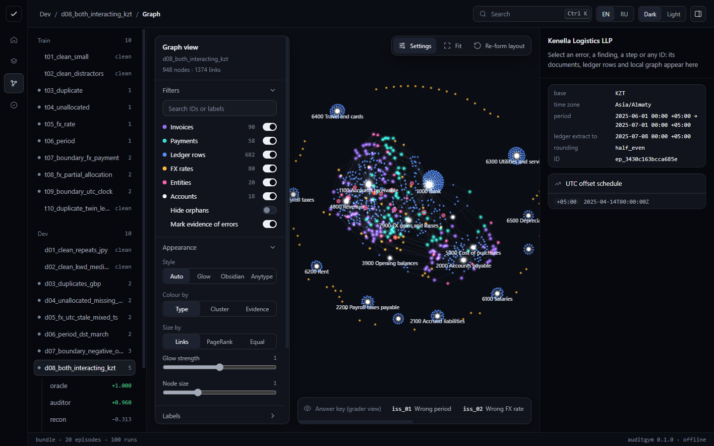
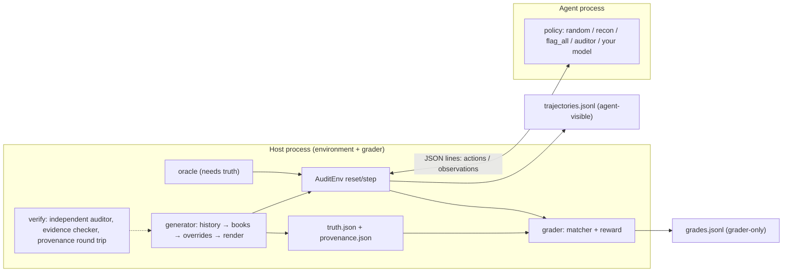

# auditgym

A reproducible RL environment for training and evaluating financial-audit agents: synthetic companies,
a narrow investigation tool interface, hidden accounting errors with a verified answer key, and a shared
reward. Offline, standard library only, Python 3.11.

[Русская версия](README.ru.md) · [Design note](docs/DESIGN.md) · [Check report](runs/check/report.md) ·
[Case](docs/CASE.md) · [Demo viewer](viewer/index.html) (open the file in a browser, works offline)



> **Кратко по-русски.** Среда для обучения ИИ-аудитора: генератор синтетических компаний (история → документы →
> проводки), четыре типа ошибок с записанной причиной, два сценария взаимодействующих ошибок, чистые компании и
> правдоподобные отвлекающие случаи. Агент работает только через пять инструментов в отдельном процессе; грейдер
> считает награду `clip(2·F1 − 1 − 0.002·шаги)`. Ключ ответов проверяется независимым аудитором и проверкой
> достаточности доказательств. Одна команда проверки: `python -m auditgym check` (121 проверка, ~30 с, без сети).

## Case → solution

| Case requirement | How auditgym does it | Where |
|---|---|---|
| "First build a consistent hidden company history, then the documents, then the errors with a recorded causal change" | History → clean books → errors as booking overrides re-posted by the same engine → record-level provenance diff | [history.py](auditgym/history.py), [books.py](auditgym/books.py), [inject.py](auditgym/inject.py), [render.py](auditgym/render.py) |
| "At least four independently configurable types" | `errors: {duplicate_invoice, unallocated_payment, wrong_fx_rate, wrong_period}`, each with variants | [config.py](auditgym/config.py) |
| "Interacting errors. Two scenarios" | `boundary_fx_payment` (partial foreign receipt at the period boundary booked by UTC date: period + FX), `fx_invoice_partial_allocation` (wrong-rate invoice + partly unallocated receipt) | [inject.py](auditgym/inject.py) |
| "Clean companies and plausible correct distractors" | Legitimate repeats, recurring amounts, split and multi-invoice payments, underpayments, overpayment + refund, unreferenced receipts, boundary and weekend FX documents; twin episodes with opposite answers | [history.py](auditgym/history.py), [splits.json](configs/splits.json) |
| "The answer key must describe the real discrepancy and the available evidence" | Independent auditor reproduces the key exactly; a third implementation re-derives type, IDs and amount from each evidence set alone | [auditor.py](auditgym/auditor.py), [verify.py](auditgym/verify.py) |
| "reset(seed, config) … step(action)", five actions, 50-row pages, 100 steps | Gymnasium-style JSON contract; observations carry only result, error and remaining steps | [env.py](auditgym/env.py), [schemas/](schemas) |
| "The grader runs outside the agent's process" | Policy in a child process over JSON lines, empty cwd, no seed or paths; oracle and grades host-side only | [protocol.py](auditgym/protocol.py), [agent.py](auditgym/agent.py) |
| "Matching … One-to-one", "Publish the normalization code, tolerance rules, and the tie-breaking rule" | Kuhn maximum matching, published normalization, ID aliases, tolerance 2 minor units | [matcher.py](auditgym/matcher.py) |
| "Terminal reward = clip(2·F1 − 1 − 0.002·inspection_steps, −1, 1)" | Exact fractions; experimental soft reward reported separately | [reward.py](auditgym/reward.py), [grader.py](auditgym/grader.py) |
| Four baseline policy adapters | random explorer (fixed seed), simple reconciliation, flag-everything attack, oracle (grader-side); plus a scripted auditor for the demo; any external policy plugs in as `module.path:ClassName` with the same isolation | [policies/](auditgym/policies), [custom_policy.py](examples/custom_policy.py) |
| "Identical seed, config, version, and actions must reproduce …", paired checks | Portable PRNG, byte-identical regeneration, transforms (permutation, ID remap, timestamp re-rendering) | [rng.py](auditgym/rng.py), [transform.py](auditgym/transform.py) |
| 10 train + 10 dev episodes, trajectories.jsonl | Source histories split first; dev on held-out regimes | [episodes/](episodes), [runs/train_dev/trajectories.jsonl](runs/train_dev/trajectories.jsonl) |
| Official check without network, single command | `python -m auditgym check`, Dockerfile runs the same command | [check.py](auditgym/check.py), [Dockerfile](Dockerfile) |

## Quick start

No keys, no network, nothing to install. Python 3.11:

```bash
python -m auditgym check
```

```bash
python -m auditgym demo
```

```bash
python -m auditgym viewer
```

`check` prints one line per check and writes [runs/check/report.md](runs/check/report.md); it exits 0 only if
all checks pass (121 on the development machine, about 30 s). `demo` runs the scripted auditor and the recon
baseline on one dev episode in an isolated process and prints every step and the grader's verdict. `viewer`
rebuilds [viewer/index.html](viewer/index.html).

Container (offline after the build):

```bash
docker build -t auditgym .
```

```bash
docker run --rm --network none --cpus 2 --memory 4g auditgym
```

The Dockerfile was written but not built on the development machine, which has no Docker; it runs the same
`check` command.

## See it in two minutes

1. Run `python -m auditgym demo`: the auditor reads 20 pages through `list_records`, submits 5 findings, and
   the grader reports reward +0.960 with TP 5, FP 0, FN 0. The recon baseline reads the same pages and falls
   for distractors.
2. Open [viewer/index.html](viewer/index.html) (English or Russian, dark or light). Pick
   `d08_both_interacting_kzt` in the sidebar to see the answer key (grader view). Click an error for its
   documents, journal rows and local graph, open **Graph** for the whole evidence network, then open the `recon`
   or `auditor` run to replay the trajectory step by step ([screenshot](docs/media/viewer_run.png)).
3. Run `python -m auditgym verify episodes/dev/d08_both_interacting_kzt`: nine named checks, then the declared
   discrepancies.
4. Read [runs/check/report.md](runs/check/report.md) for the baseline table on 20 hidden-like episodes.

## Architecture



- Generator: one company and one reporting period per episode; the open splits have 253–1,745 ledger rows,
  66–201 documents and 0–10 errors (presets allow up to 2,000 rows and 12 errors); 6 base currencies with
  exponents 0, 2 and 3; 11 time zones including DST rules and +05:45.
- Environment: five read-only tools, 50-row pages, stable cursors, 100-step and 60-second limits, bounded errors.
- Grader: published normalization, one-to-one matching, common reward plus an experimental soft reward.
- Verification: nine named checks per episode; the generator resamples any candidate that fails one.

Python API (open training mode):

```python
from auditgym.env import AuditEnv

env = AuditEnv(mode="train")  # "eval": reward stays 0 until the grader reports
obs, info = env.reset(seed=123, config={"generator": {"size": "small", "errors": {"wrong_fx_rate": 1}}})
obs, reward, terminated, truncated, info = env.step(
    {"action": "list_records", "table": "ledger", "cursor": None, "limit": 50})
```

## Evaluation

20 hidden-like episodes (5 clean, 5 interacting, 10 mixed), eval mode, agent in a separate process, from
[runs/check/report.md](runs/check/report.md):

| Policy | Return | F1 | Steps | Fully closed episodes | FP on clean |
|---|---|---|---|---|---|
| oracle (grader-side) | 1.000 | 1.000 | 0 | 100 % | 0 |
| scripted auditor | 0.939 | 1.000 | 30.3 | 100 % | 0 |
| simple reconciliation | -0.219 | 0.415 | 30.3 | 0 % | 24 |
| random explorer | -1.000 | 0.000 | 15.0 | 0 % | 10 |
| flag everything | -1.000 | 0.000 | 3.0 | 0 % | 150 |

Open splits ([runs/train_dev/summary.md](runs/train_dev/summary.md)): auditor 0.970 (train) and 0.947 (dev);
simple reconciliation -0.638 and -0.545. Its misses on dev are all `not_flagged` FX and period errors: it
reads the evidence but compares dates as written instead of in company time. With a 20-step budget the
auditor's F1 drops to 0.56; with 50 steps it is 1.0 (every dev episode needs 15 to 42 pages for a full read).
Mean P and R count clean episodes as 0 by the case definition. Details and the failure analysis:
[docs/DESIGN.md](docs/DESIGN.md#9-measured-results).

## Commands

| Command | Purpose |
|---|---|
| `python -m auditgym check` | Single offline check |
| `python -m auditgym build-splits` | Regenerate `episodes/train` and `episodes/dev` from [configs/splits.json](configs/splits.json) |
| `python -m auditgym generate --seed 123 --config examples/config_mixed.json --out DIR` | One episode directory (`--secret-env NAME` mixes in a host secret) |
| `python -m auditgym verify DIR` | Named accounting and answer-key checks for an episode |
| `python -m auditgym run --episodes episodes/dev --policies random,recon,flag_all,oracle --out runs/dev` | Baselines on episode folders; `--seeds-file examples/closed_seeds_example.json` generates closed episodes in memory; exits non-zero on an unknown policy or a crashed agent process |
| `python -m auditgym run --episodes episodes/dev --policies examples.custom_policy:FirstPagePolicy --out runs/custom` | Your own policy (any class with `act(observation, reward, info)`) in the isolated child process; `--policy-path DIR` for code outside the repository |
| `python -m auditgym grade --episode episodes/train/t03_duplicate --findings examples/findings_t03_correct.json --steps 14` | Grade a findings.json |
| `python -m auditgym transform --in DIR --out DIR2 --permute-seed 1 --remap-seed 2 --ts-repr utc` | Paired-check copy of an episode |
| `python -m auditgym schemas` | Write the JSON schemas to [schemas/](schemas) |

## Repository

```
auditgym/          environment, generator, grader, verifier, policies, CLI
  policies/        random, recon, flag_all, oracle (grader-side), auditor
  viewer/          offline viewer template and builder
configs/           splits.json (train/dev seeds and configs, config_version 1)
episodes/          train/ and dev/: public/ records + grader/ answer key and provenance
runs/              check/report.md, train_dev/trajectories.jsonl, grades.jsonl, summary.md
schemas/           JSON schemas: records, actions, observations, findings, truth, trajectories
tests/             unittest suites (83 tests)
docs/              CASE.md, PLAN.md, DESIGN.md
examples/          config and findings examples
```

All companies, people, accounts, documents, FX rates and amounts are synthetic. No real financial data,
payments or personal data are used.

## Limitations

- The Docker image was not built locally (no Docker on the development machine); the same `check` ran on
  Windows with Python 3.11.4 and asserts byte-identical regeneration of every committed episode.
- With the open generator, small closed seeds could be brute-forced: use 63-bit seeds or a host secret.
- Isolation is an OS process boundary with a sanitized environment, not a sandbox: run untrusted policies as a
  separate OS user or in a container without the repository and the seeds file.
- A deliberately small accounting model: base-currency ledger, payments in the invoice currency, no taxes or
  credit notes, built-in time-zone rules.
- Explanations are not graded; no model was trained, so no improvement is claimed.

## Team

TODO: names and roles.
