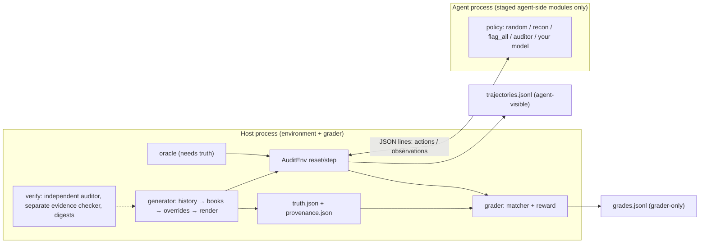

# auditgym

A reproducible RL environment for training and evaluating financial-audit agents: synthetic companies,
a narrow investigation tool interface, errors with a recorded causal change and a verified answer key, and a
shared reward. Offline, standard library only, Python 3.11.

[Русская версия](README.ru.md) · [Design note](docs/DESIGN.md) · [Check report](runs/check/report.md) ·
[Case](docs/CASE.md) · [Demo viewer](viewer/index.html) (open the file in a browser, works offline)


> **Кратко по-русски.** Среда для обучения ИИ-аудитора: генератор синтетических компаний (история → документы →
> проводки), четыре типа ошибок с записанной причиной, два сценария взаимодействующих ошибок, чистые компании и
> правдоподобные отвлекающие случаи. Агент работает только через пять инструментов в отдельном процессе; грейдер
> считает награду `clip(2·F1 − 1 − 0.002·шаги)`. Ключ ответов проверяют независимый аудитор и отдельная проверка
> достаточности доказательств. Одна команда проверки: `python -m auditgym check` (см. Quick start). Подробности и
> ограничения на русском: [README.ru.md](README.ru.md).

## Case → solution

| Case requirement | How auditgym does it | Where |
|---|---|---|
| "First build a consistent hidden company history, then the documents, then the errors with a recorded causal change" | History → clean books → errors as booking overrides re-posted by the same engine → record-level provenance diff (`ops`), with clean and final digests | [history.py](auditgym/history.py), [books.py](auditgym/books.py), [inject.py](auditgym/inject.py), [render.py](auditgym/render.py) |
| "At least four independently configurable types" | `errors: {duplicate_invoice, unallocated_payment, wrong_fx_rate, wrong_period}`, each with variants; each type can be requested alone | [config.py](auditgym/config.py) |
| "Interacting errors. Two scenarios" | `boundary_fx_payment` (partial foreign receipt at the period boundary, booked by UTC date: period + FX), `fx_invoice_partial_allocation` (wrong-rate invoice + partly unallocated receipt; always the `partial` variant) | [inject.py](auditgym/inject.py) |
| "Clean companies and plausible correct distractors" | Legitimate repeats, recurring amounts, split and multi-invoice payments, underpayments, overpayment + refund, unreferenced receipts, boundary and weekend FX documents; twin option with opposite answers | [history.py](auditgym/history.py), [splits.json](configs/splits.json) |
| "The answer key must describe the real discrepancy and the available evidence" | An independent auditor (imports no generator module) reproduces the key exactly; a separate evidence checker re-derives type, IDs and amount from each evidence set alone, with `Fraction` arithmetic and no import from `auditor.py` or `money.py`; for `unallocated_payment` the set cannot show that no other receipt settled the invoice, which rests on a generator guarantee (see Limitations) | [auditor.py](auditgym/auditor.py), [evidence_check.py](auditgym/evidence_check.py), [verify.py](auditgym/verify.py) |
| "The answer key must not be guessable from surface features" | `tests/test_tells.py` measures one-feature and episode-level shortcut rules on the open episodes; no measured rule is both selective and useful (the limits are in its docstring) | [test_tells.py](tests/test_tells.py), [splits.py](auditgym/splits.py) |
| "reset(seed, config) … step(action)", five actions, 50-row pages, 100 steps | Gymnasium-style JSON contract; observations carry only result, error and remaining steps; the schemas are kept in agreement with the environment by a fuzzer | [env.py](auditgym/env.py), [schemas/](schemas), [test_contract_fuzz.py](tests/test_contract_fuzz.py) |
| "The grader runs outside the agent's process" | Policy in a child process over JSON lines, with a staged copy of the agent-side modules, an empty temporary working directory and no seed, secret or episode path in its environment; the grader, oracle and generator are not importable there; bounded channel; code digest checked after each run | [protocol.py](auditgym/protocol.py), [agent.py](auditgym/agent.py) |
| "Matching … One-to-one", "Publish the normalization code, tolerance rules, and the tie-breaking rule" | Kuhn maximum matching, published normalization, ID aliases (doc_id ↔ invoice_id/payment_id), tolerance 2 minor units | [matcher.py](auditgym/matcher.py) |
| "Terminal reward = clip(2·F1 − 1 − 0.002·inspection_steps, −1, 1)" | Exact fractions. The experimental soft reward (per-issue credit under a maximum-weight one-to-one assignment) is reported in its own columns | [reward.py](auditgym/reward.py), [grader.py](auditgym/grader.py), [diagnostics.py](auditgym/diagnostics.py) |
| "Four baseline policy adapters" | random explorer (fixed run seed, one stream per episode), simple reconciliation, flag-everything attack, oracle (grader-side only); a scripted auditor (verifier code run through the tools; see Evaluation); any `module.path:ClassName` policy runs under the same isolation | [policies/](auditgym/policies), [examples/custom_policy.py](examples/custom_policy.py) |
| "Identical seed, config, version, and actions must reproduce …", paired checks | Portable PRNG and integer/`Decimal` arithmetic, byte-identical regeneration, replay of recorded actions, transforms (permutation, ID remap, timestamp re-rendering) | [rng.py](auditgym/rng.py), [transform.py](auditgym/transform.py), [check.py](auditgym/check.py) |
| 10 train + 10 dev episodes, trajectories.jsonl | Source histories split first; dev on held-out regimes; committed trajectories are regenerated and compared in CI | [episodes/](episodes), [runs/train_dev/trajectories.jsonl](runs/train_dev/trajectories.jsonl) |
| Official check without network, single command | `python -m auditgym check`; the Dockerfile runs the same command with `--network none`; both run in CI | [check.py](auditgym/check.py), [Dockerfile](Dockerfile), [CI workflow](.github/workflows/check.yml) |

## Quick start

No keys, no network, nothing to install. Python 3.11:

```bash
python -m auditgym check
```

`check` prints one line per named check and writes [runs/check/report.md](runs/check/report.md). It exits 0 only
if every check passes. At commit `99b7b66` it runs **412 named checks**, one of which runs the **189 unit tests** (outside the image, 7
container-only tests report as skipped). About 90 s on Windows 10 with Python 3.11.4 (the committed report records
93 s). CI run 44642027342 on that commit is green: ubuntu 43 s, windows 58 s, macOS 37 s (Python 3.11) and the
container 38 s, where the 8 container-only tests ran with none skipped. The cited lines are kept in
[runs/ci/44642027342.txt](runs/ci/44642027342.txt) (made with [tools/ci_excerpt.py](tools/ci_excerpt.py)).

```bash
python -m auditgym demo
```

`demo` runs the scripted auditor and the recon baseline on one episode in an isolated process and prints every
step and the grader's verdict (see below).

```bash
python -m auditgym viewer
```

`viewer` rebuilds [viewer/index.html](viewer/index.html), an offline page for people.

Container (offline after the build; the CI job builds it and runs it with the same flags):

```bash
docker build -t auditgym .
docker run --rm --network none --cpus 2 --memory 4g auditgym
```

The report is written inside the image at `/app/runs/check/report.md`. `--rm` removes the container, so to keep the
report, run it under a name, copy the file out and then remove the container. These commands were not run here (CI runs
only the first command above):

```bash
docker run --name auditgym-check --network none --cpus 2 --memory 4g auditgym
docker cp auditgym-check:/app/runs/check/report.md .
docker rm auditgym-check
```

## See it in two minutes

1. Run `python -m auditgym demo`. On episode `ep_5a9a09e389264d0c` the auditor reads 25 pages through
   `list_records`, submits 5 findings at step 26, and the grader reports reward **+0.950** with TP 5, FP 0, FN 0.
   The recon baseline on the same episode gets **−0.839** with TP 1, FP 13, FN 4.
2. Open [viewer/index.html](viewer/index.html) (English or Russian, dark or light). Pick
   `d08_both_interacting_kzt` in the sidebar to see the answer key (grader view). Click an error for its
   documents, journal rows and local graph, open **Graph** for the whole evidence network, then open a recorded
   run to replay the trajectory step by step ([screenshot](docs/media/viewer_run.png)).
3. Run `python -m auditgym verify episodes/dev/d08_both_interacting_kzt`: nine named checks, all `PASS`, then
   the declared discrepancies.
4. Read [runs/check/report.md](runs/check/report.md) for the baselines on the hidden-like set.

## For judges

The check groups its named checks in five rubric groups. The grouping is `RUBRIC` in
[auditgym/check.py](auditgym/check.py); the section keys in `report.json` are unchanged. Each row names the
check sections that run in `python -m auditgym check`, the unit tests that cover the same claim (section
`A_unit_tests` runs all of them), and a command you can run yourself.

| Rubric (points) | Check sections in `check` | Main unit tests | Verify it yourself |
|---|---|---|---|
| 1. Contract and isolation (25) | `E_leaks`: every observation of every recorded run holds only the allowed fields; no answer-key marker; oracle trajectories never published | `test_env`, `test_schemas`, `test_contract_fuzz` (seeded fuzzer, in-process and piped), `test_isolation`, `test_noninterference` (five policies, shuffled or replaced answer keys, byte-identical observations), `test_redteam` | `python -m auditgym check`; `python -m auditgym.redteam` (hostile probes: floods, stalls, grandchildren; not part of `check`) |
| 2. Data and answer key (25) | `B_committed_episodes`: all 20 committed episodes regenerate byte for byte and verify; `C_data`: hidden-like set verifies, with resampling rates | `test_verify` (directory mode checks stored digests), `test_generator`, `test_tells` (shortcut rules), `test_regen_examples` | `python -m auditgym verify episodes/dev/d08_both_interacting_kzt`; `python -m auditgym build-splits` followed by `git diff --exit-code -- episodes` |
| 3. Reward reliability (25) | `C_reward`: oracle reaches 1.0, flag-everything and random score poorly, the scripted auditor closes every episode; attack battery on every error episode (type shotgun, amount ladder, junk padding, evidence stuffing, wrong real ID) and on every clean episode (one false accusation per type scores −1) | `test_reward`, `test_matcher` (Kuhn matching, tolerance, aliases, invalid structures), `test_diagnostics` | `python -m auditgym grade --episode episodes/train/t03_duplicate --findings examples/findings_t03_correct.json --steps 14` (reward 0.972) |
| 4. Reproducibility (15) | `B_replay`: recorded actions replayed in a fresh environment give JSON-equal observations and the same terminal reward; `D_paired`: same seed and config give identical records and answer key; same actions give identical transitions; isolated and in-process runs agree; oracle answer and reward survive permutation, ID remap and timestamp re-rendering | `test_isolation`, `test_generator` (regeneration under two `PYTHONHASHSEED` values), `test_contract_fuzz` (committed schemas byte-equal to the generated ones) | `python -m auditgym transform --in DIR --out DIR2 --permute-seed 1 --remap-seed 2 --ts-repr utc` then `python -m auditgym verify DIR2`; CI diffs episodes, schemas and trajectories after a regeneration |
| 5. Engineering and explanation (10) | `A_unit_tests`: the whole unit suite | every `tests/test_*.py`, `test_cli`, `test_timeutil`, `test_calculator` | `python -m unittest discover -s tests -t .`; CI matrix on ubuntu, windows and macOS |

Limits of this map: the hidden-like set comes from a public master string (see Limitations), so `check` tests the
pipeline, not secrecy; the closed evaluation path is `check --seeds-file` (below).

## For organizers

Organizer episodes come in as a seeds file. Closed runs never write `runs/check`.

```bash
# official check on your own closed set; the host secret is read from an environment variable
export AUDITGYM_SECRET='<your secret>'
python -m auditgym check --seeds-file FILE --secret-env AUDITGYM_SECRET --out DIR
```

- `FILE` is JSON `{"split": "<label>", "episodes": [{"name": "...", "seed": <int>, "config": {...}}]}`; see
  [examples/closed_seeds_example.json](examples/closed_seeds_example.json). The check runs the data, reward, paired and
  leak sections, and the replay of its own runs, on your episodes. Checks that need error or clean episodes the
  file lacks are reported as `SKIP`. Default output is `runs/check_closed`; `--out DIR` overrides it. `--keep-runs`
  also writes trajectories and grades, which contain the closed answer key.
- Use 63-bit seeds and a secret. `run` warns about seeds of 40 bits or fewer when no secret is set.
- Exit codes: 0 pass, 1 failed checks or verification, 2 bad input (one `error:` line), 3 a run finished but an
  agent failed.

Generate and verify one episode:

```bash
python -m auditgym generate --seed 123 --config examples/config_mixed.json --out DIR
python -m auditgym verify DIR
```

Paired checks for your own episode copies (permuted rows, remapped IDs, another timestamp representation):

```bash
python -m auditgym transform --in DIR --out DIR2 --permute-seed 1 --remap-seed 2 --ts-repr utc
python -m auditgym verify DIR2
```

Run your own policy, a class with `act(observation, reward, info)`, in the isolated child process:

```bash
python -m auditgym run --episodes DIR_OR_FOLDER --policies yourpkg.module:YourPolicy --out runs/yours
```

Use `--policy-path DIR` for code outside this repository. Names are validated before the run; the oracle is
refused in the child. `examples/hostile/policies.py` shows the failure modes the harness handles (exit 3 for a
crashing policy).

**Advice: run closed episodes inside the container.** Outside a container the policy runs as the same OS user as
the host and can read what that user can read. Inside the image the environment and grader run as root and every
policy child runs as a separate unprivileged user (uid 10002, `agent`, no supplementary groups, umask 077) in its own
temporary directory. CI runs `tests/test_container.py` inside the image and requires that none of it is skipped: the
policy cannot read the host's environment (`/proc/<host>/environ`, where `--secret-env` values live), a root-owned 0600
seeds file, a grader directory the host wrote, or anything under `/app`, cannot write to the package, and every process
of its uid is killed at the end of each episode. Mount seeds files and episode folders under `/app` (for example
`-v $PWD/closed.json:/app/secrets/closed.json:ro`) and keep `--out` under `/app/runs`; a bind mount elsewhere keeps the
host's modes. With `--user 10001` or `--cap-drop ALL` the image falls back to running the policy as the host user, prints
one warning line, and still passes the check (both runs are in CI). Outside the container the policy runs as the
host's user and can read the host's environment, where `--secret-env` values live: on Windows 10,
`python -m auditgym.redteam --parent` starts a policy through the harness and it finds a host variable in its
parent's process memory (measured locally). On Linux the same read goes through `/proc/<ppid>/environ` (expected;
not measured outside the image).

The container has been built and run in CI (`docker build`, then `docker run --rm --network none --cpus 2 --memory 4g
--pids-limit 512`, again with `--user 10001` and with `--cap-drop ALL`). Mounting closed seeds or an output directory
into the container was not run.

## Architecture



- Generator: one company and one reporting period per episode. The 20 committed episodes (10 train, 10 dev) have
  251 to 1,905 ledger rows, 73 to 199 documents (invoices plus payments) and 0 to 10 issues each. Sizes `small`,
  `medium`, `large`; at most 12 errors per episode; six base currencies (EUR, USD, KZT, JPY, KWD, GBP) and a foreign pool that also holds KRW and BHD; exponents 0, 2
  and 3 (JPY and KRW 0, KWD and BHD 3, the rest 2); eleven built-in time zones, including DST rules and +05:45.
- Environment: five read-only tools, 50-row pages, stable cursors, a 100-step budget (submit included) and a 60 s
  limit (`time_limit_s` in the task), bounded errors that consume a step.
- Grader: published normalization, one-to-one matching, common reward plus an experimental soft reward.
- Verification: nine named checks per episode (`verify DIR`); the generator resamples any candidate that fails one.

Python API (open training mode):

```python
from auditgym.env import AuditEnv

env = AuditEnv(mode="train")  # "eval": reward stays 0 until the grader reports
obs, info = env.reset(seed=123, config={"generator": {"size": "small", "errors": {"wrong_fx_rate": 1}}})
obs, reward, terminated, truncated, info = env.step(
    {"action": "list_records", "table": "ledger", "cursor": None, "limit": 50})
```

## Evaluation

Every table below is copied from a generated file. Commands to regenerate them are given under each table.

**Scripted auditor.** The auditor is verifier code (`auditor.py`) run through the tool interface. It is a
solvability proof, not a learned policy: it shows that every scenario can be closed within the budget, not that
an agent would reason this way. Its numbers are not agent capability.

### Hidden-like set (20 episodes)

From [runs/check/report.md](runs/check/report.md). These episodes come from the public master string
`auditgym-check-v1`, so they test the pipeline. Eval mode, every agent in an isolated process.

| Policy | Return | Soft return | Macro P | Macro R | Micro P | Micro R | F1 | Steps | Closed share | FP on clean |
|---|---|---|---|---|---|---|---|---|---|---|
| oracle (grader-side) | 1.000 | 1.000 | 0.75 | 0.75 | 1.00 | 1.00 | 1.000 | 0.0 | 1.00 | 0 |
| scripted auditor (verifier code) | 0.936 | 0.936 | 0.75 | 0.75 | 1.00 | 1.00 | 1.000 | 32.0 | 1.00 | 0 |
| recon (simple reconciliation) | −0.589 | −0.589 | 0.15 | 0.54 | 0.16 | 0.75 | 0.231 | 32.0 | 0.00 | 40 |
| random explorer | −0.613 | −0.613 | 0.00 | 0.00 | 0.00 | 0.00 | 0.200 | 34.0 | 0.20 | 2 |
| flag everything | −1.000 | −0.995 | 0.00 | 0.00 | 0.00 | 0.00 | 0.000 | 3.0 | 0.00 | 150 |

Regenerate: `python -m auditgym check` (writes `runs/check/report.md`).

### Open splits (10 train, 10 dev)

From [runs/train_dev/summary.md](runs/train_dev/summary.md) (`python -m auditgym run --episodes episodes/train episodes/dev --policies random,recon,flag_all,oracle,auditor --out runs/train_dev`).
Soft return is the experimental reward; the common return is the one that counts. Macro P and R average over
episodes; a clean episode has no true positive, so a correct empty answer scores P = R = 0 there, which is why the
oracle's macro P/R is 0.7 (train) and 0.8 (dev). Micro P = ΣTP / Σ(TP+FP) and micro R = ΣTP / Σ(TP+FN) pool all
episodes and are the figures to read.

| Split | Policy | Return | Soft return | Macro P | Macro R | Micro P | Micro R | F1 | Steps | Closed share | FP on clean |
|---|---|---|---|---|---|---|---|---|---|---|---|
| train | scripted auditor | 0.971 | 0.971 | 0.70 | 0.70 | 1.00 | 1.00 | 1.000 | 14.3 | 1.0 | 0 |
| train | recon | −0.690 | −0.690 | 0.10 | 0.50 | 0.08 | 0.60 | 0.161 | 14.3 | 0.0 | 26 |
| train | random | −0.613 | −0.613 | 0.00 | 0.00 | 0.00 | 0.00 | 0.200 | 19.3 | 0.2 | 1 |
| train | flag everything | −1.000 | −1.000 | 0.00 | 0.00 | 0.00 | 0.00 | 0.000 | 3.0 | 0.0 | 90 |
| train | oracle | 1.000 | 1.000 | 0.70 | 0.70 | 1.00 | 1.00 | 1.000 | 0.0 | 1.0 | 0 |
| dev | scripted auditor | 0.943 | 0.943 | 0.80 | 0.80 | 1.00 | 1.00 | 1.000 | 28.7 | 1.0 | 0 |
| dev | recon | −0.689 | −0.689 | 0.12 | 0.45 | 0.14 | 0.57 | 0.178 | 28.7 | 0.0 | 5 |
| dev | random | −1.000 | −1.000 | 0.00 | 0.00 | 0.00 | 0.00 | 0.000 | 18.9 | 0.0 | 5 |
| dev | flag everything | −1.000 | −0.992 | 0.00 | 0.00 | 0.00 | 0.00 | 0.000 | 3.0 | 0.0 | 60 |
| dev | oracle | 1.000 | 1.000 | 0.80 | 0.80 | 1.00 | 1.00 | 1.000 | 0.0 | 1.0 | 0 |

The same file has the failure analysis. On dev, recon's misses are all `not_flagged`: it reads the evidence but
compares dates as written instead of in company time. Its recall is 1.0 on duplicates and unallocated receipts,
0.22 on FX and 0.25 on period errors. Random and flag-everything misses are `search` (they never observed a complete
evidence set), with one `not_flagged` miss for random and one `evidence` miss for flag-everything on dev.

**Change after the shortcut removal.** Git history shows recon's return fell after the commit that removed the
data shortcuts (`a94d9b9`, parent `bb80adb`): dev −0.545 → −0.689, train −0.638 → −0.690
(`git show a94d9b9^:runs/train_dev/summary.md` against the current file), and on the hidden-like set −0.490 →
−0.589 (`git show bb80adb:runs/check/report.md`). The scripted auditor is nearly unchanged (dev 0.947 → 0.943,
train 0.970 → 0.971). The cause has not been isolated: the same change also altered the distractor mix.

### Action budget

From [runs/budget/summary.md](runs/budget/summary.md) (dev split, scripted auditor and recon, isolated, eval mode).
Command: `python -m auditgym budget` (default budgets 20, 50, 100; the same as `make budget` where make is installed).

| Budget (steps) | Auditor return | Auditor F1 | Auditor closed | Recon return | Recon F1 |
|---|---|---|---|---|---|
| 20 | −0.083 | 0.472 | 0.2 | −0.849 | 0.082 |
| 50 | 0.943 | 1.000 | 1.0 | −0.689 | 0.178 |
| 100 | 0.943 | 1.000 | 1.0 | −0.689 | 0.178 |

### Generator stress

From [runs/stress/report.md](runs/stress/report.md). Command: `python -m auditgym stress --n 300`. Counts are
reproducible; timings and memory are not. The whole run took 346 s on this machine.

| Set | Configs | Generated and verified | Verify failed | Infeasible (ConfigError) | First attempt | Later attempts | Max generation time | Peak memory |
|---|---|---|---|---|---|---|---|---|
| random | 300 | 282 | 0 | 18 | 260 | 22 | 0.38 s | 6.1 MB |
| extreme | 17 | 17 | 0 | 0 | 14 | 3 | 0.30 s | 5.5 MB |

The 17 extreme configurations are 12 errors in each of the 11 time zones, three currency-exponent mixes, a year
boundary, Sydney DST and one large episode with 12 errors; the scripted auditor closes all of them in 11 to 47 steps. The 18 infeasible requests are
17 `boundary_fx_payment` requests with a fixed period (the period's last day or the next day is a weekend) and one
`UTC` request for errors that need a non-zero offset. Each gives a ConfigError that names what is missing.

## Commands

| Command | Purpose |
|---|---|
| `python -m auditgym check` | The single offline check (named checks, rubric groups, [report](runs/check/report.md)) |
| `python -m auditgym check --seeds-file FILE --secret-env VAR --out DIR` | The same battery on organizer episodes; never writes `runs/check` |
| `python -m auditgym build-splits` | Regenerate `episodes/train` and `episodes/dev` from [configs/splits.json](configs/splits.json) |
| `python -m auditgym generate --seed N --config FILE --out DIR [--secret-env VAR]` | One episode directory |
| `python -m auditgym verify DIR` | Named accounting and answer-key checks for an episode directory |
| `python -m auditgym run --episodes DIRS --policies P1,P2 --out DIR` | Baselines on episode folders (`--mode eval\|train`, `--max-steps N`, `--policy-seed N`) |
| `python -m auditgym run --seeds-file FILE [--secret-env VAR] --policies ... --out DIR` | Closed episodes generated in memory |
| `python -m auditgym run ... --policies module:Class [--policy-path DIR]` | Your own policy in the isolated child process |
| `python -m auditgym grade --episode DIR --findings FILE --steps N` | Grade a findings file |
| `python -m auditgym transform --in DIR --out DIR2 --permute-seed N --remap-seed N --ts-repr utc` | Paired-check copy of an episode |
| `python -m auditgym stress --n 300` | Generator stress run, writes [runs/stress/report.md](runs/stress/report.md) |
| `python -m auditgym budget` | Action-budget sweep, writes [runs/budget/summary.md](runs/budget/summary.md) |
| `python -m auditgym demo` | Auditor and recon on one episode, step by step |
| `python -m auditgym viewer` | Rebuild [viewer/index.html](viewer/index.html) |
| `python -m auditgym schemas` | Write the JSON schemas to [schemas/](schemas) |
| `python -m auditgym.redteam` | Hostile-policy probes (floods, stalls, grandchild processes); not part of `check` |
| `python -m unittest discover -s tests -t .` | The unit suite (the same tests that `check` runs as one named check) |

**Exit codes.** 0 success; 1 a check or verification failed; 2 bad input (one `error:` line on stderr, for example
an unknown policy or an unset `--secret-env` variable); 3 the run finished but an agent process failed (crash,
exit, or tampering with the graded code).

**Trajectory fields** (`runs/*/trajectories.jsonl`, one line per record): `run_id` (`split:policy:seed`), `split`,
`policy`, `episode_id`, `step`, `action`, `observation`, `reward`, `terminated`, `truncated`. Step 0 is the reset
observation with `action` null and reward 0.0. The terminal reward is written into the last record of each episode
after the run; in eval mode the policy itself received 0.0 at every step. Oracle runs never appear in trajectories. `runs/train_dev/meta.json` records the versions (auditgym, generator, config,
schema, grade), Python 3.11.4, the platform, the mode, the policies, the command and `secret_used`, which supports the
case's configuration-versions criterion.

## Repository

```
auditgym/          environment, generator, grader, verifier, evidence checker, policies, CLI
  policies/        random, recon, flag_all, oracle (grader-side), auditor
  viewer/          offline viewer template and builder
configs/           splits.json (train/dev seeds and configs, config_version 1)
episodes/          train/ and dev/: public/ records + grader/ answer key and provenance
runs/              check/ (report, grades, trajectories), check_closed/ (organizer runs), train_dev/,
                   stress/, budget/
schemas/           JSON schemas: records, actions, observations, findings, truth, policy, provenance, trajectories
tests/             unittest suites
docs/              CASE.md, DESIGN.md, TASKS.md, PLAN.md (historical), media/
examples/          config and findings examples, a custom policy, hostile policies for the probes
.github/workflows/ CI: check on ubuntu, windows and macOS; container build and run
```

All companies, people, accounts, documents, FX rates and amounts are synthetic. No real financial data,
payments or personal data are used.

## Limitations

- **Platforms.** Local runs were on Windows 10 with Python 3.11.4. CI runs the same check on ubuntu, windows and
  macOS with Python 3.11 (the Windows runner set up CPython 3.11.9) and regenerates the committed episodes, schemas
  and trajectories byte for byte. Python 3.12 and 3.13 were not tested.
- **Container.** The image is built and run in CI with `--network none --cpus 2 --memory 4g --pids-limit 512` (run
  44642027342). Inside the image the host runs as root and every policy child as uid 10002 (`agent`). Under
  `--user 10001` or `--cap-drop ALL` the policy falls back to the host's user with one warning line, and the
  same-user limits below apply.
- **Isolation is a process boundary, not a sandbox.** The policy runs in a separate process with a staged copy of
  the agent-side modules, an empty working directory and a stripped environment. The host hashes the agent-side
  code, configs and schemas before and after each run and fails the run on change; this detects tampering, it does
  not prevent it. Processes that leave the tracked group or job survive the run. Outside a container, a child
  running as the same OS user can read files whose paths it can guess and, on Windows, its parent's command line
  (measured locally). It can also read the host's environment, where `--secret-env` values live: on Windows from the
  parent's process memory (`python -m auditgym.redteam --parent`, measured locally), on Linux through
  `/proc/<ppid>/environ` (expected, not measured outside the image). Inside the image the separate policy uid blocks
  this (CI); the two fallbacks do not. Open train and dev answer keys sit in the repository by design.
- **Noninterference** is measured by replay (five policies, in process and in the child, on episodes whose answer
  key is shuffled, replaced or emptied): observations, rewards and info are byte-identical. Timing is not covered,
  because the time limit is part of the contract.
- **Seeds.** The generator is open source. With no host secret and a guessed config, a small seed can be recovered
  from the `episode_id` of the manifest in seconds, so the answer key can be regenerated. Use 63-bit seeds and
  `--secret-env`; `run` warns about seeds of 40 bits or fewer when no secret is set. Public records allow brute-forcing small seeds in any
  case.
- **Hidden-like set.** The episodes in `check` come from the public master string `auditgym-check-v1`. They test the
  pipeline, not secrecy. Organizers run the same battery on their own seeds with `check --seeds-file`.
- **Scripted auditor.** It is verifier code run through the tools (see Evaluation). Its perfect F1 is a solvability
  result, not an agent result.
- **Unallocated payment evidence.** The three-record evidence set for `unallocated_payment` relies on a generator
  guarantee: the receipt references a single invoice, and no other receipt is booked against that invoice. The cited
  records cannot show this; an agent can confirm it only by reading all payments.
- **boundary_fx_payment feasibility.** It needs weekdays on both sides of the period end. With a fixed period,
  17 of the 36 months of 2025–2027 are infeasible; the ConfigError names the nearest feasible months. The count follows
  from the rule (the period's last day and the first day after it must both be weekdays): `python -c "from auditgym.config import feasibility_problems as f; print(sum(bool(f('UTC', f'{y}-{m:02d}', {'boundary_offset': False, 'boundary_weekdays': True, 'utc_date': False})) for y in (2025, 2026, 2027) for m in range(1, 13)))"` prints 17.
- **Residual public tells.** Two tells from the answer-key audit are weaker but not gone: the largest foreign purchase can
  be the FX target, and off-hours payments are no longer only boundary receipts. The measurements behind this ran outside
  the repository, so no command here reproduces them, and neither is a selective rule on its own.
- **Accounting model.** Deliberately small: a base-currency ledger, payments in the invoice currency, no taxes, no
  credit notes, no cross-currency settlement, eleven built-in time zones instead of the IANA database.
- **Evidence IDs.** An ID that is blank or longer than 64 characters makes the whole submission invalid (reward −1),
  even as an extra evidence ID. The task text publishes this rule (`max_id_chars`). Unknown well-formed extra IDs are
  ignored. An integral float amount (for example `106965.0`) is coerced to an integer by the environment and by the
  `grade` command alike.
- **flag_all** is a format-level attack: it reads first pages and uses document amounts. Smarter attacks are covered
  by the reward battery in `check`, not by this baseline.
- **Experimental reward** is reported in its own columns and never replaces the common reward.
- **Explanations are not graded**, and there is no LLM judge. Time-zone twin pairs are not implemented; only the
  duplicate twin pair t03/t10 exists.
- **No model was trained**, so no improvement is claimed.

## Team

TODO: names and roles.
