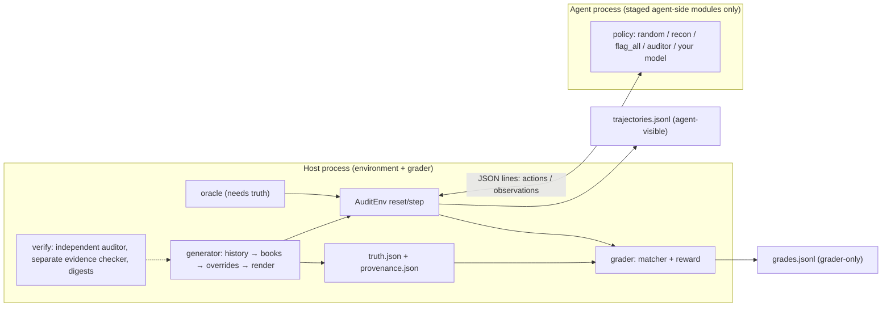

# auditgym

A reproducible RL environment for training and evaluating financial-audit agents: synthetic companies, a narrow investigation tool interface, errors with a recorded causal change and a verified answer key, and a shared reward. Offline, standard library only, Python 3.11 (CI also runs 3.12 and 3.13 on ubuntu).

[Русская версия](README.ru.md) · [Design note](docs/DESIGN.md) · [Check report](runs/check/report.md) · [Case](docs/CASE.md) · [Demo viewer](viewer/index.html) (open the file in a browser, works offline)

Excerpt of the output at commit `c9c7ab4` (Windows 10, Python 3.11.4):

```text
$ python -m auditgym check
auditgym 0.2.0 check (offline, Python 3.11.4); episodes: public master string auditgym-check-v1
A. unit tests
fuzz: 3000 in-process + 300 piped, 0 invariant violations, 0 schema/env disagreements
  [PASS] unittest: 333 run, 322 passed, 11 skipped
B. committed train/dev episodes
  [PASS] train/t01_clean_small regenerates byte-identically
  ...
summary: A_unit_tests 1/1, B_committed_episodes 40/40, B_replay 10/10, C_data 22/22, C_reward 427/427, D_paired 93/93, E_leaks 3/3, F_contract 20/20 (616 named checks of 79 kinds)
PASS in 137 s; report: runs/check/report.md
```

> **Кратко по-русски.** Среда для обучения ИИ-аудитора: генератор синтетических компаний (история → документы → проводки), четыре типа ошибок с записанной причиной, два сценария взаимодействующих ошибок, чистые компании и правдоподобные отвлекающие случаи. Агент работает только через пять инструментов в отдельном процессе; грейдер считает награду `clip(2·F1 − 1 − 0.002·шаги)`. Ключ ответов проверяют независимый аудитор и отдельная проверка достаточности доказательств. Одна команда проверки: `python -m auditgym check` (см. Quick start). Подробности и ограничения на русском: [README.ru.md](README.ru.md).

## Case → solution

| Case requirement | How auditgym does it | Where |
|---|---|---|
| "First build a consistent hidden company history, then the documents, then the errors with a recorded causal change" | Hidden history, then clean books, then errors as booking overrides re-posted by the same engine; provenance is an exact record diff with clean and final digests | [history.py](auditgym/history.py), [books.py](auditgym/books.py), [inject.py](auditgym/inject.py), [render.py](auditgym/render.py) · [DESIGN §1](docs/DESIGN.md#1-generation-history-first-errors-last) |
| "At least four independently configurable types" | Four types (duplicate invoice, unallocated payment, wrong FX rate, wrong period), each with variants, each requestable alone | [config.py](auditgym/config.py) · [DESIGN §3](docs/DESIGN.md#3-errors-variants-scenarios-distractors) |
| "Interacting errors. Two scenarios" | `boundary_fx_payment` (partial foreign receipt at the period boundary) and `fx_invoice_partial_allocation` (wrong-rate invoice, partly unallocated receipt) | [inject.py](auditgym/inject.py) · [DESIGN §3](docs/DESIGN.md#3-errors-variants-scenarios-distractors) |
| "Clean companies and plausible correct distractors" | Legitimate repeats, split and multi-invoice payments, underpayments, overpayment and refund, boundary and weekend FX documents, a twin with opposite answers; `check` requires a false positive on every distractor | [history.py](auditgym/history.py), [splits.json](configs/splits.json), [check_battery.py](auditgym/check_battery.py) · [DESIGN §3](docs/DESIGN.md#3-errors-variants-scenarios-distractors), [§8](docs/DESIGN.md#8-reproducibility-and-paired-checks) |
| "The answer key must describe the real discrepancy and the available evidence" | An independent auditor (standard library only, its own integer FX arithmetic) reproduces the key; a separate evidence checker re-derives each finding from its evidence set alone; the `unallocated_payment` set rests on a generator guarantee ([Limitations](#limitations)) | [auditor.py](auditgym/auditor.py), [evidence_check.py](auditgym/evidence_check.py), [verify.py](auditgym/verify.py) · [DESIGN §7](docs/DESIGN.md#7-verification-of-data-and-answer-key) |
| "The answer key must not be guessable from surface features" | 36 document rules and 5 episode rules measured on 1000 generated episodes; no document rule reaches precision 0.24 (the best one reaches 0.231 against a base rate of 0.027); no episode rule beats its base rate by more than 0.03 | [tells.py](auditgym/tells.py), [test_tells.py](tests/test_tells.py), [runs/tells/summary.md](runs/tells/summary.md) · [DESIGN §3](docs/DESIGN.md#3-errors-variants-scenarios-distractors) |
| "reset(seed, config) … step(action)", five actions, 50-row pages, 100 steps | Gymnasium-style JSON contract with four read-only actions and `submit`; schemas kept in agreement with the environment by a fuzzer; `F_contract` runs 20 named checks | [env.py](auditgym/env.py), [schemas/](schemas), [contract_battery.py](auditgym/contract_battery.py), [test_contract_fuzz.py](tests/test_contract_fuzz.py) · [DESIGN §4](docs/DESIGN.md#4-environment-contract) |
| "The grader runs outside the agent's process" | Policy in a child process over JSON lines, with a staged copy of the agent-side modules; grader, oracle and generator are not importable there; the image runs the policy as uid 10002 | [protocol.py](auditgym/protocol.py), [agent.py](auditgym/agent.py), [Dockerfile](Dockerfile) · [DESIGN §5](docs/DESIGN.md#5-isolation-and-leaks) |
| "Matching … One-to-one", "Publish the normalization code, tolerance rules, and the tie-breaking rule" | Kuhn maximum matching, published normalization, ID aliases (doc_id ↔ invoice_id/payment_id), tolerance 2 minor units | [matcher.py](auditgym/matcher.py) · [DESIGN §6](docs/DESIGN.md#6-matcher-and-reward) |
| "Terminal reward = clip(2·F1 − 1 − 0.002·inspection_steps, −1, 1)" | Exact fractions; the experimental soft reward has its own columns and never replaces the common reward | [reward.py](auditgym/reward.py), [grader.py](auditgym/grader.py), [diagnostics.py](auditgym/diagnostics.py) · [DESIGN §6](docs/DESIGN.md#6-matcher-and-reward) |
| "Four baseline policy adapters" | random, recon, flag_all and oracle (grader side only), plus silent and a scripted auditor; any `module.path:ClassName` runs under the same isolation | [policies/](auditgym/policies), [examples/custom_policy.py](examples/custom_policy.py) · [DESIGN §5](docs/DESIGN.md#5-isolation-and-leaks) |
| "Identical seed, config, version, and actions must reproduce …", paired checks | Portable PRNG, integer and `Decimal` arithmetic, byte-identical regeneration, replay of recorded actions, four paired transforms (permutation, ID remap, timestamp re-rendering, renaming) | [rng.py](auditgym/rng.py), [transform.py](auditgym/transform.py), [check.py](auditgym/check.py) · [DESIGN §8](docs/DESIGN.md#8-reproducibility-and-paired-checks) |
| 10 train + 10 dev episodes, trajectories.jsonl | Source histories split first; dev on held-out regimes; committed trajectories are regenerated and compared in CI | [episodes/](episodes), [runs/train_dev/trajectories.jsonl](runs/train_dev/trajectories.jsonl) · [DESIGN §8](docs/DESIGN.md#8-reproducibility-and-paired-checks) |
| Official check without network, single command | `python -m auditgym check`; the Dockerfile runs the same command with `--network none`; both run in CI | [check.py](auditgym/check.py), [Dockerfile](Dockerfile), [CI workflow](.github/workflows/check.yml) · [DESIGN §13](docs/DESIGN.md#13-continuous-integration) |

## Quick start

No keys, no network, nothing to install. Python 3.11:

```bash
python -m auditgym check
```

`check` prints one line per named check, rewrites [runs/check/report.md](runs/check/report.md) and `report.json`, and exits 0 only if every check passes.

At commit `c9c7ab4` it runs **616 named checks of 79 kinds** (a kind is one property; most run on every episode they apply to), one of which runs the **333 unit tests** (on Windows 322 pass and 11 are skipped; on ubuntu 324 and 9; on macOS 321 and 12; inside the image 329 and 4; with `--user 10001` 323 and 10; with `--cap-drop ALL` 321 and 12). The skips depend on the platform and the container mode: the 8 container-only tests of `tests/test_container.py` outside the image, the Windows-only test off Windows, the 3 Linux-only hardening tests of `tests/test_linux_hardening.py` off Linux, the 2 negative hardening checks when the test process runs as root (inside the image and under `--cap-drop ALL`), and the CI workflow-label test, which skips inside the image because `.github` is not in it. About 100–140 s on Windows 10 with Python 3.11.4 (the committed report records 137 s). The report header carries a code stamp ([DESIGN §8](docs/DESIGN.md#8-reproducibility-and-paired-checks)). CI run 44712065782 on that commit is green on all six jobs: ubuntu 63 s, 63 s and 56 s (Python 3.11, 3.12 and 3.13), windows 53 s, macOS 72 s (Python 3.11) and the container 94 s, where the 9 tests in `tests/test_container.py` ran with none skipped, also in strict mode. The `--user 10001` and `--cap-drop ALL` fallback runs pass in 92 s and 91 s. The container also runs `python -m auditgym.redteam --parent` in three modes (default image, `--user 10001`, `--cap-drop ALL`). Strict mode with `--cap-drop ALL` exits 2 with one error line; the closed path with a mounted seeds file and output directory passes in strict mode (4 s). The cited lines are in [runs/ci/44712065782.txt](runs/ci/44712065782.txt), made with [tools/ci_excerpt.py](tools/ci_excerpt.py); the conclusion of every job and step is in [runs/ci/44712065782.jobs.json](runs/ci/44712065782.jobs.json). The full log is not committed ([DESIGN §13](docs/DESIGN.md#13-continuous-integration)).

```bash
python -m auditgym demo
```

`demo` runs the scripted auditor and the recon baseline on one episode in an isolated process and prints every step and the grader's verdict.

```bash
python -m auditgym viewer
```

`viewer` rebuilds [viewer/index.html](viewer/index.html), an offline page for people (English or Russian, dark or light).

Container, offline after the build (CI builds and runs it with the same flags plus `--pids-limit 512`):

```bash
docker build -t auditgym .
docker run --rm --network none --cpus 2 --memory 4g auditgym
```

The report is written at `/app/runs/check/report.md` inside the image. The copy-out commands (named container, `docker cp`, `docker rm`) were not run locally; CI runs that pattern with `--name official` and `--pids-limit 512` ([DESIGN §5](docs/DESIGN.md#5-isolation-and-leaks), [§13](docs/DESIGN.md#13-continuous-integration)).

## See it in two minutes

1. Run `python -m auditgym demo`. On episode `ep_5a9a09e389264d0c` the auditor reads 25 pages through `list_records`, submits 5 findings at step 26, and the grader reports reward **+0.950** with TP 5, FP 0, FN 0. The recon baseline on the same episode gets **−0.839** with TP 1, FP 13, FN 4.
2. Open [viewer/index.html](viewer/index.html) and pick `d08_both_interacting_kzt` in the sidebar to see the answer key (grader view). Click an error for its documents and journal rows, open **Graph** for the whole evidence network, then open a recorded run to replay it step by step ([screenshot](docs/media/viewer_run.png)).

   
3. Run `python -m auditgym verify episodes/dev/d08_both_interacting_kzt`: nine named checks, all `PASS`, then the declared discrepancies.
4. Read [runs/check/report.md](runs/check/report.md) for the baselines on the hidden-like set.

## For judges

The check groups its named checks in five rubric groups. The grouping is `RUBRIC` in [auditgym/check.py](auditgym/check.py); the section keys in `report.json` are unchanged. Each row names the check sections that run in `python -m auditgym check`, the unit tests that cover the same claim, and a command you can run yourself. The report header states the coverage (616 named checks of 79 kinds) and whether the policy ran as a separate user.

| Rubric (points) | Check sections in `check` | Main unit tests | Verify it yourself |
|---|---|---|---|
| 1. Contract and isolation (25) | `F_contract`: 20 named contract checks in process (reset and observation keys, 50-row pages, record keys in order, the same cursor twice and again after a fresh reset, unknown ID and action, calculator limits, submit and finished episodes, truncation at step 100 and not before, frozen-clock time limit, eval hides the reward, −1 for invalid and foreign submissions, observation schema, a 300-action seeded fuzz with a reset at every episode end); `E_leaks`: the 2219 observations of this run's hidden-like baselines hold only the allowed fields and no answer-key marker; oracle trajectories are never published | `test_contract_battery`, `test_env`, `test_schemas`, `test_contract_fuzz` (seeded fuzzer, in-process and piped), `test_isolation`, `test_noninterference` (five policies, shuffled or replaced answer keys, byte-identical observations), `test_redteam`, `test_linux_hardening` (Linux host hardening), `test_entrypoints` (both entry points harden the host before they read `--secret-env`), `test_container` (inside the image, must not skip in CI) | `python -m auditgym check`; `python -m auditgym.redteam` (hostile probes: floods, stalls, grandchildren; not part of `check`); `python -m auditgym.redteam --parent` (what a policy of the same user reads about its parent); `AUDITGYM_REQUIRE_AGENT_USER=1 python -m auditgym check` exits 2 outside the image (strict isolation) |
| 2. Data and answer key (25) | `B_committed_episodes`: all 20 committed episodes regenerate byte for byte and verify; `C_data`: hidden-like set verifies, with resampling rates | `test_verify` (directory mode checks stored digests, malformed provenance and retargeted injections; the auditor imports no generator code and its arithmetic matches `money.py`), `test_generator`, `test_tells` (shortcut rules), `test_regen_examples`, `test_cli` (an invalid `truth.json` exits 2) | `python -m auditgym verify episodes/dev/d08_both_interacting_kzt`; `python -m auditgym build-splits` followed by `git diff --exit-code -- episodes`; `python -m auditgym.tells --n 1000 --master auditgym-tells-v1 --out runs/tells` (about 140 to 160 s; rewrites [runs/tells/summary.md](runs/tells/summary.md) byte for byte) |
| 3. Reward reliability (25) | `C_reward`: oracle reaches 1.0, flag-everything and random score poorly, the scripted auditor closes every episode and beats the silent baseline; attack battery on every error episode (type shotgun, amount ladder, junk padding, evidence stuffing, wrong real ID, and one false accusation per distractor, built from the real records by the published rules, which costs exactly one false positive; one check line per distractor kind) and on every clean episode (the same distractor accusations score −1, below silence); each distractor accusation must also match a decoy key that states exactly its claim and no decoy that differs in one criterion | `test_reward`, `test_matcher` (Kuhn matching, tolerance, aliases, wrong type, invalid structures), `test_check_battery` (the same constructors score true positives on real issues; a matcher that ignores one criterion fails), `test_diagnostics` | `python -m auditgym grade --episode episodes/train/t03_duplicate --findings examples/findings_t03_correct.json --steps 14` (reward 0.972) |
| 4. Reproducibility (15) | `B_replay`: recorded actions replayed in a fresh environment give JSON-equal observations and the same terminal reward; `D_paired`: same seed and config give identical records and answer key; same actions give identical transitions; isolated and in-process runs agree; oracle answer and reward survive permutation, ID remap, timestamp re-rendering and renaming of the company and invoice wording | `test_isolation`, `test_generator` (regeneration under two `PYTHONHASHSEED` values), `test_contract_fuzz` (committed schemas byte-equal to the generated ones), `test_transform_rename` | `python -m auditgym transform --in DIR --out DIR2 --permute-seed 1 --remap-seed 2 --ts-repr utc --rename-seed 3` then `python -m auditgym verify DIR2`; CI diffs episodes, schemas and trajectories after a regeneration |
| 5. Engineering and explanation (10) | `A_unit_tests`: the whole unit suite, reported as run, passed and skipped | every `tests/test_*.py`, `test_cli`, `test_timeutil`, `test_calculator` | `python -m unittest discover -s tests -t .`; CI matrix on ubuntu (Python 3.11, 3.12, 3.13), windows and macOS (Python 3.11) |

Limits of this map: the hidden-like set and the closed path are described under [Limitations](#limitations) and [For organizers](#for-organizers).

## For organizers

Organizer episodes come in as a seeds file; closed runs never write `runs/check`.

```bash
# official check on your own closed set; the host secret is read from an environment variable
export AUDITGYM_SECRET='<your secret>'
python -m auditgym check --seeds-file FILE --secret-env AUDITGYM_SECRET --out DIR
```

- **Run closed episodes inside the container.** Outside a container the policy runs as your OS user and can read what that user can read. Mount seeds files and episode folders under `/app`; the commands and measured limits are in [DESIGN §5](docs/DESIGN.md#5-isolation-and-leaks).
- `FILE` is JSON `{"split": "<label>", "episodes": [{"name": "...", "seed": <int>, "config": {...}}]}`; see [examples/closed_seeds_example.json](examples/closed_seeds_example.json). Checks that need error or clean episodes the file lacks are `SKIP`. Default output is `runs/check_closed`; `--keep-runs` also writes the closed answer key into trajectories and grades.
- Use 63-bit seeds and a secret: `run` and `check --seeds-file` warn about seeds of 40 bits or fewer when no secret is set.
- Strict isolation (opt-in): `AUDITGYM_REQUIRE_AGENT_USER=1` makes `check`, `run`, `demo`, `viewer` and `budget` exit 2 with one `error:` line when the policy cannot run as the separate user ([DESIGN §5](docs/DESIGN.md#5-isolation-and-leaks)).
- CI runs the closed path in the container the way an organizer would: strict mode, mounted seeds file, the secret in an environment variable ([DESIGN §13](docs/DESIGN.md#13-continuous-integration)).
- `python tools/organizer_sweep.py DIR [CHUNK] [--record]` runs this closed check over the stress mix plus one boundary configuration per edge value that `config.py` accepts (423 configurations: 401 feasible, 22 infeasible, each infeasible one with a ConfigError that names the reason), and the contract battery on every feasible episode. On the code of `c9c7ab4` all 7 chunks passed (six of 60 episodes and one of 41), every contract battery passed and no feasible configuration failed to generate; [runs/sweep/summary.md](runs/sweep/summary.md) carries the same code stamp as the check report (`23e2b934…`). Details: [DESIGN §8](docs/DESIGN.md#8-reproducibility-and-paired-checks).
- Your own policy, a class with `act(observation, reward, info)`, runs in the isolated child: `python -m auditgym run --episodes DIR_OR_FOLDER --policies yourpkg.module:YourPolicy --out runs/yours` (add `--policy-path DIR` for code outside this repository). Module names are validated before the run; a missing class fails in the child with exit 3. The oracle is refused there.
- `examples/hostile/policies.py` shows the failure modes the harness handles (exit 3 for a crashing policy).
- Generate, verify and copy episodes with the paired transforms: see the [Commands](#commands) table. Example: `python -m auditgym generate --seed 123 --config examples/config_mixed.json --out DIR` writes one episode.
- Exit codes: 0 pass; 1 a check or verification failed; 2 bad input (one `error:` line); 3 a run finished but an agent failed ([DESIGN §8](docs/DESIGN.md#run-outputs-and-exit-codes)).

## Architecture



- Generator: one company and one reporting period per episode; sizes, currencies, time zones and the invoice-count band are in [DESIGN §1](docs/DESIGN.md#1-generation-history-first-errors-last).
- Environment: five tools (four read-only, plus `submit`), 50-row pages, stable cursors (`F_contract` repeats the same cursor, also after a fresh reset), a 100-step budget and a 60 s limit; bounded errors that consume a step. Python API example in [DESIGN §4](docs/DESIGN.md#4-environment-contract).
- Grader: published normalization, one-to-one matching, the common reward and an experimental soft reward ([DESIGN §6](docs/DESIGN.md#6-matcher-and-reward)).
- Verification: nine named checks per episode; the generator resamples any candidate that fails one ([DESIGN §7](docs/DESIGN.md#7-verification-of-data-and-answer-key)).
- Isolation: the policy runs in a child process that sees observations only ([DESIGN §5](docs/DESIGN.md#5-isolation-and-leaks)).

## Evaluation

Every table below is copied from a generated file, and the command that regenerates each one is under it. The scripted auditor is verifier code run through the tools: a solvability proof, not a learned policy, so its numbers are not agent capability.

### Hidden-like set (20 episodes)

From [runs/check/report.md](runs/check/report.md). These episodes come from the public master string `auditgym-check-v1`, so they test the pipeline. Eval mode, every agent in an isolated process.

| Policy | Return | Soft return | Macro P | Macro R | Micro P | Micro R | F1 | Steps | Closed share | FP on clean |
|---|---|---|---|---|---|---|---|---|---|---|
| oracle (grader-side) | 1.000 | 1.000 | 0.75 | 0.75 | 1.00 | 1.00 | 1.000 | 0.0 | 1.00 | 0 |
| scripted auditor (verifier code) | 0.936 | 0.936 | 0.75 | 0.75 | 1.00 | 1.00 | 1.000 | 32.0 | 1.00 | 0 |
| recon (simple reconciliation) | −0.589 | −0.589 | 0.15 | 0.54 | 0.16 | 0.75 | 0.231 | 32.0 | 0.00 | 40 |
| random explorer | −0.613 | −0.613 | 0.00 | 0.00 | 0.00 | 0.00 | 0.200 | 34.0 | 0.20 | 2 |
| flag everything | −1.000 | −0.995 | 0.00 | 0.00 | 0.00 | 0.00 | 0.000 | 3.0 | 0.00 | 150 |
| silent (submits nothing at once) | −0.500 | −0.500 | 0.00 | 0.00 | n/a | 0.00 | 0.250 | 0.0 | 0.25 | 0 |

The empty answer scores −0.500 here: +1 on the 5 clean episodes and −1 on the 15 error episodes. recon and the random explorer score below it; only the scripted auditor and the oracle beat it. The check asserts auditor > silent and does not claim that recon beats it. Regenerate: `python -m auditgym check`.

### Open splits (10 train, 10 dev)

From [runs/train_dev/summary.md](runs/train_dev/summary.md) (`python -m auditgym run --episodes episodes/train episodes/dev --policies random,recon,flag_all,oracle,auditor,silent --out runs/train_dev`). Soft return is the experimental reward; the common return is the one that counts. Macro P and R average over episodes, and a clean episode counts as 0, which is why the oracle's macro P/R is 0.7 (train) and 0.8 (dev). Micro P and micro R pool all episodes and are the figures to read.

| Split | Policy | Return | Soft return | Macro P | Macro R | Micro P | Micro R | F1 | Steps | Closed share | FP on clean |
|---|---|---|---|---|---|---|---|---|---|---|---|
| train | scripted auditor | 0.971 | 0.971 | 0.70 | 0.70 | 1.00 | 1.00 | 1.000 | 14.3 | 1.0 | 0 |
| train | recon | −0.690 | −0.690 | 0.10 | 0.50 | 0.08 | 0.60 | 0.161 | 14.3 | 0.0 | 26 |
| train | random | −0.613 | −0.613 | 0.00 | 0.00 | 0.00 | 0.00 | 0.200 | 19.3 | 0.2 | 1 |
| train | flag everything | −1.000 | −1.000 | 0.00 | 0.00 | 0.00 | 0.00 | 0.000 | 3.0 | 0.0 | 90 |
| train | oracle | 1.000 | 1.000 | 0.70 | 0.70 | 1.00 | 1.00 | 1.000 | 0.0 | 1.0 | 0 |
| train | silent | −0.400 | −0.400 | 0.00 | 0.00 | n/a | 0.00 | 0.300 | 0.0 | 0.3 | 0 |
| dev | scripted auditor | 0.943 | 0.943 | 0.80 | 0.80 | 1.00 | 1.00 | 1.000 | 28.7 | 1.0 | 0 |
| dev | recon | −0.689 | −0.689 | 0.12 | 0.45 | 0.14 | 0.57 | 0.178 | 28.7 | 0.0 | 5 |
| dev | random | −1.000 | −1.000 | 0.00 | 0.00 | 0.00 | 0.00 | 0.000 | 18.9 | 0.0 | 5 |
| dev | flag everything | −1.000 | −0.992 | 0.00 | 0.00 | 0.00 | 0.00 | 0.000 | 3.0 | 0.0 | 60 |
| dev | oracle | 1.000 | 1.000 | 0.80 | 0.80 | 1.00 | 1.00 | 1.000 | 0.0 | 1.0 | 0 |
| dev | silent | −0.600 | −0.600 | 0.00 | 0.00 | n/a | 0.00 | 0.200 | 0.0 | 0.2 | 0 |

On dev, recon's misses are all `not_flagged`: it reads the evidence but compares dates as written, not in company time. Per-type recall, the miss reasons of the other policies and recon's change after the shortcut removal: [DESIGN §9](docs/DESIGN.md#9-measured-results).

### Action budget

From [runs/budget/summary.md](runs/budget/summary.md) (dev split, scripted auditor and recon, isolated, eval mode). Command: `python -m auditgym budget`.

| Budget (steps) | Auditor return | Auditor F1 | Auditor closed | Recon return | Recon F1 |
|---|---|---|---|---|---|
| 20 | −0.083 | 0.472 | 0.2 | −0.849 | 0.082 |
| 50 | 0.943 | 1.000 | 1.0 | −0.689 | 0.178 |
| 100 | 0.943 | 1.000 | 1.0 | −0.689 | 0.178 |

### Generator stress

From [runs/stress/report.md](runs/stress/report.md). Command: `python -m auditgym stress --n 300`. Counts are reproducible; timings and memory are not.

| Set | Configs | Generated and verified | Verify failed | Infeasible (ConfigError) | First attempt | Later attempts | Max generation time | Peak memory |
|---|---|---|---|---|---|---|---|---|
| random | 300 | 282 | 0 | 18 | 260 | 22 | 0.38 s | 6.1 MB |
| extreme | 17 | 17 | 0 | 0 | 14 | 3 | 0.30 s | 5.5 MB |

All 17 extreme configurations verify, and the scripted auditor closes them in 11 to 47 steps. The composition of both sets: [DESIGN §9](docs/DESIGN.md#9-measured-results).

## Commands

| Command | Purpose |
|---|---|
| `python -m auditgym check` | The single offline check (named checks, rubric groups, [report](runs/check/report.md)) |
| `python -m auditgym check --seeds-file FILE --secret-env VAR --out DIR` | The same battery on organizer episodes; never writes `runs/check` |
| `python -m auditgym build-splits` | Regenerate `episodes/train` and `episodes/dev` from [configs/splits.json](configs/splits.json) |
| `python -m auditgym generate --seed N --config FILE --out DIR [--secret-env VAR]` | One episode directory |
| `python -m auditgym verify DIR` | Named accounting and answer-key checks for an episode directory |
| `python -m auditgym run --episodes DIRS --policies P1,P2 --out DIR` | Baselines on episode folders (`--mode eval\|train`, `--max-steps N`, `--policy-seed N`) |
| `python -m auditgym run --seeds-file FILE [--secret-env VAR] --policies ... --out DIR` | Closed episodes generated in memory |
| `python -m auditgym run ... --policies module:Class [--policy-path DIR]` | Your own policy in the isolated child process |
| `python -m auditgym grade --episode DIR --findings FILE --steps N` | Grade a findings file |
| `python -m auditgym transform --in DIR --out DIR2 --permute-seed N --remap-seed N --ts-repr utc --rename-seed N` | Paired-check copy of an episode |
| `python -m auditgym.tells --n 1000 --master auditgym-tells-v1 --out runs/tells` | Shortcut-tell measurement on generated episodes, writes [runs/tells/summary.md](runs/tells/summary.md) |
| `python tools/organizer_sweep.py OUT_DIR [CHUNK] [--record]` | The closed check over the stress and boundary mixes; `--record` writes [runs/sweep/summary.md](runs/sweep/summary.md) |
| `python -m auditgym stress --n 300` | Generator stress run, writes [runs/stress/report.md](runs/stress/report.md) |
| `python -m auditgym budget` | Action-budget sweep, writes [runs/budget/summary.md](runs/budget/summary.md) |
| `python -m auditgym demo` | Auditor and recon on one episode, step by step |
| `python -m auditgym viewer` | Rebuild [viewer/index.html](viewer/index.html) |
| `python -m auditgym schemas` | Write the JSON schemas to [schemas/](schemas) |
| `python -m auditgym.redteam` | Hostile-policy probes (floods, stalls, grandchild processes); not part of `check` |
| `python -m auditgym.redteam --parent` | Only the parent-visibility measurement: the parent's command line from a plain child process, and the host's environment from a policy child started through the harness |
| `python -m unittest discover -s tests -t .` | The unit suite (the same tests that `check` runs as one named check) |

Trajectory fields, the `meta.json` versions and the exit-code rules: [DESIGN §8](docs/DESIGN.md#run-outputs-and-exit-codes).

## Repository

```
auditgym/          environment, generator, grader, verifier, evidence checker, policies, CLI
  policies/        random, recon, flag_all, oracle (grader-side), auditor, silent
  viewer/          offline viewer template and builder
configs/           splits.json (train/dev seeds and configs, config_version 1)
episodes/          train/ and dev/: public/ records + grader/ answer key and provenance
runs/              check/ (report.md and report.json are committed; grades.jsonl, trajectories.jsonl and
                   unittest.log are written by a local run and git-ignored), check_closed/ (organizer runs,
                   git-ignored), train_dev/, stress/, budget/, tells/, sweep/ (organizer sweep),
                   ci/ (excerpts of cited CI logs)
tools/             ci_excerpt.py (keeps the cited CI log lines), organizer_sweep.py (closed path at scale)
schemas/           JSON schemas: records, actions, observations, findings, truth, policy, provenance, trajectories
tests/             unittest suites
docs/              CASE.md, DESIGN.md, TASKS.md, PLAN.md (historical), media/, design/ (static mocks, not rebuilt)
examples/          config and findings examples, a custom policy, hostile policies for the probes
.github/workflows/ CI: check on ubuntu (Python 3.11, 3.12, 3.13), windows and macOS (Python 3.11); container build and run
```

All companies, people, accounts, documents, FX rates and amounts are synthetic. No real financial data, payments or personal data are used.

## Limitations

Each limit is stated once; the linked DESIGN section has the detail.

- **Platforms.** Local runs on Windows 10 with Python 3.11.4; CI on ubuntu with Python 3.11, 3.12 and 3.13, and on windows and macOS with Python 3.11. `pyproject.toml` sets `requires-python` to `>=3.11,<3.14`, so Python 3.14 was not tested ([§10](docs/DESIGN.md#10-limitations)).
- **Container.** The image is built and run in CI with `--network none --cpus 2 --memory 4g --pids-limit 512`. `--user 10001` and `--cap-drop ALL` fall back to a same-user policy with one warning line; `AUDITGYM_REQUIRE_AGENT_USER=1` turns that fallback into exit 2 ([§5](docs/DESIGN.md#5-isolation-and-leaks)).
- **Isolation is a process boundary, not a sandbox.** Outside a container a same-user child can read files whose paths it can guess, its parent's command line and, on Windows, the host's environment block: that block is readable (measured), and the `--secret-env` variable is removed from it after reading (measured: the secret is not found there). The value stays in the host's memory, and a memory read is not measured. On Linux the environment read is blocked (measured in CI on ubuntu with Python 3.11, 3.12 and 3.13); on macOS nothing is measured. Residuals on Linux: a child with CAP_SYS_PTRACE, `/proc/<pid>/cmdline`, files the same user can read, an ancestor that holds the variable, and interpreter start-up. `--cap-drop ALL` (root without capabilities): the `--parent` probe measured the same readings as `--user 10001` in CI, but no unit test asserts them, because the negative assertions skip for a root test process. The host hashes the agent-side code and fails the run on change: this detects tampering, it does not prevent it. A process that leaves the tracked group or job survives the run. Inside the image the separate uid blocks the reads (measured in CI on an ubuntu Docker host only); the `--user 10001` fallback keeps the Linux block (its unit run in CI passes the negative assertions), and `--cap-drop ALL` is measured by the probe only. Open train and dev answer keys sit in the repository by design ([§5](docs/DESIGN.md#5-isolation-and-leaks)).
- **Noninterference** is measured by replay; timing is not covered, because the time limit is part of the contract ([§5](docs/DESIGN.md#5-isolation-and-leaks)).
- **Seeds.** The generator is open source. With no host secret and a guessed config, a small seed can be recovered from `episode_id` and the answer key regenerated; public records allow brute-forcing small seeds anyway. Use 63-bit seeds and `--secret-env` ([§10](docs/DESIGN.md#10-limitations)).
- **Hidden-like set.** The episodes in `check` come from the public master string `auditgym-check-v1`: they test the pipeline, not secrecy ([§10](docs/DESIGN.md#10-limitations)).
- **Scripted auditor.** It is verifier code run through the tools; its perfect F1 is a solvability result, not an agent result ([§10](docs/DESIGN.md#10-limitations)).
- **Evidence padding.** Extra evidence IDs up to the 10-ID cap are free under the published superset rule; the battery checks that padding stays a true positive ([§10](docs/DESIGN.md#10-limitations)).
- **Paired transforms** cover row order, ID remap, timestamp representation and renaming. There is no date shift ([§10](docs/DESIGN.md#10-limitations)).
- **Unallocated payment evidence.** The three-record set relies on a generator guarantee that no other receipt settles the invoice; the cited records cannot show it ([§7](docs/DESIGN.md#7-verification-of-data-and-answer-key), [§10](docs/DESIGN.md#10-limitations)).
- **boundary_fx_payment feasibility.** It needs weekdays on both sides of the period end; with a fixed period, 17 of the 36 months of 2025–2027 are infeasible ([§9](docs/DESIGN.md#9-measured-results)).
- **Invoice counts.** A total of 1,651 or more invoices is a ConfigError at once; counts from about 900 sales invoices up to that total fail after 16 attempts with exit 2 and reason `budget_feasible` ([§1](docs/DESIGN.md#1-generation-history-first-errors-last)).
- **Duplicates are purchase-only.** `duplicate_invoice` is injected only into purchase invoices, and the legitimate repeats and the twin are purchase invoices too, so a policy could learn to search for duplicates among purchases only ([§3](docs/DESIGN.md#3-errors-variants-scenarios-distractors)).
- **Shortcut tells** are measured only for the rules written down; the best document rule is about eight times its base rate, mostly on twin invoices, which still need the evidence. A feature nobody listed may still leak ([§3](docs/DESIGN.md#3-errors-variants-scenarios-distractors)).
- **Directory verification.** `verify DIR` accepts some edited copies: a changed `provenance.seed`, a removed or shortened distractor list, a variant or distractor kind swapped for another known one ([§7](docs/DESIGN.md#7-verification-of-data-and-answer-key)).
- **Accounting model.** Deliberately small: base-currency ledger, payments in the invoice currency, no taxes, credit notes or cross-currency settlement, eleven built-in time zones instead of the IANA database ([§10](docs/DESIGN.md#10-limitations)).
- **Evidence IDs, amounts and submit size.** A blank or over-long ID (more than 64 characters) makes the whole submission invalid (reward −1), even as an extra evidence ID; so does text that is not valid UTF-8 (a lone surrogate) in an ID, `episode_id` or explanation. Unknown well-formed extra IDs are ignored, and an integral float amount is coerced to an integer. A submit line over `MAX_LINE` (2,000,000 bytes) is invalid in the child but can be scored in process: an exception to parity; a malformed submit gives `invalid_submission` only when `"action": "submit"` is its first member, otherwise it is one bounded `unknown_action` step ([§4](docs/DESIGN.md#4-environment-contract), [§5](docs/DESIGN.md#5-isolation-and-leaks)).
- **flag_all** is a format-level attack: it reads first pages and uses document amounts. Smarter attacks are covered by the reward battery in `check` ([§10](docs/DESIGN.md#10-limitations)).
- **Experimental reward** is reported in its own columns and never replaces the common reward ([§6](docs/DESIGN.md#6-matcher-and-reward)).
- **Explanations are not graded**, and there is no LLM judge. Time-zone twin pairs are not implemented; only the duplicate twin pair t03/t10 exists ([§10](docs/DESIGN.md#10-limitations)).
- **No model was trained**, so no improvement is claimed.

## Team

TODO: names and roles.
