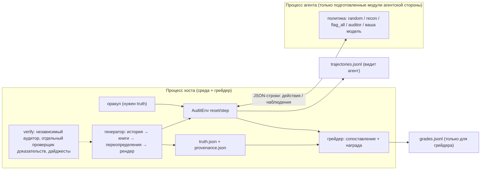

# auditgym

Воспроизводимая RL-среда для обучения и оценки агентов финансового аудита: синтетические компании, узкий
интерфейс инструментов расследования, ошибки с записанным причинным изменением и проверенным ключом ответов, а
также общая награда. Работает офлайн, только стандартная библиотека, Python 3.11.

[English version](README.md) · [Дизайн-документ](docs/DESIGN.md) · [Отчёт проверки](runs/check/report.md) ·
[Кейс](docs/CASE.md) · [Демо-просмотрщик](viewer/index.html) (откройте файл в браузере, работает офлайн)


> **Кратко.** Среда для обучения ИИ-аудитора: генератор синтетических компаний (история → документы →
> проводки), четыре типа ошибок с записанной причиной, два сценария взаимодействующих ошибок, чистые компании и
> правдоподобные отвлекающие случаи. Агент работает только через пять инструментов в отдельном процессе; грейдер
> считает награду `clip(2·F1 − 1 − 0.002·шаги)`. Ключ ответов проверяют независимый аудитор и отдельная проверка
> достаточности доказательств. Одна команда проверки: `python -m auditgym check` (см. Быстрый старт).

## Кейс → решение

| Требование кейса | Как это сделано в auditgym | Где |
|---|---|---|
| «Сначала построить непротиворечивую скрытую историю компании, затем документы, затем ошибки с записанным причинным изменением» | История → чистые книги → ошибки как переопределения проводок, которые заново проводит тот же движок → диф провенанса на уровне записей (`ops`), с дайджестами чистого и итогового состояния | [history.py](auditgym/history.py), [books.py](auditgym/books.py), [inject.py](auditgym/inject.py), [render.py](auditgym/render.py) |
| «Минимум четыре независимо настраиваемых типа» | `errors: {duplicate_invoice, unallocated_payment, wrong_fx_rate, wrong_period}`, у каждого есть варианты; каждый тип можно запросить отдельно | [config.py](auditgym/config.py) |
| «Взаимодействующие ошибки. Два сценария» | `boundary_fx_payment` (частичное поступление в иностранной валюте на границе периода, проведённое по дате UTC: период + курс), `fx_invoice_partial_allocation` (счёт с неверным курсом + частично нераспределённое поступление; всегда вариант `partial`) | [inject.py](auditgym/inject.py) |
| «Чистые компании и правдоподобные корректные отвлекающие случаи» | Законные повторы, регулярные суммы, платежи частями и по нескольким счетам, недоплаты, переплата с возвратом, поступления без ссылки, документы на границе периода и валютные документы выходного дня; опция twin с противоположным ответом. `check` превращает каждый отвлекающий случай в самое правдоподобное ложное обвинение по опубликованным правилам и требует ложного срабатывания (−1 на чистых эпизодах) | [history.py](auditgym/history.py), [splits.json](configs/splits.json), [check_battery.py](auditgym/check_battery.py) |
| «Ключ ответов должен описывать реальное расхождение и доступные доказательства» | Независимый аудитор (импортирует только стандартную библиотеку и разбор времени: ни модулей генератора, ни `money.py`; своя целочисленная арифметика курсов, сверенная с `money.py` на 10 000 случайных случаев) воспроизводит ключ точно; отдельный проверщик доказательств выводит тип, ID и сумму из каждого набора доказательств сам по себе, арифметика на `Fraction`, без импорта из `auditor.py` или `money.py`; для `unallocated_payment` набор не может показать, что счёт не закрыт другим поступлением: это держится на гарантии генератора (см. «Ограничения») | [auditor.py](auditgym/auditor.py), [evidence_check.py](auditgym/evidence_check.py), [verify.py](auditgym/verify.py) |
| «Ключ ответов нельзя угадать по поверхностным признакам» | `python -m auditgym.tells` измеряет 36 правил для документов и 5 правил для эпизодов на 1000 сгенерированных эпизодов ([runs/tells/summary.md](runs/tells/summary.md)): ни одно правило для документов не достигает точности 0.24 (базовая доля 0.027; лучшие правила ищут счета-близнецы, где нужно искать дубликат, и примерно четыре из пяти счетов-близнецов не входят в ключ ответов), и ни одно правило для эпизодов не превосходит свою базовую долю более чем на 0.03; `tests/test_tells.py` проверяет те же пороги на 20 открытых эпизодах и правила окна на 100 сгенерированных | [tells.py](auditgym/tells.py), [test_tells.py](tests/test_tells.py) |
| «reset(seed, config) … step(action)», пять действий, страницы по 50 строк, 100 шагов | Контракт в стиле Gymnasium с JSON; наблюдения содержат только результат, ошибку и оставшиеся шаги; схемы сверяются с окружением фаззером; секция `F_contract` в `check` запускает 20 именованных проверок контракта | [env.py](auditgym/env.py), [schemas/](schemas), [contract_battery.py](auditgym/contract_battery.py), [test_contract_fuzz.py](tests/test_contract_fuzz.py) |
| «Грейдер работает вне процесса агента» | Политика в дочернем процессе, обмен JSON-строками по stdio; в дочерний процесс попадает подготовленная копия модулей агентской стороны, пустой временный рабочий каталог, без seed, секрета и путей к эпизоду в окружении; грейдер, оракул и генератор не импортируются; ограниченный канал; дайджест кода проверяется после каждого запуска. В образе политика работает от отдельного пользователя (uid 10002); `AUDITGYM_REQUIRE_AGENT_USER=1` отказывает в запуске в противном случае | [protocol.py](auditgym/protocol.py), [agent.py](auditgym/agent.py), [Dockerfile](Dockerfile) |
| «Сопоставление … один к одному», «опубликовать код нормализации, правила допусков и правило разрешения ничьих» | Максимальное паросочетание Куна, опубликованная нормализация, алиасы ID (doc_id ↔ invoice_id/payment_id), допуск 2 минорные единицы | [matcher.py](auditgym/matcher.py) |
| «Терминальная награда = clip(2·F1 − 1 − 0.002·inspection_steps, −1, 1)» | Точные дроби. Экспериментальная мягкая награда (кредит по каждой проблеме при максимальном по весу однозначном назначении) выводится в отдельных колонках | [reward.py](auditgym/reward.py), [grader.py](auditgym/grader.py), [diagnostics.py](auditgym/diagnostics.py) |
| «Четыре базовых адаптера политик» | Случайный исследователь (фиксированный seed прогона, отдельный поток на эпизод), упрощённая сверка, атака «отметить всё», оракул (только на стороне грейдера); молчаливая базовая политика (сразу ничего не отправляет); скриптованный аудитор (код верификатора, прогнанный через инструменты; см. «Оценка»); любая политика `module.path:ClassName` запускается с той же изоляцией | [policies/](auditgym/policies), [examples/custom_policy.py](examples/custom_policy.py) |
| «Одинаковые seed, конфигурация, версия и действия должны воспроизводить …», парные проверки | Переносимый PRNG и арифметика на целых числах и `Decimal`, побайтовая регенерация, воспроизведение записанных действий, преобразования (перестановка, переименование ID, перерисовка меток времени, переименование компании и формулировок счетов) | [rng.py](auditgym/rng.py), [transform.py](auditgym/transform.py), [check.py](auditgym/check.py) |
| 10 обучающих (train) и 10 dev эпизодов, trajectories.jsonl | Сначала делятся исходные истории; dev-эпизоды — на отложенных режимах; записанные траектории регенерируются и сравниваются в CI | [episodes/](episodes), [runs/train_dev/trajectories.jsonl](runs/train_dev/trajectories.jsonl) |
| Официальная проверка без сети, одной командой | `python -m auditgym check`; Dockerfile запускает ту же команду с `--network none`; оба запускаются в CI | [check.py](auditgym/check.py), [Dockerfile](Dockerfile), [рабочий процесс CI](.github/workflows/check.yml) |

## Быстрый старт

Ничего не нужно: ни ключей, ни сети, ни установки. Python 3.11:

```bash
python -m auditgym check
```

`check` печатает по строке на каждую именованную проверку и пишет [runs/check/report.md](runs/check/report.md).
Код выхода 0 только если прошли все проверки. На коммите `af2fc47` запускается **615 именованных проверок 78 видов** (вид — это одно свойство; большинство
прогоняется на каждом эпизоде, к которому применимо), одна из них запускает **228 модульных тестов** (вне образа 8
тестов только для контейнера помечаются как пропущенные). Около 100 с на Windows 10 с Python 3.11.4 (в
зафиксированном отчёте 101 с). Прогон CI 44656432334 на этом коммите зелёный: ubuntu 48 с, windows 41 с, macOS 36 с
(Python 3.11) и контейнер 67 с, где 9 тестов только для контейнера выполнились без пропусков, в том числе в строгом
режиме; строгий режим с `--cap-drop ALL` завершается с кодом 2 и одной строкой ошибки. Цитируемые строки лога
сохранены в [runs/ci/44656432334.txt](runs/ci/44656432334.txt) (сделано [tools/ci_excerpt.py](tools/ci_excerpt.py)).

```bash
python -m auditgym demo
```

`demo` запускает скриптованный аудитор и упрощённую сверку на одном эпизоде в изолированном процессе и печатает
каждый шаг и вердикт грейдера (см. ниже).

```bash
python -m auditgym viewer
```

`viewer` пересобирает [viewer/index.html](viewer/index.html), офлайн-страницу для людей.

Контейнер (после сборки работает офлайн; задание CI собирает его и запускает с теми же флагами):

```bash
docker build -t auditgym .
docker run --rm --network none --cpus 2 --memory 4g auditgym
```

Отчёт пишется внутри образа, по пути `/app/runs/check/report.md`. `--rm` удаляет контейнер, поэтому, чтобы сохранить
отчёт, запустите контейнер с именем, скопируйте файл и затем удалите контейнер. Эти команды здесь не запускались (CI
выполняет только первую команду выше):

```bash
docker run --name auditgym-check --network none --cpus 2 --memory 4g auditgym
docker cp auditgym-check:/app/runs/check/report.md .
docker rm auditgym-check
```

## Две минуты на просмотр

1. Запустите `python -m auditgym demo`. На эпизоде `ep_5a9a09e389264d0c` аудитор читает 25 страниц через
   `list_records`, на шаге 26 отправляет 5 находок, и грейдер сообщает награду **+0.950** с TP 5, FP 0, FN 0.
   Упрощённая сверка на том же эпизоде получает **−0.839** с TP 1, FP 13, FN 4.
2. Откройте [viewer/index.html](viewer/index.html) (английский или русский, тёмная или светлая тема). В боковой
   панели выберите `d08_both_interacting_kzt`, чтобы увидеть ключ ответов (вид грейдера). Нажмите на ошибку, чтобы
   увидеть её документы, строки журнала и локальный граф; откройте **Graph** для всей сети доказательств, затем
   откройте записанный прогон и пошагово проиграйте траекторию ([снимок экрана](docs/media/viewer_run.png)).
3. Запустите `python -m auditgym verify episodes/dev/d08_both_interacting_kzt`: девять именованных проверок, все
   `PASS`, затем объявленные расхождения.
4. Прочитайте [runs/check/report.md](runs/check/report.md): базовые показатели на контрольном наборе hidden-like.

## Для жюри

Проверка группирует именованные проверки по пяти критериям рубрики. Группировка — это `RUBRIC` в
[auditgym/check.py](auditgym/check.py); ключи секций в `report.json` не изменились. В каждой строке указаны секции
проверки, которые выполняются в `python -m auditgym check`, модульные тесты, покрывающие то же утверждение (секция
`A_unit_tests` запускает их все), и команда, которую можно выполнить самостоятельно. В заголовке отчёта указано покрытие
(615 именованных проверок 78 видов: вид — это одно свойство; большинство прогоняется на каждом эпизоде, к которому применимо) и
то, работала ли политика от отдельного пользователя.

| Критерий рубрики (баллы) | Секции проверки `check` | Основные модульные тесты | Как проверить самостоятельно |
|---|---|---|---|
| 1. Контракт и изоляция (25) | `F_contract`: 20 именованных проверок контракта в процессе (ключи reset и наблюдения, страницы по 50 строк, ключи записей по порядку, один и тот же курсор дважды и снова после нового reset, неизвестный ID и действие, лимиты калькулятора, submit и завершённые эпизоды, усечение на шаге 100 и не раньше, лимит времени при замороженных часах, eval скрывает награду, −1 за некорректные и чужие отправки, схема наблюдения, фаззинг из 300 действий с seed и reset в конце каждого эпизода); `E_leaks`: 2219 наблюдений базовых политик hidden-like этого прогона содержат только разрешённые поля и нет маркеров ключа ответов; траектории оракула не публикуются | `test_contract_battery`, `test_env`, `test_schemas`, `test_contract_fuzz` (фаззер с seed, в процессе и через канал), `test_isolation`, `test_noninterference` (пять политик, перемешанные или подменённые ключи ответов, побайтово одинаковые наблюдения), `test_redteam`, `test_container` (внутри образа, в CI не должен пропускаться) | `python -m auditgym check`; `python -m auditgym.redteam` (враждебные пробы: потоки лишних строк, зависания, внуки-процессы; в `check` не входит); `python -m auditgym.redteam --parent` (что политика того же пользователя читает о своём родителе); `AUDITGYM_REQUIRE_AGENT_USER=1 python -m auditgym check` завершается с кодом 2 вне образа (строгая изоляция) |
| 2. Данные и ключ ответов (25) | `B_committed_episodes`: все 20 закоммиченных эпизодов регенерируются побайтово и проходят верификацию; `C_data`: контрольный набор hidden-like проходит верификацию, с частотами повторной генерации | `test_verify` (режим каталога проверяет сохранённые дайджесты; аудитор не импортирует код генератора, а его арифметика совпадает с `money.py`), `test_generator`, `test_tells` (правила-признаки), `test_regen_examples` | `python -m auditgym verify episodes/dev/d08_both_interacting_kzt`; `python -m auditgym build-splits`, затем `git diff --exit-code -- episodes`; `python -m auditgym.tells --n 1000 --master auditgym-tells-v1 --out runs/tells` (около 160 с; побайтово перезаписывает [runs/tells/summary.md](runs/tells/summary.md)) |
| 3. Надёжность награды (25) | `C_reward`: оракул получает 1.0, атаки «отметить всё» и случайный исследователь получают мало, скриптованный аудитор закрывает каждый эпизод и побеждает молчаливую базовую политику; батарея атак на каждом эпизоде с ошибкой (type shotgun, amount ladder, добивка мусором, набивка доказательств, неверный реальный ID и одно ложное обвинение на каждый отвлекающий случай, построенное из реальных записей по опубликованным правилам, которое стоит ровно одного ложного срабатывания; одна строка проверки на вид отвлекающего случая) и на каждом чистом эпизоде (те же обвинения по отвлекающим случаям получают −1, ниже молчания); каждое такое обвинение должно также совпасть с ложным ключом (decoy), который описывает ровно его утверждение, и не совпасть ни с одним ложным ключом, отличающимся одним критерием | `test_reward`, `test_matcher` (сопоставление Куна, допуск, алиасы, некорректные структуры), `test_check_battery` (те же конструкторы дают истинные срабатывания на реальных проблемах; сопоставитель, игнорирующий один критерий, не проходит), `test_diagnostics` | `python -m auditgym grade --episode episodes/train/t03_duplicate --findings examples/findings_t03_correct.json --steps 14` (награда 0.972) |
| 4. Воспроизводимость (15) | `B_replay`: записанные действия, воспроизведённые в новой среде, дают наблюдения, равные в JSON, и ту же терминальную награду; `D_paired`: одинаковые seed и конфигурация дают одинаковые записи и ключ ответов; одинаковые действия дают одинаковые переходы; прогоны в изоляции и в процессе совпадают; ответ и награда оракула сохраняются при перестановке, переименовании ID, перерисовке меток времени и переименовании компании и формулировок счетов | `test_isolation`, `test_generator` (регенерация при двух значениях `PYTHONHASHSEED`), `test_contract_fuzz` (закоммиченные схемы побайтово совпадают со сгенерированными), `test_transform_rename` | `python -m auditgym transform --in DIR --out DIR2 --permute-seed 1 --remap-seed 2 --ts-repr utc --rename-seed 3`, затем `python -m auditgym verify DIR2`; CI сравнивает эпизоды, схемы и траектории после регенерации |
| 5. Инженерия и объяснение (10) | `A_unit_tests`: весь набор модульных тестов, с числом запущенных, пройденных и пропущенных | все `tests/test_*.py`, `test_cli`, `test_timeutil`, `test_calculator` | `python -m unittest discover -s tests -t .`; матрица CI на ubuntu, windows и macOS |

Ограничения этой карты: контрольный набор hidden-like строится из публичной мастер-строки (см. «Ограничения»), поэтому
`check` проверяет конвейер, а не секретность; путь закрытой оценки — `check --seeds-file` (ниже).

## Для организаторов

Эпизоды организаторов передаются файлом seeds. Закрытые прогоны никогда не пишут в `runs/check`.

```bash
# официальная проверка на вашем закрытом наборе; секрет хоста читается из переменной окружения
export AUDITGYM_SECRET='<your secret>'
python -m auditgym check --seeds-file FILE --secret-env AUDITGYM_SECRET --out DIR
```

- `FILE` — JSON `{"split": "<метка>", "episodes": [{"name": "...", "seed": <целое>, "config": {...}}]}`; образец:
  [examples/closed_seeds_example.json](examples/closed_seeds_example.json). Проверка запускает на ваших эпизодах
  разделы данных, награды, парных проверок и проверки утечек, а также воспроизведение собственных прогонов. Проверки,
  которым нужны эпизоды с ошибками или чистые эпизоды, которых нет в файле, помечаются `SKIP`. Вывод по умолчанию —
  `runs/check_closed`; `--out DIR` его переопределяет. `--keep-runs` дополнительно пишет траектории и оценки, которые
  содержат закрытый ключ ответов.
- Используйте 63-битные seed и секрет. `run` и `check --seeds-file` предупреждают о seed в 40 бит и меньше, если секрет
  не задан.
- Строгая изоляция (по желанию): с `AUDITGYM_REQUIRE_AGENT_USER=1` команды `check`, `run`, `demo`, `viewer` и `budget`
  завершаются с кодом 2 и одной строкой `error:` до первого эпизода и до любого отчёта, если политику нельзя запустить
  от отдельного пользователя. Образ эту переменную не задаёт, поэтому раннер, который добавляет `--user` или
  сбрасывает capabilities, по-прежнему проходит проверку с одной строкой предупреждения. Чтобы потребовать отдельного
  пользователя: `docker run --rm --network none -e AUDITGYM_REQUIRE_AGENT_USER=1 auditgym`. CI запускает это в образе по
  умолчанию (проверка проходит, ни один контейнерный тест не пропущен) и с `--cap-drop ALL` (код 2, одна строка).
- Коды выхода: 0 — все проверки прошли, 1 — проверка или верификация не прошла, 2 — некорректный ввод (одна строка
  `error:`), 3 — прогон завершился, но процесс агента сломался.

Генерация и проверка одного эпизода:

```bash
python -m auditgym generate --seed 123 --config examples/config_mixed.json --out DIR
python -m auditgym verify DIR
```

Парные проверки для ваших копий эпизодов (переставленные строки, переименованные ID, другое представление времени, переименованные компания и формулировки счетов):

```bash
python -m auditgym transform --in DIR --out DIR2 --permute-seed 1 --remap-seed 2 --ts-repr utc --rename-seed 3
python -m auditgym verify DIR2
```

Запуск вашей политики — класса с `act(observation, reward, info)` — в изолированном дочернем процессе:

```bash
python -m auditgym run --episodes DIR_OR_FOLDER --policies yourpkg.module:YourPolicy --out runs/yours
```

`--policy-path DIR` нужен для кода вне этого репозитория. Имена проверяются до начала прогона; оракул в дочернем
процессе не допускается. `examples/hostile/policies.py` показывает режимы сбоя, которые обрабатывает обвязка
(код выхода 3 для падающей политики).

**Совет: запускайте закрытые эпизоды внутри контейнера.** Вне контейнера политика работает от того же пользователя ОС,
что и хост, и может читать всё, что доступно этому пользователю. Внутри образа среда и грейдер работают от root, а
каждая политика — в дочернем процессе от отдельного непривилегированного пользователя (uid 10002, `agent`, без
дополнительных групп, umask 077) в собственном временном каталоге. CI запускает `tests/test_container.py` внутри образа
и требует, чтобы ни один тест не был пропущен: политика не может прочитать окружение хоста (`/proc/<host>/environ`, где
лежат значения `--secret-env`), файл seeds с правами 0600 владельца root, каталог грейдера, записанный хостом, и что-либо
в `/app`, не может писать в пакет, а все процессы её uid завершаются в конце каждого эпизода. Монтируйте файлы seeds и
каталоги эпизодов внутрь `/app` (например, `-v $PWD/closed.json:/app/secrets/closed.json:ro`), а `--out` держите внутри
`/app/runs`: монтирование в другое место сохраняет права хоста. С `--user 10001` или `--cap-drop ALL` образ запускает
политику от пользователя хоста, печатает одну строку предупреждения и по-прежнему проходит проверку (оба запуска есть в
CI); с `-e AUDITGYM_REQUIRE_AGENT_USER=1` образ вместо этого отказывает (код 2). Вне контейнера политика работает от
пользователя хоста и может прочитать окружение хоста, где лежат значения
`--secret-env`: в Windows 10 `python -m auditgym.redteam --parent` запускает политику через обвязку, и она находит
переменную хоста в памяти родительского процесса (измерено локально). В Linux то же чтение идёт через
`/proc/<ppid>/environ` (ожидаемо; вне образа не измерялось).

Контейнер собирался и запускался в CI (`docker build`, затем `docker run --rm --network none --cpus 2 --memory 4g
--pids-limit 512`, ещё раз с `--user 10001` и с `--cap-drop ALL`). Монтирование закрытых seed-файлов или каталога
вывода в контейнер не запускалось.

## Архитектура



- Генератор: одна компания и один отчётный период на эпизод. 20 закоммиченных эпизодов (10 обучающих, 10 dev)
  содержат от 251 до 1 905 строк журнала, от 73 до 199 документов (счета плюс платежи) и от 0 до 10 проблем в каждом.
  Размеры `small`, `medium`, `large`; не более 12 ошибок на эпизод; шесть базовых валют (EUR, USD, KZT, JPY, KWD, GBP) и пул иностранных валют, где есть также KRW и BHD; показатели степени
  0, 2 и 3 (JPY и KRW — 0, KWD и BHD — 3, остальные — 2); одиннадцать встроенных часовых поясов, включая правила перехода на
  летнее время и +05:45.
- Среда: пять инструментов только для чтения, страницы по 50 строк, стабильные курсоры, бюджет 100 шагов (включая
  submit) и лимит 60 с (`time_limit_s` в задании), ограниченные ошибки, которые расходуют шаг.
- Грейдер: опубликованная нормализация, сопоставление один к одному, общая награда плюс экспериментальная мягкая награда.
- Верификация: девять именованных проверок на эпизод (`verify DIR`); генератор пересэмплирует любого кандидата, не
  прошедшего одну из них.

Python API (открытый режим обучения):

```python
from auditgym.env import AuditEnv

env = AuditEnv(mode="train")  # "eval": награда остаётся 0, пока грейдер не сообщит
obs, info = env.reset(seed=123, config={"generator": {"size": "small", "errors": {"wrong_fx_rate": 1}}})
obs, reward, terminated, truncated, info = env.step(
    {"action": "list_records", "table": "ledger", "cursor": None, "limit": 50})
```

## Оценка

Каждая таблица ниже скопирована из сгенерированного файла. Команды для её воспроизведения указаны под таблицей.

**Скриптованный аудитор.** Аудитор — это код верификатора (`auditor.py`), прогнанный через интерфейс инструментов.
Это доказательство разрешимости, а не обученная политика: оно показывает, что каждый сценарий закрывается в пределах
бюджета, но не то, что агент рассуждал бы так же. Его числа не являются показателем возможностей агента.

### Контрольный набор hidden-like (20 эпизодов)

Из [runs/check/report.md](runs/check/report.md). Эти эпизоды построены из публичной мастер-строки
`auditgym-check-v1`, поэтому они проверяют конвейер. Режим оценки, каждый агент в изолированном процессе.

| Политика | Награда | Мягкая награда | Макро P | Макро R | Микро P | Микро R | F1 | Шаги | Доля закрытых | FP на чистых |
|---|---|---|---|---|---|---|---|---|---|---|
| оракул (только на стороне грейдера) | 1.000 | 1.000 | 0.75 | 0.75 | 1.00 | 1.00 | 1.000 | 0.0 | 1.00 | 0 |
| скриптованный аудитор (код верификатора) | 0.936 | 0.936 | 0.75 | 0.75 | 1.00 | 1.00 | 1.000 | 32.0 | 1.00 | 0 |
| упрощённая сверка (recon) | −0.589 | −0.589 | 0.15 | 0.54 | 0.16 | 0.75 | 0.231 | 32.0 | 0.00 | 40 |
| случайный исследователь | −0.613 | −0.613 | 0.00 | 0.00 | 0.00 | 0.00 | 0.200 | 34.0 | 0.20 | 2 |
| отметить всё (flag everything) | −1.000 | −0.995 | 0.00 | 0.00 | 0.00 | 0.00 | 0.000 | 3.0 | 0.00 | 150 |
| молчаливая (сразу ничего не отправляет) | −0.500 | −0.500 | 0.00 | 0.00 | n/a | 0.00 | 0.250 | 0.0 | 0.25 | 0 |

Пустой ответ здесь даёт −0.500: +1 на 5 чистых эпизодах и −1 на 15 эпизодах с ошибками. recon и случайный
исследователь получают меньше; лучше него только скриптованный аудитор и оракул. Проверка утверждает, что аудитор >
молчаливая, и не утверждает, что recon её превосходит.

Регенерация: `python -m auditgym check` (пишет `runs/check/report.md`).

### Открытые наборы (10 обучающих, 10 dev)

Из [runs/train_dev/summary.md](runs/train_dev/summary.md) (`python -m auditgym run --episodes episodes/train episodes/dev --policies random,recon,flag_all,oracle,auditor,silent --out runs/train_dev`).
Мягкая награда — экспериментальная; учитывается общая награда. Макро P и R усредняют по эпизодам; у чистого эпизода
нет истинных срабатываний, поэтому правильный пустой ответ даёт там P = R = 0. Именно поэтому макро P/R оракула равны
0.7 (обучающие) и 0.8 (dev). Микро P = ΣTP / Σ(TP+FP), микро R = ΣTP / Σ(TP+FN) объединяют все эпизоды; их и
следует читать.

| Набор | Политика | Награда | Мягкая награда | Макро P | Макро R | Микро P | Микро R | F1 | Шаги | Доля закрытых | FP на чистых |
|---|---|---|---|---|---|---|---|---|---|---|---|
| обучающий | скриптованный аудитор | 0.971 | 0.971 | 0.70 | 0.70 | 1.00 | 1.00 | 1.000 | 14.3 | 1.0 | 0 |
| обучающий | упрощённая сверка | −0.690 | −0.690 | 0.10 | 0.50 | 0.08 | 0.60 | 0.161 | 14.3 | 0.0 | 26 |
| обучающий | случайный исследователь | −0.613 | −0.613 | 0.00 | 0.00 | 0.00 | 0.00 | 0.200 | 19.3 | 0.2 | 1 |
| обучающий | отметить всё | −1.000 | −1.000 | 0.00 | 0.00 | 0.00 | 0.00 | 0.000 | 3.0 | 0.0 | 90 |
| обучающий | оракул | 1.000 | 1.000 | 0.70 | 0.70 | 1.00 | 1.00 | 1.000 | 0.0 | 1.0 | 0 |
| обучающий | молчаливая | −0.400 | −0.400 | 0.00 | 0.00 | n/a | 0.00 | 0.300 | 0.0 | 0.3 | 0 |
| dev | скриптованный аудитор | 0.943 | 0.943 | 0.80 | 0.80 | 1.00 | 1.00 | 1.000 | 28.7 | 1.0 | 0 |
| dev | упрощённая сверка | −0.689 | −0.689 | 0.12 | 0.45 | 0.14 | 0.57 | 0.178 | 28.7 | 0.0 | 5 |
| dev | случайный исследователь | −1.000 | −1.000 | 0.00 | 0.00 | 0.00 | 0.00 | 0.000 | 18.9 | 0.0 | 5 |
| dev | отметить всё | −1.000 | −0.992 | 0.00 | 0.00 | 0.00 | 0.00 | 0.000 | 3.0 | 0.0 | 60 |
| dev | оракул | 1.000 | 1.000 | 0.80 | 0.80 | 1.00 | 1.00 | 1.000 | 0.0 | 1.0 | 0 |
| dev | молчаливая | −0.600 | −0.600 | 0.00 | 0.00 | n/a | 0.00 | 0.200 | 0.0 | 0.2 | 0 |

В том же файле есть разбор промахов. На dev все промахи упрощённой сверки — `not_flagged`: она читает
доказательства, но сравнивает даты так, как они записаны, а не во времени компании. Её полнота 1.0 для дубликатов и
нераспределённых поступлений, 0.22 для ошибок курса и 0.25 для ошибок периода. Промахи случайного исследователя и
«отметить всё» — `search` (полного набора доказательств они никогда не видели), с одним промахом `not_flagged` у
случайного и одним промахом `evidence` у «отметить всё» на dev.

**Изменение после удаления подсказок в данных.** История git показывает, что награда упрощённой сверки упала
после коммита, удалившего подсказки в данных (`a94d9b9`, родитель `bb80adb`): dev −0.545 → −0.689,
обучающий −0.638 → −0.690 (`git show a94d9b9^:runs/train_dev/summary.md` против текущего файла), а на наборе hidden-like
−0.490 → −0.589 (`git show bb80adb:runs/check/report.md`). Скриптованный аудитор почти не изменился (dev 0.947 →
0.943, обучающий 0.970 → 0.971). Причина не выделена: то же изменение сместило и распределение отвлекающих случаев.

### Бюджет действий

Из [runs/budget/summary.md](runs/budget/summary.md) (dev, скриптованный аудитор и упрощённая сверка,
изоляция, режим оценки). Команда: `python -m auditgym budget` (бюджеты по умолчанию 20, 50, 100; то же, что и
`make budget`, там, где установлен make).

| Бюджет (шаги) | Награда аудитора | F1 аудитора | Доля закрытых аудитора | Награда сверки | F1 сверки |
|---|---|---|---|---|---|
| 20 | −0.083 | 0.472 | 0.2 | −0.849 | 0.082 |
| 50 | 0.943 | 1.000 | 1.0 | −0.689 | 0.178 |
| 100 | 0.943 | 1.000 | 1.0 | −0.689 | 0.178 |

### Стресс-тест генератора

Из [runs/stress/report.md](runs/stress/report.md). Команда: `python -m auditgym stress --n 300`. Счётчики воспроизводимы;
время и память — нет. Весь прогон занял 346 с на этой машине.

| Набор | Конфигураций | Сгенерировано и проверено | Не прошли проверку | Невыполнимо (ConfigError) | С первой попытки | С повторных попыток | Макс. время генерации | Пиковая память |
|---|---|---|---|---|---|---|---|---|
| случайный | 300 | 282 | 0 | 18 | 260 | 22 | 0.38 с | 6.1 МБ |
| экстремальный | 17 | 17 | 0 | 0 | 14 | 3 | 0.30 с | 5.5 МБ |

17 экстремальных конфигураций — это 12 ошибок в каждом из 11 часовых поясов, три смеси степеней валют, переход через
год, летнее время Сиднея и один большой эпизод с 12 ошибками; скриптованный аудитор закрывает все 17 за 11–47 шагов. 18 невыполнимых запросов: 17
запросов `boundary_fx_payment` с фиксированным периодом (последний день периода или следующий день — выходной) и один
запрос с `UTC` на ошибки, которым нужно ненулевое смещение. Каждый даёт ConfigError с указанием, чего не хватает.

## Команды

| Команда | Назначение |
|---|---|
| `python -m auditgym check` | Единая офлайн-проверка (именованные проверки, группы рубрики, [отчёт](runs/check/report.md)) |
| `python -m auditgym check --seeds-file FILE --secret-env VAR --out DIR` | Та же батарея на эпизодах организаторов; никогда не пишет в `runs/check` |
| `python -m auditgym build-splits` | Регенерировать `episodes/train` и `episodes/dev` из [configs/splits.json](configs/splits.json) |
| `python -m auditgym generate --seed N --config FILE --out DIR [--secret-env VAR]` | Один каталог эпизода |
| `python -m auditgym verify DIR` | Именованные проверки бухгалтерии и ключа ответов для каталога эпизода |
| `python -m auditgym run --episodes DIRS --policies P1,P2 --out DIR` | Базовые прогоны на каталогах эпизодов (`--mode eval\|train`, `--max-steps N`, `--policy-seed N`) |
| `python -m auditgym run --seeds-file FILE [--secret-env VAR] --policies ... --out DIR` | Закрытые эпизоды, сгенерированные в памяти |
| `python -m auditgym run ... --policies module:Class [--policy-path DIR]` | Ваша политика в изолированном дочернем процессе |
| `python -m auditgym grade --episode DIR --findings FILE --steps N` | Оценить файл находок |
| `python -m auditgym transform --in DIR --out DIR2 --permute-seed N --remap-seed N --ts-repr utc --rename-seed N` | Копия эпизода для парных проверок |
| `python -m auditgym.tells --n 1000 --master auditgym-tells-v1 --out runs/tells` | Измерение правил-признаков на сгенерированных эпизодах, пишет [runs/tells/summary.md](runs/tells/summary.md) |
| `python -m auditgym stress --n 300` | Стресс-прогон генератора, пишет [runs/stress/report.md](runs/stress/report.md) |
| `python -m auditgym budget` | Развёртка по бюджету действий, пишет [runs/budget/summary.md](runs/budget/summary.md) |
| `python -m auditgym demo` | Аудитор и сверка на одном эпизоде, пошагово |
| `python -m auditgym viewer` | Пересобрать [viewer/index.html](viewer/index.html) |
| `python -m auditgym schemas` | Записать JSON-схемы в [schemas/](schemas) |
| `python -m auditgym.redteam` | Пробы враждебных политик (потоки лишних строк, зависания, процессы-внуки); не входит в `check` |
| `python -m auditgym.redteam --parent` | Только измерение видимости родителя: командную строку читает обычный дочерний процесс, окружение хоста — политика, запущенная через обвязку |
| `python -m unittest discover -s tests -t .` | Набор модульных тестов (те же тесты, что `check` запускает одной проверкой) |

**Коды выхода.** 0 — успех; 1 — проверка или верификация не прошла; 2 — некорректный ввод (одна строка `error:` в
stderr, например неизвестная политика или не заданная переменная `--secret-env`); 3 — прогон завершился, но процесс
агента сломался (падение, выход или подмена проверяемого кода).

**Поля траектории** (`runs/*/trajectories.jsonl`, одна строка на запись): `run_id` (`split:policy:seed`), `split`,
`policy`, `episode_id`, `step`, `action`, `observation`, `reward`, `terminated`, `truncated`. Шаг 0 — наблюдение
после reset с `action` null и наградой 0.0. Терминальная награда записывается в последнюю запись каждого эпизода после
прогона; в режиме оценки сама политика на каждом шаге получала 0.0. Прогоны оракула никогда не попадают в траектории. `runs/train_dev/meta.json` записывает версии (auditgym, генератора, конфигурации, схемы и оценки), версию Python (3.11.4 здесь), платформу, режим, политики, команду и `secret_used`; это подтверждает требование кейса о версиях конфигураций.

## Структура репозитория

```
auditgym/          среда, генератор, грейдер, верификатор, проверщик доказательств, политики, CLI
  policies/        random, recon, flag_all, oracle (только на стороне грейдера), auditor, silent
  viewer/          офлайн-шаблон просмотрщика и его сборщик
configs/           splits.json (seed и конфигурации обучающих/dev эпизодов, config_version 1)
episodes/          train/ и dev/: записи public/ + ключ ответов и провенанс в grader/
runs/              check/ (отчёт, оценки, траектории), check_closed/ (закрытые прогоны организаторов), train_dev/,
                   stress/, budget/
schemas/           JSON-схемы: записи, действия, наблюдения, находки, truth, policy, provenance, траектории
tests/             наборы unittest
docs/              CASE.md, DESIGN.md, TASKS.md, PLAN.md (исторический план), media/
examples/          примеры конфигураций и находок, пользовательская политика, враждебные политики для проб
.github/workflows/ CI: check на ubuntu, windows и macOS; сборка и запуск контейнера
```

Все компании, люди, счета, документы, курсы валют и суммы синтетические. Реальные финансовые данные, платежи и
персональные данные не используются.

## Ограничения

- **Платформы.** Локальные прогоны — Windows 10, Python 3.11.4. CI запускает ту же проверку на ubuntu, windows и macOS
  с Python 3.11 (на раннере Windows установлен CPython 3.11.9) и регенерирует закоммиченные эпизоды, схемы и траектории
  побайтово. Python 3.12 и 3.13 не проверялись.
- **Контейнер.** Образ собирается и запускается в CI с `--network none --cpus 2 --memory 4g --pids-limit 512`.
  Внутри образа хост работает от root, а каждая политика — от uid 10002 (`agent`). С `--user 10001` или `--cap-drop ALL`
  политика запускается от пользователя хоста с одной строкой предупреждения, и тогда действуют ограничения того же
  пользователя, описанные ниже; `AUDITGYM_REQUIRE_AGENT_USER=1` превращает этот запасной режим в код выхода 2.
  Монтирование закрытых seed-файлов или каталога вывода в контейнер не запускалось.
- **Изоляция — это граница процесса, а не песочница.** Политика работает в отдельном процессе с подготовленной копией
  модулей агентской стороны, пустым рабочим каталогом и очищенным окружением. Хост хеширует код, конфигурации и схемы
  агентской стороны до и после каждого прогона и проваливает прогон при изменении; это обнаруживает подмену, но не
  предотвращает её. Процессы, покинувшие отслеживаемую группу или задание, переживают прогон. Вне контейнера дочерний
  процесс от того же пользователя ОС может читать файлы, пути к которым угадывает, а в Windows — командную строку
  родителя (измерено локально). Он может прочитать и окружение хоста, где лежат значения `--secret-env`: в Windows —
  из памяти родительского процесса (`python -m auditgym.redteam --parent`, измерено локально), в Linux — через
  `/proc/<ppid>/environ` (ожидаемо, вне образа не измерялось). Внутри образа это блокирует отдельный uid политики (CI);
  оба запасных режима — нет. Открытые ключи ответов обучающих и dev эпизодов
  лежат в репозитории по замыслу.
- **Невмешательство (noninterference).** Проверяется повтором (пять политик, в процессе и в дочернем процессе, на эпизодах с
  перемешанным, подменённым или очищенным ключом ответов): наблюдения, награды и info побайтово совпадают. Время не
  покрывается, потому что лимит времени входит в контракт.
- **Seed.** Генератор открыт. Без секрета хоста и при угаданной конфигурации малый seed можно восстановить из
  `episode_id` манифеста за секунды, поэтому ключ ответов можно регенерировать. Используйте 63-битные seed и
  `--secret-env`; `run` и `check --seeds-file` предупреждают о seed в 40 бит и меньше, если секрет не задан. Публичные записи всё равно позволяют
  перебрать малые seed.
- **Контрольный набор hidden-like.** Эпизоды в `check` строятся из публичной мастер-строки `auditgym-check-v1`. Они
  проверяют конвейер, а не секретность. Организаторы запускают ту же батарею на своих seed через `check --seeds-file`.
- **Скриптованный аудитор.** Это код верификатора, прогнанный через инструменты (см. «Оценку»). Его идеальный F1 —
  результат разрешимости, а не результат агента.
- **Набивка доказательств.** Лишние ID доказательств до лимита в 10 ID бесплатны: находка совпадает, когда её
  доказательства содержат полный допустимый набор (опубликованное правило надмножества), поэтому ссылка на больше
  записей ничего не стоит. Батарея проверяет, что набивка остаётся истинным срабатыванием; её она не штрафует.
- **Парные преобразования** покрывают порядок строк, переименование ID, представление времени и переименование компании
  и формулировок счетов. Преобразования сдвига дат нет: границы периода, курсовые даты и правила часовых поясов
  пришлось бы сдвигать вместе.
- **Доказательства для unallocated_payment.** Набор из трёх записей для `unallocated_payment` опирается на гарантию
  генератора: поступление ссылается на один счёт, и на этот счёт не проведено никакое другое поступление. Приведённые
  записи этого не показывают; агент может это подтвердить, только прочитав все платежи.
- **Выполнимость boundary_fx_payment.** Нужны рабочие дни по обе стороны конца периода. При фиксированном периоде 17 из
  36 месяцев 2025–2027 невыполнимы; ConfigError называет ближайшие выполнимые месяцы. Посчитать можно самим правилом (последний день периода и следующий день
  должны быть рабочими; `feasibility_problems` в `auditgym/config.py`): `python -c "from auditgym.config import feasibility_problems as f; print(sum(bool(f('UTC', f'{y}-{m:02d}', {'boundary_offset': False, 'boundary_weekdays': True, 'utc_date': False})) for y in (2025, 2026, 2027) for m in range(1, 13)))"` выводит 17.
- **Признаки-подсказки** измерены только для правил, которые мы записали. `python -m auditgym.tells --n 1000 --master
  auditgym-tells-v1 --out runs/tells` (около 160 с) оценивает 36 правил для документов и 5 правил для эпизодов на 1000
  сгенерированных эпизодов (750 с ошибками, затронуто 3799 из 141 479 документов, базовая доля 0.027). Лучшие правила
  для документов примерно в восемь раз выше этой доли: «оплаченный счёт-близнец» даёт точность 0.231 при полноте 0.079,
  а «счёт с близнецом» — 0.218 при полноте 0.291. Близнец — это место, где нужно искать дубликат, а примерно четыре из
  пяти счетов-близнецов не входят в ключ ответов, поэтому этим правилам всё равно нужны доказательства. Два сработавших правила для
  эпизодов отмечают эпизоды с ошибками с долей 0.753 и 0.770 при базовой доле 0.750.
  Самая крупная иностранная закупка — цель курса в 17 из 180 подходящих эпизодов (0.094) при случайном уровне 0.103.
  Платежи вне рабочих часов — не только поступления на границе периода: 102 из их 249 срабатываний лежат вне окна
  ошибки. Признак, который никто не перечислил, всё равно может давать утечку.
- **Модель учёта.** Намеренно упрощённая: журнал в базовой валюте, платежи в валюте счёта, без налогов, кредит-нот и
  расчётов между валютами, одиннадцать встроенных часовых поясов вместо базы IANA.
- **ID доказательств.** ID, пустой или длиннее 64 символов, делает всю отправку (submission) некорректной (награда −1), даже если это
  лишний ID доказательства. Это правило опубликовано в тексте задания (`max_id_chars`). Неизвестные, но корректные
  лишние ID игнорируются. Целая сумма, записанная дробным числом (например, `106965.0`), приводится к целому и средой,
  и командой `grade`.
- **flag_all** — атака на уровне формата: она читает первые страницы и использует суммы документов. Более сильные атаки
  покрыты батареей наград в `check`, а не этим базовым вариантом.
- **Экспериментальная награда** выводится в собственных колонках и никогда не заменяет общую награду.
- **Объяснения не оцениваются**, LLM-судьи нет. Парные по часовому поясу близнецы не реализованы; есть только пара
  дубликатов t03/t10.
- **Модель не обучалась**, поэтому улучшение не заявляется.

## Команда

TODO: имена и роли.
