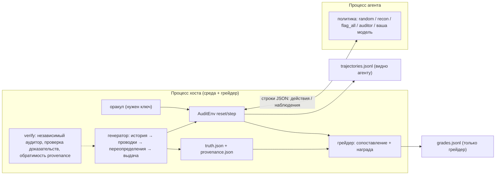

# auditgym

Воспроизводимая RL-среда для обучения и оценки ИИ-аудиторов: синтетические компании, узкий интерфейс
инструментов для расследования, скрытые бухгалтерские ошибки с проверенным ключом ответов и общая функция
награды. Работает без сети, только стандартная библиотека Python 3.11.

[English version](README.md) · [Проектная записка](docs/DESIGN.md) · [Отчёт проверки](runs/check/report.md) ·
[Кейс](docs/CASE.md) · [Демо-просмотрщик](viewer/index.html) (открыть файл в браузере, работает офлайн)


## Кейс → решение

| Требование кейса | Как это сделано в auditgym | Где в коде |
|---|---|---|
| «Сначала согласованная скрытая история компании, затем документы, затем ошибки с записанной причиной» | История → чистые проводки → ошибки как переопределения проводок, которые перепроводит тот же движок → построчный diff в provenance | [history.py](auditgym/history.py), [books.py](auditgym/books.py), [inject.py](auditgym/inject.py), [render.py](auditgym/render.py) |
| «Минимум четыре независимо настраиваемых типа ошибок» | `errors: {duplicate_invoice, unallocated_payment, wrong_fx_rate, wrong_period}`, у каждого типа есть варианты | [config.py](auditgym/config.py) |
| «Взаимодействующие ошибки: два сценария» | `boundary_fx_payment` (частичный валютный платёж на границе периода, проведённый по дате UTC: период + курс), `fx_invoice_partial_allocation` (счёт по неверному курсу + частично нераспределённый платёж) | [inject.py](auditgym/inject.py) |
| «Чистые компании и правдоподобные корректные отвлекающие случаи» | Законные повторы, регулярные суммы, раздельные и многосчётные платежи, недоплаты, переплата с возвратом, платежи без ссылки на счёт, документы на границе периода и в выходные; пары-близнецы с противоположным ответом | [history.py](auditgym/history.py), [splits.json](configs/splits.json) |
| «Ключ ответов описывает реальное расхождение и доступные доказательства» | Независимый аудитор воспроизводит ключ точно; третья реализация выводит тип, ID и сумму из каждого набора доказательств отдельно | [auditor.py](auditgym/auditor.py), [verify.py](auditgym/verify.py) |
| «reset(seed, config) … step(action)», пять действий, страницы по 50 строк, 100 шагов | JSON-контракт в стиле Gymnasium; наблюдение содержит только результат, ошибку и остаток шагов | [env.py](auditgym/env.py), [schemas/](schemas) |
| «Грейдер работает вне процесса агента» | Политика в дочернем процессе, обмен строками JSON, пустой рабочий каталог, без seed и путей; оракул и оценки только на стороне хоста | [protocol.py](auditgym/protocol.py), [agent.py](auditgym/agent.py) |
| «Сопоставление один к одному», «опубликовать нормализацию, допуск и правило разрешения неоднозначностей» | Максимальное паросочетание (алгоритм Куна), опубликованная нормализация, алиасы ID, допуск 2 минорные единицы | [matcher.py](auditgym/matcher.py) |
| «Итоговая награда = clip(2·F1 − 1 − 0.002·inspection_steps, −1, 1)» | Точные дроби; экспериментальная мягкая награда считается отдельно | [reward.py](auditgym/reward.py), [grader.py](auditgym/grader.py) |
| Четыре адаптера базовых политик | случайный исследователь (фиксированный seed), простая сверка, атака «пометить всё», оракул (на стороне грейдера); плюс скриптовый аудитор для демо; любая внешняя политика подключается как `module.path:ClassName` с той же изоляцией | [policies/](auditgym/policies), [custom_policy.py](examples/custom_policy.py) |
| «Одинаковые seed, config, версия и действия воспроизводят …», парные проверки | Переносимый ГПСЧ, побайтовая повторная генерация, преобразования (перестановка строк, замена ID, другая запись времени) | [rng.py](auditgym/rng.py), [transform.py](auditgym/transform.py) |
| 10 обучающих + 10 dev-эпизодов, trajectories.jsonl | Сначала разделены исходные истории компаний; dev — на отложенных режимах | [episodes/](episodes), [runs/train_dev/trajectories.jsonl](runs/train_dev/trajectories.jsonl) |
| Официальная проверка без сети, одна команда | `python -m auditgym check`, Dockerfile запускает ту же команду | [check.py](auditgym/check.py), [Dockerfile](Dockerfile) |

## Быстрый старт

Без ключей, без сети, ничего не нужно устанавливать. Python 3.11:

```bash
python -m auditgym check
```

```bash
python -m auditgym demo
```

```bash
python -m auditgym viewer
```

`check` печатает строку на каждую проверку и пишет [runs/check/report.md](runs/check/report.md); код выхода 0
только если пройдены все проверки (121 на машине разработки, около 30 с). `demo` запускает скриптового аудитора
и базовую сверку на одном dev-эпизоде в изолированном процессе и печатает каждый шаг и вердикт грейдера.
`viewer` пересобирает [viewer/index.html](viewer/index.html).

Контейнер (после сборки работает без сети):

```bash
docker build -t auditgym .
```

```bash
docker run --rm --network none --cpus 2 --memory 4g auditgym
```

Dockerfile написан, но на машине разработки не собирался: Docker там не установлен. Он запускает ту же
команду `check`.

## Посмотреть за две минуты

1. Запустите `python -m auditgym demo`: аудитор читает 20 страниц через `list_records`, отправляет 5 находок,
   грейдер сообщает награду +0.960 при TP 5, FP 0, FN 0. Базовая сверка читает те же страницы и попадается
   на отвлекающие случаи.
2. Откройте [viewer/index.html](viewer/index.html) (русский или английский, тёмная или светлая тема).
   Выберите `d08_both_interacting_kzt` в боковой панели, чтобы увидеть ключ ответов (вид грейдера). Клик по
   ошибке показывает её документы, проводки и локальный граф, раздел **Граф** показывает всю сеть
   доказательств, а прогоны `recon` и `auditor` воспроизводят траекторию пошагово
   ([скриншот](docs/media/viewer_run.png)).
3. Запустите `python -m auditgym verify episodes/dev/d08_both_interacting_kzt`: девять именованных проверок,
   затем заявленные расхождения.
4. Таблица базовых политик на 20 эпизодах, похожих на закрытые: [runs/check/report.md](runs/check/report.md).

## Архитектура



- Генератор: одна компания и один отчётный период на эпизод; в открытых наборах 253–1 745 строк главной книги,
  66–201 документ и 0–10 ошибок (пресеты допускают до 2 000 строк и 12 ошибок); 6 базовых валют с экспонентами
  0, 2 и 3; 11 часовых поясов, включая переход на летнее время и +05:45.
- Среда: пять инструментов только для чтения, страницы по 50 строк, стабильные курсоры, лимиты 100 шагов и
  60 секунд, ограниченные по длине сообщения об ошибках.
- Грейдер: опубликованная нормализация, сопоставление один к одному, общая награда и экспериментальная мягкая.
- Проверка: девять именованных проверок на эпизод; кандидат, не прошедший любую из них, генерируется заново.

Python API (открытый режим обучения):

```python
from auditgym.env import AuditEnv

env = AuditEnv(mode="train")  # "eval": награда остаётся 0, пока не отчитается грейдер
obs, info = env.reset(seed=123, config={"generator": {"size": "small", "errors": {"wrong_fx_rate": 1}}})
obs, reward, terminated, truncated, info = env.step(
    {"action": "list_records", "table": "ledger", "cursor": None, "limit": 50})
```

## Оценка

20 эпизодов, похожих на закрытые (5 чистых, 5 с взаимодействующими ошибками, 10 смешанных), режим eval, агент в
отдельном процессе, по [runs/check/report.md](runs/check/report.md):

| Политика | Награда | F1 | Шаги | Полностью закрытые эпизоды | FP на чистых |
|---|---|---|---|---|---|
| оракул (на стороне грейдера) | 1.000 | 1.000 | 0 | 100 % | 0 |
| скриптовый аудитор | 0.939 | 1.000 | 30.3 | 100 % | 0 |
| простая сверка | -0.219 | 0.415 | 30.3 | 0 % | 24 |
| случайный исследователь | -1.000 | 0.000 | 15.0 | 0 % | 10 |
| «пометить всё» | -1.000 | 0.000 | 3.0 | 0 % | 150 |

Открытые наборы ([runs/train_dev/summary.md](runs/train_dev/summary.md)): аудитор 0.970 (train) и 0.947 (dev);
простая сверка -0.638 и -0.545. Все её пропуски на dev — `not_flagged` по курсам и периодам: доказательства
прочитаны, но даты сравниваются в записанном виде, а не во времени компании. При бюджете 20 шагов F1 аудитора
падает до 0.56, при 50 шагах равен 1.0 (полное чтение dev-эпизода требует от 15 до 42 страниц). Средние P и R
считают чистые эпизоды нулём по определению кейса. Подробности и анализ отказов:
[docs/DESIGN.md](docs/DESIGN.md#9-measured-results).

## Команды

| Команда | Назначение |
|---|---|
| `python -m auditgym check` | Единая офлайн-проверка |
| `python -m auditgym build-splits` | Пересоздать `episodes/train` и `episodes/dev` из [configs/splits.json](configs/splits.json) |
| `python -m auditgym generate --seed 123 --config examples/config_mixed.json --out DIR` | Один каталог эпизода (`--secret-env NAME` подмешивает секрет хоста) |
| `python -m auditgym verify DIR` | Именованные бухгалтерские проверки и проверки ключа ответов для эпизода |
| `python -m auditgym run --episodes episodes/dev --policies random,recon,flag_all,oracle --out runs/dev` | Базовые политики на каталогах эпизодов; `--seeds-file examples/closed_seeds_example.json` генерирует закрытые эпизоды в памяти; ненулевой код выхода при неизвестной политике или упавшем процессе агента |
| `python -m auditgym run --episodes episodes/dev --policies examples.custom_policy:FirstPagePolicy --out runs/custom` | Своя политика (любой класс с `act(observation, reward, info)`) в изолированном дочернем процессе; `--policy-path DIR` для кода вне репозитория |
| `python -m auditgym grade --episode episodes/train/t03_duplicate --findings examples/findings_t03_correct.json --steps 14` | Оценить файл findings.json |
| `python -m auditgym transform --in DIR --out DIR2 --permute-seed 1 --remap-seed 2 --ts-repr utc` | Копия эпизода для парной проверки |
| `python -m auditgym schemas` | Записать JSON-схемы в [schemas/](schemas) |

## Репозиторий

```
auditgym/          среда, генератор, грейдер, верификатор, политики, CLI
  policies/        random, recon, flag_all, oracle (на стороне грейдера), auditor
  viewer/          шаблон и сборщик офлайн-просмотрщика
configs/           splits.json (seed и конфигурации train/dev, config_version 1)
episodes/          train/ и dev/: public/ записи + grader/ ключ ответов и provenance
runs/              check/report.md, train_dev/trajectories.jsonl, grades.jsonl, summary.md
schemas/           JSON-схемы: записи, действия, наблюдения, находки, ключ, траектории
tests/             наборы unittest (83 теста)
docs/              CASE.md, PLAN.md, DESIGN.md
examples/          примеры конфигурации, находок и своей политики
```

Все компании, люди, счета, документы, валютные курсы и суммы синтетические. Реальные финансовые данные,
платежи и персональные данные не используются.

## Ограничения

- Docker-образ локально не собирался (на машине разработки нет Docker); та же команда `check` выполнена на
  Windows с Python 3.11.4 и проверяет побайтовую повторную генерацию каждого опубликованного эпизода.
- Генератор открыт, поэтому при маленьких закрытых seed ключ можно подобрать перебором: используйте 63-битные
  seed или секрет хоста.
- Изоляция — это граница процесса ОС с очищенным окружением, а не песочница: недоверенные политики запускайте
  под отдельным пользователем ОС или в контейнере без репозитория и файла seed.
- Учётная модель намеренно небольшая: главная книга в базовой валюте, платежи в валюте счёта, без налогов и
  кредит-нот, встроенные правила часовых поясов.
- Пояснения к находкам не оцениваются; модель не обучалась, поэтому улучшение не заявляется.

## Команда

TODO: имена и роли.
