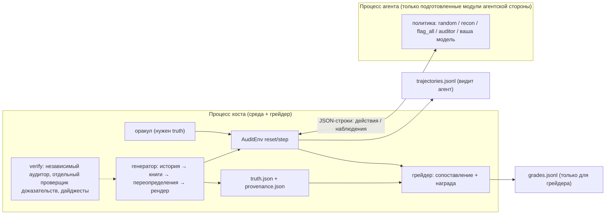

# auditgym

Воспроизводимая RL-среда для обучения и оценки агентов финансового аудита: синтетические компании, узкий
интерфейс инструментов расследования, ошибки с записанным причинным изменением и проверенным ключом ответов, а
также общая награда. Работает офлайн, только стандартная библиотека, Python 3.11 (CI также запускает 3.12 и 3.13 на ubuntu).

[English version](README.md) · [Дизайн-документ](docs/DESIGN.md) · [Отчёт проверки](runs/check/report.md) ·
[Кейс](docs/CASE.md) · [Демо-просмотрщик](viewer/index.html) (откройте файл в браузере, работает офлайн)

Фрагмент вывода на коммите `b15fa6b` (Windows 10, Python 3.11.4):

```text
$ python -m auditgym check
auditgym 0.2.0 check (offline, Python 3.11.4); episodes: public master string auditgym-check-v1
A. unit tests
fuzz: 3000 in-process + 300 piped, 0 invariant violations, 0 schema/env disagreements
  [PASS] unittest: 494 run, 483 passed, 11 skipped
B. committed train/dev episodes
  [PASS] train/t01_clean_small regenerates byte-identically
  ...
summary: A_unit_tests 1/1, B_committed_episodes 40/40, B_replay 10/10, C_data 22/22, C_reward 427/427, D_paired 133/133, E_leaks 3/3, F_contract 20/20 (656 named checks of 79 kinds)
PASS in 247 s; report: runs/check/report.md
```

> **Кратко.** Среда для обучения ИИ-аудитора: генератор синтетических компаний (история → документы →
> проводки), четыре типа ошибок с записанной причиной, два сценария взаимодействующих ошибок, чистые компании и
> правдоподобные отвлекающие случаи. Агент работает только через пять инструментов в отдельном процессе; грейдер
> считает награду `clip(2·F1 − 1 − 0.002·шаги)`. Ключ ответов проверяют независимый аудитор и отдельная проверка
> достаточности доказательств. Одна команда проверки: `python -m auditgym check` (см. Быстрый старт).

## Кейс → решение

| Требование кейса | Как это сделано в auditgym | Где |
|---|---|---|
| «Сначала построить непротиворечивую скрытую историю компании, затем документы, затем ошибки с записанным причинным изменением» | История, затем чистые книги, затем ошибки как переопределения проводок, которые заново проводит тот же движок; провенанс — точный диф записей с дайджестами чистого и итогового состояния | [history.py](auditgym/history.py), [books.py](auditgym/books.py), [inject.py](auditgym/inject.py), [render.py](auditgym/render.py) · [DESIGN §1](docs/DESIGN.md#1-generation-history-first-errors-last) |
| «Минимум четыре независимо настраиваемых типа» | Четыре типа (дубликат счёта, нераспределённый платёж, неверный курс пересчёта, неверный период), у каждого есть варианты; каждый тип можно запросить отдельно | [config.py](auditgym/config.py) · [DESIGN §3](docs/DESIGN.md#3-errors-variants-scenarios-distractors) |
| «Взаимодействующие ошибки. Два сценария» | `boundary_fx_payment` (частичное поступление в иностранной валюте на границе периода) и `fx_invoice_partial_allocation` (счёт с неверным курсом и частично нераспределённое поступление) | [inject.py](auditgym/inject.py) · [DESIGN §3](docs/DESIGN.md#3-errors-variants-scenarios-distractors) |
| «Чистые компании и правдоподобные корректные отвлекающие случаи» | Законные повторы, платежи частями и по нескольким счетам, недоплаты, переплата и возврат, документы на границе периода и с валютой в выходные, близнец с противоположным ответом; `check` требует ложного срабатывания на каждом отвлекающем случае | [history.py](auditgym/history.py), [splits.json](configs/splits.json), [check_battery.py](auditgym/check_battery.py) · [DESIGN §3](docs/DESIGN.md#3-errors-variants-scenarios-distractors), [§8](docs/DESIGN.md#8-reproducibility-and-paired-checks) |
| «Ключ ответов должен описывать реальное расхождение и доступные доказательства» | Независимый аудитор (только стандартная библиотека, собственная целочисленная арифметика курсов) воспроизводит ключ; отдельный проверщик доказательств заново выводит каждую находку из её набора доказательств; для `unallocated_payment` приведённый набор показывает открытый остаток счёта, а `verify` дополнительно проверяет по всем публичным записям, что никакое другое поступление не закрывало счёт и что набор содержит все строки 1100 счёта; `verify DIR` сверяет записанное изменение каждого внедрения с записями | [auditor.py](auditgym/auditor.py), [evidence_check.py](auditgym/evidence_check.py), [verify.py](auditgym/verify.py) · [DESIGN §7](docs/DESIGN.md#7-verification-of-data-and-answer-key) |
| «Ключ ответов нельзя угадать по поверхностным признакам» | 36 правил для документов и 5 правил для эпизодов измерены на 1000 сгенерированных эпизодах; ни одно правило для документов не достигает точности 0.24 (лучшее даёт 0.231 при базовой доле 0.027); ни одно правило для эпизодов не превосходит свою базовую долю более чем на 0.03 | [tells.py](auditgym/tells.py), [test_tells.py](tests/test_tells.py), [runs/tells/summary.md](runs/tells/summary.md) · [DESIGN §3](docs/DESIGN.md#3-errors-variants-scenarios-distractors) |
| «reset(seed, config) … step(action)», пять действий, страницы по 50 строк, 100 шагов | Контракт в стиле Gymnasium с JSON: четыре действия только для чтения и `submit`; схемы сверяются с окружением фаззером; секция `F_contract` запускает 20 именованных проверок контракта | [env.py](auditgym/env.py), [schemas/](schemas), [contract_battery.py](auditgym/contract_battery.py), [test_contract_fuzz.py](tests/test_contract_fuzz.py) · [DESIGN §4](docs/DESIGN.md#4-environment-contract) |
| «Грейдер работает вне процесса агента» | Политика работает в дочернем процессе и обменивается с хостом JSON-строками; в процесс попадает подготовленная копия модулей агентской стороны. Грейдер, оракул и генератор там не импортируются; образ запускает политику от uid 10002; в Windows дочерний процесс до загрузки любого кода политики понижает себя до Low integrity, поэтому не может читать память хоста (измерено) | [protocol.py](auditgym/protocol.py), [agent.py](auditgym/agent.py), [Dockerfile](Dockerfile) · [DESIGN §5](docs/DESIGN.md#5-isolation-and-leaks) |
| «Сопоставление … один к одному», «опубликовать код нормализации, правила допусков и правило разрешения ничьих» | Максимальное паросочетание Куна, опубликованная нормализация, алиасы ID (doc_id ↔ invoice_id/payment_id), допуск 2 минорные единицы | [matcher.py](auditgym/matcher.py) · [DESIGN §6](docs/DESIGN.md#6-matcher-and-reward) |
| «Терминальная награда = clip(2·F1 − 1 − 0.002·inspection_steps, −1, 1)» | Точные дроби; экспериментальная мягкая награда выводится в отдельных колонках и никогда не заменяет общую награду | [reward.py](auditgym/reward.py), [grader.py](auditgym/grader.py), [diagnostics.py](auditgym/diagnostics.py) · [DESIGN §6](docs/DESIGN.md#6-matcher-and-reward) |
| «Четыре базовых адаптера политик» | random, recon, flag_all и oracle (только на стороне грейдера), плюс silent и скриптованный аудитор; любой `module.path:ClassName` запускается с той же изоляцией | [policies/](auditgym/policies), [examples/custom_policy.py](examples/custom_policy.py) · [DESIGN §5](docs/DESIGN.md#5-isolation-and-leaks) |
| «Одинаковые seed, конфигурация, версия и действия должны воспроизводить …», парные проверки | Переносимый PRNG, арифметика на целых числах и `Decimal`, побайтовая регенерация, воспроизведение записанных действий, пять парных преобразований (перестановка, переотображение ID, перерисовка меток времени, переименование, сдвиг дат на 28 лет) | [rng.py](auditgym/rng.py), [transform.py](auditgym/transform.py), [check.py](auditgym/check.py) · [DESIGN §8](docs/DESIGN.md#8-reproducibility-and-paired-checks) |
| 10 обучающих (train) и 10 dev эпизодов, trajectories.jsonl | Сначала делятся исходные истории; dev — на отложенных режимах; записанные траектории регенерируются и сравниваются в CI | [episodes/](episodes), [runs/train_dev/trajectories.jsonl](runs/train_dev/trajectories.jsonl) · [DESIGN §8](docs/DESIGN.md#8-reproducibility-and-paired-checks) |
| Официальная проверка без сети, одной командой | `python -m auditgym check`; Dockerfile запускает ту же команду с `--network none`; оба запускаются в CI | [check.py](auditgym/check.py), [Dockerfile](Dockerfile), [рабочий процесс CI](.github/workflows/check.yml) · [DESIGN §13](docs/DESIGN.md#13-continuous-integration) |

## Быстрый старт

Ничего не нужно: ни ключей, ни сети, ни установки. Python 3.11:

```bash
python -m auditgym check
```

`check` печатает по одной строке на каждую именованную проверку, перезаписывает
[runs/check/report.md](runs/check/report.md) и `report.json` и завершается с кодом 0 только если прошли все проверки.

На коммите `b15fa6b` запускается **656 именованных проверок 79 видов** (вид — это одно свойство; большинство
проверок прогоняется на каждом эпизоде, к которому они применимы). Одна из них запускает **494 модульных теста**. Заголовок отчёта содержит штамп кода ([DESIGN §8](docs/DESIGN.md#8-reproducibility-and-paired-checks)). Измеренные прогоны (строка локального прогона и строки CI — на `b15fa6b`; прогон CI 44841936613, 494 теста, строки лога — в [runs/ci/44841936613.txt](runs/ci/44841936613.txt)):

| Где | Модульные тесты: прошли / пропущены | Результат `check` |
|---|---|---|
| Windows 10, Python 3.11.4 (локально, зафиксированный отчёт) | 483 / 11 | `PASS in 247 s` |
| CI windows-latest, Python 3.11 | 483 / 11 | `PASS in 158 s` |
| CI ubuntu, Python 3.11 / 3.12 / 3.13 | 471 / 23 | `PASS in` 117 / 104 / 87 s |
| CI macOS, Python 3.11 | 468 / 26 | `PASS in 79 s` |
| CI контейнер (`--network none`, 2 CPU, 4 ГБ); то же в строгом режиме | 476 / 18 | `PASS in 166 s`; строгий режим `PASS in 169 s` |
| CI контейнер, `--user 10001` | 470 / 24 | `PASS in 163 s` |
| CI контейнер, `--cap-drop ALL` | 468 / 26 | `PASS in 163 s` |
| CI контейнер, закрытый путь (смонтированный файл seeds, строгий режим) | не запускались | `PASS in 4 s` |
| CI контейнер, строгий режим с `--cap-drop ALL` | не запускались | код 2 с одной строкой `error:` |
| CI контейнер, своя политика рядом с ключом ответов при `--cap-drop ALL` | не запускались | код 2 с одной строкой `error: custom policy` |

Пропуски зависят от платформы и режима контейнера; список — в [DESIGN §13](docs/DESIGN.md#13-continuous-integration). Прогон CI 44841936613 на `b15fa6b` (494 теста) — последний, он зелёный во всех шести заданиях. Шаги контейнера с официальной проверкой, строгим режимом и закрытым путём печатают строку отчёта `Policy isolation: separate user (uid 10002).`, то есть отчёт, записанный в образе, показывает, что политика работала от отдельного пользователя.

Цитируемые строки лога сохранены в [runs/ci/44841936613.txt](runs/ci/44841936613.txt) (сделано [tools/ci_excerpt.py](tools/ci_excerpt.py)); результат каждого задания и шага — в [runs/ci/44841936613.jobs.json](runs/ci/44841936613.jobs.json). Значения `PASS in` — время самой проверки, задания целиком идут дольше. Задание с контейнером также запускает `python -m auditgym.redteam --parent` в трёх режимах (образ по умолчанию, `--user 10001`, `--cap-drop ALL`). Полный лог не записан в репозиторий.

```bash
python -m auditgym demo
```

`demo` запускает скриптованный аудитор и упрощённую сверку на одном эпизоде в изолированном процессе и печатает
каждый шаг и вердикт грейдера.

```bash
python -m auditgym viewer
```

`viewer` пересобирает [viewer/index.html](viewer/index.html), офлайн-страницу для людей (английский или русский
язык, тёмная или светлая тема).

Контейнер, офлайн после сборки (CI собирает и запускает его с теми же флагами плюс `--pids-limit 512`):

```bash
docker build -t auditgym .
docker run --rm --network none --cpus 2 --memory 4g auditgym
```

Отчёт пишется внутри образа по пути `/app/runs/check/report.md`. Команды копирования (именованный контейнер,
`docker cp`, `docker rm`) локально не запускались; CI выполняет этот шаблон с `--name official` и `--pids-limit 512`
([DESIGN §5](docs/DESIGN.md#5-isolation-and-leaks), [§13](docs/DESIGN.md#13-continuous-integration)).

## Две минуты на просмотр

1. Запустите `python -m auditgym demo`. На эпизоде `ep_5a9a09e389264d0c` аудитор читает 25 страниц через
   `list_records`, на шаге 26 отправляет 5 находок, и грейдер сообщает награду **+0.950** при TP 5, FP 0, FN 0.
   Упрощённая сверка на том же эпизоде получает **−0.839** при TP 1, FP 13, FN 4.
2. Откройте [viewer/index.html](viewer/index.html) и в боковой панели выберите `d08_both_interacting_kzt`, чтобы
   увидеть ключ ответов (вид грейдера). Нажмите на ошибку, чтобы увидеть её документы и строки журнала; откройте
   **Graph** для всей сети доказательств, затем откройте записанный прогон и пошагово проиграйте его
   ([снимок экрана](docs/media/viewer_run.png)).

   
3. Запустите `python -m auditgym verify episodes/dev/d08_both_interacting_kzt`: девять именованных проверок, все
   `PASS`, затем объявленные расхождения.
4. Прочитайте [runs/check/report.md](runs/check/report.md): базовые показатели на контрольном наборе hidden-like.

## Для жюри

Проверка группирует именованные проверки по пяти группам рубрики. Группировка задана `RUBRIC` в
[auditgym/check.py](auditgym/check.py); ключи секций в `report.json` не изменились. В каждой строке указаны секции
проверки, которые запускаются в `python -m auditgym check`, модульные тесты, которые покрывают то же утверждение, и
команда, которую можно выполнить самостоятельно. Заголовок отчёта показывает покрытие (656 именованных проверок 79
видов) и то, работала ли политика от отдельного пользователя.

| Критерий рубрики (баллы) | Секции проверки в `check` | Основные модульные тесты | Как проверить самостоятельно |
|---|---|---|---|
| 1. Контракт и изоляция (25) | `F_contract`: 20 именованных проверок контракта в процессе (ключи reset и наблюдения, страницы по 50 строк, ключи записей по порядку, один и тот же курсор дважды и снова после нового reset, неизвестный ID и действие, лимиты калькулятора, submit и завершённые эпизоды, усечение на шаге 100 и не раньше, лимит времени при замороженных часах, eval скрывает награду, −1 за некорректные и чужие отправки, схема наблюдения, фаззинг из 300 действий с seed); `E_leaks`: 2219 наблюдений базовых политик hidden-like этого прогона содержат только разрешённые поля и не содержат маркеров ключа ответов; траектории оракула никогда не публикуются | `test_contract_battery`, `test_env`, `test_schemas`, `test_contract_fuzz` (фаззер с seed, в процессе и через канал), `test_isolation`, `test_noninterference` (пять политик, перемешанные или подменённые ключи ответов, побайтово одинаковые наблюдения), `test_redteam`, `test_linux_hardening` (защита хоста в Linux), `test_windows_hardening` (дочерний процесс Windows с Low integrity не может открыть хост; контроль на уровне хоста может), `test_entrypoints` (обе точки входа защищают хост до чтения `--secret-env`), `test_container` (внутри образа, в CI не должен пропускаться) | `python -m auditgym check`; `python -m auditgym.redteam` (враждебные пробы: потоки лишних строк, зависания, процессы-внуки; в `check` не входит); `python -m auditgym.redteam --parent` (что политика того же пользователя читает о своём родителе); `AUDITGYM_REQUIRE_AGENT_USER=1 python -m auditgym check` завершается кодом 2 вне образа (строгая изоляция) |
| 2. Данные и ключ ответов (25) | `B_committed_episodes`: все 20 закоммиченных эпизодов регенерируются побайтово и проходят верификацию; `C_data`: контрольный набор hidden-like проходит верификацию, с долями пересэмплирования | `test_verify` (режим каталога проверяет сохранённые дайджесты, неверный провенанс, перенацеленные внедрения, записанное изменение каждого внедрения по записям и то, что никакое другое поступление не закрывало счёт нераспределённого платежа и что набор содержит все строки 1100 счёта; аудитор не импортирует код генератора, а его арифметика совпадает с `money.py`), `test_generator`, `test_tells` (правила-признаки), `test_regen_examples`, `test_cli` (неверный `truth.json` даёт код 2) | `python -m auditgym verify episodes/dev/d08_both_interacting_kzt`; `python -m auditgym build-splits`, затем `git diff --exit-code -- episodes`; `python -m auditgym.tells --n 1000 --master auditgym-tells-v1 --out runs/tells` (около 140–160 с; побайтово перезаписывает [runs/tells/summary.md](runs/tells/summary.md)) |
| 3. Надёжность награды (25) | `C_reward`: оракул получает 1.0, «отметить всё» и случайный исследователь набирают мало, скриптованный аудитор закрывает каждый эпизод и побеждает молчаливую базовую политику; батарея атак на каждом эпизоде с ошибкой (type shotgun, amount ladder, junk padding, evidence stuffing, wrong real ID и одно ложное обвинение на каждый отвлекающий случай, построенное из реальных записей, которое стоит ровно одного ложного срабатывания) и на каждом чистом эпизоде (те же обвинения получают −1, ниже молчания); каждое обвинение должно совпасть с подставным ключом (decoy), который утверждает ровно то же, и не совпасть ни с одним ключом, отличающимся одним критерием | `test_reward`, `test_matcher` (сопоставление Куна, допуск, алиасы, неверный тип, некорректные структуры), `test_check_battery` (те же конструкторы дают истинные срабатывания на реальных проблемах; сопоставитель, игнорирующий один критерий, не проходит), `test_diagnostics` | `python -m auditgym grade --episode episodes/train/t03_duplicate --findings examples/findings_t03_correct.json --steps 14` (награда 0.972) |
| 4. Воспроизводимость (15) | `B_replay`: записанные действия, воспроизведённые в новой среде, дают наблюдения, равные в JSON, и ту же терминальную награду; `D_paired`: одинаковые seed и конфигурация дают одинаковые записи и ключ ответов; одинаковые действия дают одинаковые переходы; прогоны в изоляции и в процессе совпадают; ответ оракула и награда сохраняются при перестановке, переотображении ID, перерисовке меток времени, переименовании компании и формулировок счетов и сдвиге дат на 28 лет (+28, иначе −28, иначе пропуск) | `test_isolation`, `test_generator` (регенерация при двух значениях `PYTHONHASHSEED`), `test_contract_fuzz` (закоммиченные схемы побайтово равны сгенерированным), `test_transform_rename`, `test_transform_shift` (дни недели, високосные дни и даты правил DST сохраняются при сдвиге; даты вне 1901-03-01 .. 2099-12-31 отклоняются) | `python -m auditgym transform --in DIR --out DIR2 --permute-seed 1 --remap-seed 2 --ts-repr utc --rename-seed 3 --shift-years 28`, затем `python -m auditgym verify DIR2`; CI сравнивает эпизоды, схемы и траектории после регенерации |
| 5. Инженерия и объяснение (10) | `A_unit_tests`: весь набор модульных тестов, с числом запущенных, пройденных и пропущенных; внутри него `test_mutation_smoke` падает, если записанный прогон мутаций больше не совпадает со списком мутантов или модуль тестов изменился после записи | все `tests/test_*.py`, `test_cli`, `test_timeutil`, `test_calculator`; [runs/mutation/summary.md](runs/mutation/summary.md): 126 из 126 однострочных мутантов ядра убиты: 82 убиты модулями тестов, указанными для них, а остальные 44 проходят их и убиты `test_mutation_survivors`, написанным для них | `python -m unittest discover -s tests -t .`; `python tools/mutation_smoke.py OUT_DIR --jobs 4` (около 7 мин); матрица CI: ubuntu (Python 3.11, 3.12, 3.13), windows и macOS (Python 3.11) |

Ограничения этой карты: контрольный набор hidden-like и закрытый путь описаны в разделах
[Ограничения](#ограничения) и [Для организаторов](#для-организаторов).

## Для организаторов

Эпизоды организаторов передаются файлом seeds; закрытые прогоны никогда не пишут в `runs/check`.

```bash
# официальная проверка на вашем закрытом наборе; секрет хоста читается из переменной окружения
export AUDITGYM_SECRET='<your secret>'
python -m auditgym check --seeds-file FILE --secret-env AUDITGYM_SECRET --out DIR
```

- **Запускайте закрытые эпизоды внутри контейнера.** Вне контейнера политика работает от вашего пользователя ОС и может
  читать всё, что он может читать. Монтируйте файлы seeds и каталоги эпизодов под `/app`; команды и измеренные
  ограничения — в [DESIGN §5](docs/DESIGN.md#5-isolation-and-leaks).
- `FILE` — JSON `{"split": "<label>", "episodes": [{"name": "...", "seed": <int>, "config": {...}}]}`; образец: [examples/closed_seeds_example.json](examples/closed_seeds_example.json). Проверки, которым нужны эпизоды с ошибками или чистые эпизоды, которых нет в файле, помечаются `SKIP`. Вывод по умолчанию — `runs/check_closed`; `--keep-runs` дополнительно записывает закрытый ключ ответов в траектории и оценки.
- **Отклонённые записи.** Запись, которую генератор отклоняет (`ConfigError` или `GenerationError`, например `boundary_fx_payment` с `"timezone": "UTC"`), — строка `SKIP` в `C_data`, `[SKIP] <name>: generated from its seed and config - refused, ConfigError: <reason>`; остальные записи проверяются, код выхода 0, если прошли все выполненные проверки. `run --seeds-file` печатает `WARNING: entry <name> refused, <reason>`, пишет запись в `meta.json` в `refused_entries` и запускает остальные. Только файл, в котором нельзя сгенерировать ни одной записи, завершается кодом 2 с одной строкой `error:`.
- Используйте 63-битные seed и секрет. `run --seeds-file` и `check --seeds-file` без `--secret-env` завершаются кодом 2 с одной строкой `error:`, потому что любой, кто знает публичные записи, восстановит малый seed из `episode_id`. `--no-secret` — явное согласие работать без секрета для seed, публичных по замыслу: запуск продолжается, сохраняет `WARNING` о seed в 40 бит и меньше и записывает это согласие (`"no_secret": true` в `meta.json` для `run`; заголовок отчёта `check` читается `secret: no, --no-secret`). `--no-secret` вместе с `--secret-env` или без `--seeds-file` завершается кодом 2. Закоммиченный пример проходит с ним: `python -m auditgym check --seeds-file examples/closed_seeds_example.json --no-secret` (97 именованных проверок 76 видов).
- Строгая изоляция (по желанию): `AUDITGYM_REQUIRE_AGENT_USER=1` заставляет `check`, `run`, `demo`, `viewer` и
  `budget` завершаться кодом 2 с одной строкой `error:`, если политику нельзя запустить от отдельного пользователя
  ([DESIGN §5](docs/DESIGN.md#5-isolation-and-leaks)).
- CI запускает закрытый путь в контейнере так, как это сделал бы организатор: строгий режим, смонтированный файл
  seeds, секрет в переменной окружения ([DESIGN §13](docs/DESIGN.md#13-continuous-integration)).
- `python tools/organizer_sweep.py DIR [CHUNK] [--record]` запускает эту закрытую проверку на наборе stress и на одной граничной конфигурации для каждого крайнего значения, которое принимает `config.py` (423 конфигурации: 418 выполнимых и 5 невыполнимых, у каждой невыполнимой — ConfigError с причиной), и батарею контракта на каждом выполнимом эпизоде. На коде коммита `b15fa6b` прошли все 7 порций (шесть по 60 эпизодов, одна из 58). [runs/sweep/summary.md](runs/sweep/summary.md) несёт штамп кода отчёта проверки (`1265d019…`); [DESIGN §8](docs/DESIGN.md#8-reproducibility-and-paired-checks).
- Ваша политика, класс с `act(observation, reward, info)`, запускается в изолированном дочернем процессе: `python -m auditgym run --episodes DIR_OR_FOLDER --policies yourpkg.module:YourPolicy --out runs/yours` (добавьте `--policy-path DIR` для кода вне этого репозитория; он действует только для политик `module:Class`, а встроенная политика никогда не получает этот каталог в путь импорта). Вне закоммиченных открытых эпизодов (`episodes/train`, `episodes/dev`) для этого нужен официальный образ (права по умолчанию) или `--allow-same-user`. Оракул там не допускается, а класс, которого нет, падает в дочернем процессе с кодом 3. В Windows политика работает с Low integrity и может писать только в свой рабочий каталог, TEMP/TMP и каталоги с меткой Low; любая другая запись завершает эпизод как ошибку агента ([DESIGN §5](docs/DESIGN.md#5-isolation-and-leaks)).
- **Свои политики на закрытых данных.** `run` с политикой `module:Class` и файлом seeds или `--secret-env` не запускается (код 2, одна строка `error: custom policy ...`), если политика будет работать от пользователя хоста: без отдельного пользователя политики или с `--in-process`. Хост считается способным переключиться на пользователя политики, только если есть учётная запись агента, `/proc` доступен для перечисления и есть права CAP_CHOWN, CAP_SETGID и CAP_SETUID, поэтому root под `docker --cap-drop ALL` считается неспособным (встроенные политики там по-прежнему переходят на пользователя хоста с одной строкой предупреждения). `--allow-same-user` разрешает запуск от пользователя хоста, и `meta.json` записывает `"allow_same_user": true`. В официальном образе политика работает от отдельного пользователя, и флаг не нужен; `AUDITGYM_REQUIRE_AGENT_USER=1` по-прежнему отклоняет любой возврат к тому же пользователю. `check --seeds-file` запускает только встроенные политики и не меняется.
- **Ключи ответов на диске.** Если политика `module:Class` будет работать от пользователя хоста (без отдельного пользователя политики или с `--in-process`) на каталоге `--episodes`, в котором есть `grader/` и который не входит в закоммиченные эпизоды из `episodes/index.json` (открытые эпизоды train и dev, их ключи ответов публичны по замыслу; новая папка под `episodes/train` или `episodes/dev` не освобождается), `run` завершается кодом 2 с одной строкой `error: custom policy <name> would run as the host's user next to answer keys (<dir>/grader): it can read them; <advice>, or pass --allow-same-user to accept that (recorded in meta.json)` и ничего не пишет. `<advice>` — "drop --in-process" на хосте, который может переключиться на пользователя политики, и "run it in the official image (separate policy user)" в остальных случаях. С `--allow-same-user` запуск продолжается с одной строкой `WARNING`, а `meta.json` записывает `"allow_same_user": true`. Закоммиченные открытые разбиения флага не требуют, поэтому `examples/custom_policy.py` на `episodes/dev` не меняется.
- `examples/hostile/policies.py` показывает режимы сбоя, которые обрабатывает обвязка (код выхода 3 для падающей
  политики).
- Генерация, проверка и копирование эпизодов с парными преобразованиями: см. таблицу [Команды](#команды). Пример:
  `python -m auditgym generate --seed 123 --config examples/config_mixed.json --out DIR` создаёт один эпизод.
- Коды выхода: 0 — все проверки прошли; 1 — проверка или верификация не прошла; 2 — некорректный ввод (одна строка
  `error:`); 3 — прогон завершился, но агент завершился с ошибкой
  ([DESIGN §8](docs/DESIGN.md#run-outputs-and-exit-codes)).

## Архитектура



- Генератор: одна компания и один отчётный период на эпизод; размеры, валюты, часовые пояса и диапазон числа счетов
  описаны в [DESIGN §1](docs/DESIGN.md#1-generation-history-first-errors-last).
- Среда: пять инструментов (четыре только для чтения и `submit`), страницы по 50 строк, стабильные курсоры (`F_contract` повторяет один курсор, в том числе после нового reset), бюджет 100 шагов и лимит 60 с;
  ограниченные ошибки, которые расходуют шаг. Пример Python API — в [DESIGN §4](docs/DESIGN.md#4-environment-contract).
- Грейдер: опубликованная нормализация, сопоставление один к одному, общая награда и экспериментальная мягкая награда
  ([DESIGN §6](docs/DESIGN.md#6-matcher-and-reward)).
- Верификация: девять именованных проверок на эпизод; генератор пересэмплирует любого кандидата, который не проходит
  одну из них ([DESIGN §7](docs/DESIGN.md#7-verification-of-data-and-answer-key)).
- Изоляция: политика работает в дочернем процессе, который видит только наблюдения
  ([DESIGN §5](docs/DESIGN.md#5-isolation-and-leaks)).

## Оценка

Каждая таблица ниже скопирована из сгенерированного файла; команда, которая её регенерирует, указана под ней.
Скриптованный аудитор — это код верификатора, прогнанный через инструменты: доказательство разрешимости, а не
обученная политика, поэтому его числа не говорят о возможностях агента.

### Контрольный набор hidden-like (20 эпизодов)

Из [runs/check/report.md](runs/check/report.md). Эти эпизоды построены из публичной мастер-строки
`auditgym-check-v1`, поэтому они проверяют конвейер. Режим оценки, каждый агент в изолированном процессе.

| Политика | Награда | Мягкая награда | Макро P | Макро R | Микро P | Микро R | F1 | Шаги | Доля закрытых | FP на чистых |
|---|---|---|---|---|---|---|---|---|---|---|
| оракул (на стороне грейдера) | 1.000 | 1.000 | 0.75 | 0.75 | 1.00 | 1.00 | 1.000 | 0.0 | 1.00 | 0 |
| скриптованный аудитор (код верификатора) | 0.936 | 0.936 | 0.75 | 0.75 | 1.00 | 1.00 | 1.000 | 32.0 | 1.00 | 0 |
| упрощённая сверка (recon) | −0.589 | −0.589 | 0.15 | 0.54 | 0.16 | 0.75 | 0.231 | 32.0 | 0.00 | 40 |
| случайный исследователь | −0.613 | −0.613 | 0.00 | 0.00 | 0.00 | 0.00 | 0.200 | 34.0 | 0.20 | 2 |
| отметить всё (flag everything) | −1.000 | −0.995 | 0.00 | 0.00 | 0.00 | 0.00 | 0.000 | 3.0 | 0.00 | 150 |
| молчаливая (сразу ничего не отправляет) | −0.500 | −0.500 | 0.00 | 0.00 | n/a | 0.00 | 0.250 | 0.0 | 0.25 | 0 |

Пустой ответ здесь получает −0.500: +1 на 5 чистых эпизодах и −1 на 15 эпизодах с ошибками. Упрощённая сверка и
случайный исследователь получают меньше него; лучше только скриптованный аудитор и оракул. Проверка утверждает, что
аудитор > молчаливой, и не утверждает, что упрощённая сверка её превосходит. Регенерация: `python -m auditgym check`.

### Открытые наборы (10 обучающих, 10 dev)

Из [runs/train_dev/summary.md](runs/train_dev/summary.md) (`python -m auditgym run --episodes episodes/train episodes/dev --policies random,recon,flag_all,oracle,auditor,silent --out runs/train_dev`).
Мягкая награда — экспериментальная; считается общая награда. Макро P и R усредняются по эпизодам, а чистый эпизод
считается как 0, поэтому макро P/R оракула равны 0.7 (обучающие) и 0.8 (dev). Микро P и микро R объединяют все эпизоды;
их и следует читать.

| Набор | Политика | Награда | Мягкая награда | Макро P | Макро R | Микро P | Микро R | F1 | Шаги | Доля закрытых | FP на чистых |
|---|---|---|---|---|---|---|---|---|---|---|---|
| обучающий | скриптованный аудитор | 0.971 | 0.971 | 0.70 | 0.70 | 1.00 | 1.00 | 1.000 | 14.3 | 1.0 | 0 |
| обучающий | упрощённая сверка | −0.690 | −0.690 | 0.10 | 0.50 | 0.08 | 0.60 | 0.161 | 14.3 | 0.0 | 26 |
| обучающий | случайный исследователь | −0.613 | −0.613 | 0.00 | 0.00 | 0.00 | 0.00 | 0.200 | 19.3 | 0.2 | 1 |
| обучающий | отметить всё | −1.000 | −1.000 | 0.00 | 0.00 | 0.00 | 0.00 | 0.000 | 3.0 | 0.0 | 90 |
| обучающий | оракул | 1.000 | 1.000 | 0.70 | 0.70 | 1.00 | 1.00 | 1.000 | 0.0 | 1.0 | 0 |
| обучающий | молчаливая | −0.400 | −0.400 | 0.00 | 0.00 | n/a | 0.00 | 0.300 | 0.0 | 0.3 | 0 |
| dev | скриптованный аудитор | 0.943 | 0.943 | 0.80 | 0.80 | 1.00 | 1.00 | 1.000 | 28.7 | 1.0 | 0 |
| dev | упрощённая сверка | −0.689 | −0.689 | 0.12 | 0.45 | 0.14 | 0.57 | 0.178 | 28.7 | 0.0 | 5 |
| dev | случайный исследователь | −1.000 | −1.000 | 0.00 | 0.00 | 0.00 | 0.00 | 0.000 | 18.9 | 0.0 | 5 |
| dev | отметить всё | −1.000 | −0.992 | 0.00 | 0.00 | 0.00 | 0.00 | 0.000 | 3.0 | 0.0 | 60 |
| dev | оракул | 1.000 | 1.000 | 0.80 | 0.80 | 1.00 | 1.00 | 1.000 | 0.0 | 1.0 | 0 |
| dev | молчаливая | −0.600 | −0.600 | 0.00 | 0.00 | n/a | 0.00 | 0.200 | 0.0 | 0.2 | 0 |

На dev все промахи упрощённой сверки — `not_flagged`: она читает доказательства, но сравнивает даты так, как они
записаны, а не во времени компании. Полнота по типам, причины промахов остальных политик и изменение сверки после
удаления подсказок в данных — в [DESIGN §9](docs/DESIGN.md#9-measured-results).

### Бюджет действий

Из [runs/budget/summary.md](runs/budget/summary.md) (набор dev, скриптованный аудитор и упрощённая сверка, изоляция,
режим оценки). Команда: `python -m auditgym budget`.

| Бюджет (шаги) | Награда аудитора | F1 аудитора | Доля закрытых аудитором | Награда сверки | F1 сверки |
|---|---|---|---|---|---|
| 20 | −0.083 | 0.472 | 0.2 | −0.885 | 0.063 |
| 50 | 0.943 | 1.000 | 1.0 | −0.689 | 0.178 |
| 100 | 0.943 | 1.000 | 1.0 | −0.689 | 0.178 |

Более крупный набор доказательств unallocated стоит сверке одного истинного срабатывания на d09 при 20 шагах, потому что её урезанное чтение не увидело строки 1100 счёта. Награды при 50 и 100 шагах и в `runs/train_dev` не изменились.

### Стресс-тест генератора

Из [runs/stress/report.md](runs/stress/report.md). Команда: `python -m auditgym stress --n 300`. Счётчики
воспроизводимы; времена и память — нет.

| Набор | Конфигураций | Сгенерировано и проверено | Не прошли проверку | Невыполнимо (ConfigError) | С первой попытки | С повторных попыток | Макс. время генерации | Пиковая память |
|---|---|---|---|---|---|---|---|---|
| случайный | 300 | 299 | 0 | 1 | 276 | 23 | 0.44 s | 6.0 MB |
| экстремальный | 17 | 17 | 0 | 0 | 14 | 3 | 0.23 s | 5.6 MB |

Единственный невыполнимый запрос требует часовой пояс `UTC`, у которого никогда нет смещения от UTC. Все 17 экстремальных конфигураций проходят проверку, и скриптованный аудитор закрывает их за 11–47 шагов. Состав
обоих наборов: [DESIGN §9](docs/DESIGN.md#9-measured-results).

## Команды

| Команда | Назначение |
|---|---|
| `python -m auditgym check` | Единая офлайн-проверка (именованные проверки, группы рубрики, [отчёт](runs/check/report.md)) |
| `python -m auditgym check --seeds-file FILE --secret-env VAR --out DIR` | Та же батарея на эпизодах организаторов (или `--no-secret` для публичного файла-примера); никогда не пишет в `runs/check` |
| `python -m auditgym build-splits` | Регенерировать `episodes/train` и `episodes/dev` из [configs/splits.json](configs/splits.json) |
| `python -m auditgym generate --seed N --config FILE --out DIR [--secret-env VAR]` | Один каталог эпизода |
| `python -m auditgym verify DIR` | Именованные проверки бухгалтерии и ключа ответов для каталога эпизода |
| `python -m auditgym run --episodes DIRS --policies P1,P2 --out DIR` | Базовые прогоны на каталогах эпизодов (`--mode eval\|train`, `--max-steps N`, `--policy-seed N`) |
| `python -m auditgym run --seeds-file FILE (--secret-env VAR \| --no-secret) --policies ... --out DIR` | Закрытые эпизоды, сгенерированные в памяти |
| `python -m auditgym run ... --policies module:Class [--policy-path DIR] [--allow-same-user]` | Ваша политика в изолированном дочернем процессе; `--allow-same-user` разрешает ей работать от пользователя хоста на закрытых данных (файл seeds, `--secret-env`) и рядом с ключом ответов на диске (каталог `--episodes` с `grader/` вне закоммиченных открытых эпизодов); `--policy-path` действует только для `module:Class` (см. [Для организаторов](#для-организаторов)) |
| `python -m auditgym grade --episode DIR --findings FILE --steps N` | Оценить файл находок |
| `python -m auditgym transform --in DIR --out DIR2 --permute-seed N --remap-seed N --ts-repr utc --rename-seed N --shift-years 28` | Копия эпизода для парных проверок (любое подмножество флагов; сдвиг — ненулевое кратное 28 лет) |
| `python -m auditgym.tells --n 1000 --master auditgym-tells-v1 --out runs/tells` | Измерение правил-признаков на сгенерированных эпизодах, пишет [runs/tells/summary.md](runs/tells/summary.md) |
| `python tools/organizer_sweep.py OUT_DIR [CHUNK] [--record]` | Закрытая проверка на наборах stress и граничных конфигураций; `--record` пишет [runs/sweep/summary.md](runs/sweep/summary.md) |
| `python tools/mutation_smoke.py OUT_DIR [--record] [--jobs N]` | Однострочные мутанты ядра, каждый в свежей копии репозитория; `--record` пишет [runs/mutation/summary.md](runs/mutation/summary.md) |
| `python -m auditgym stress --n 300` | Стресс-прогон генератора, пишет [runs/stress/report.md](runs/stress/report.md) |
| `python -m auditgym budget` | Перебор бюджета действий, пишет [runs/budget/summary.md](runs/budget/summary.md) |
| `python -m auditgym demo` | Аудитор и сверка на одном эпизоде, пошагово |
| `python -m auditgym viewer` | Пересобрать [viewer/index.html](viewer/index.html) |
| `python -m auditgym schemas` | Записать JSON-схемы в [schemas/](schemas) |
| `python -m auditgym.redteam` | Пробы враждебных политик (потоки лишних строк, зависания, процессы-внуки); не входит в `check` |
| `python -m auditgym.redteam --parent` | Только измерение видимости родителя: командную строку читает обычный дочерний процесс, окружение хоста — политика, запущенная через обвязку |
| `python -m unittest discover -s tests -t .` | Набор модульных тестов (те же тесты, что `check` запускает одной проверкой) |

Поля траекторий, версии в `meta.json` и правила кодов выхода: [DESIGN §8](docs/DESIGN.md#run-outputs-and-exit-codes).

## Структура репозитория

```
auditgym/          среда, генератор, грейдер, верификатор, проверщик доказательств, политики, CLI
  policies/        random, recon, flag_all, oracle (только на стороне грейдера), auditor, silent
  viewer/          офлайн-шаблон просмотрщика и его сборщик
configs/           splits.json (seed и конфигурации обучающих и dev эпизодов, config_version 1)
episodes/          train/ и dev/: записи public/ плюс ключ ответов и провенанс в grader/
runs/              check/ (report.md и report.json в репозитории; grades.jsonl, trajectories.jsonl и
                   unittest.log пишет локальный прогон, git их игнорирует), check_closed/ (прогоны организаторов,
                   git игнорирует), train_dev/, stress/, budget/, tells/, sweep/ (прогон организатора),
                   mutation/ (прогон мутаций), ci/ (выдержки из цитируемых логов CI)
tools/             ci_excerpt.py (сохраняет цитируемые строки лога CI), organizer_sweep.py (закрытый путь в масштабе),
                   mutation_smoke.py (прогон мутаций по ядру)
schemas/           JSON-схемы: записи, действия, наблюдения, находки, truth, policy, provenance, траектории
tests/             наборы unittest
docs/              CASE.md, DESIGN.md, TASKS.md, PLAN.md (исторический), media/, design/ (статические макеты, не пересобираются)
examples/          примеры конфигураций и находок, пользовательская политика, враждебные политики для проб
.github/workflows/ CI: check на ubuntu (Python 3.11, 3.12, 3.13), windows и macOS (3.11); сборка и запуск контейнера
```

Все компании, люди, счета, документы, курсы валют и суммы синтетические. Реальные финансовые данные, платежи и
персональные данные не используются.

## Ограничения

Каждое ограничение указано один раз; в связанном разделе DESIGN есть подробности.

- **Платформы.** Локальные прогоны — Windows 10 с Python 3.11.4; CI — ubuntu с Python 3.11, 3.12 и 3.13, windows и macOS с Python 3.11. `pyproject.toml` задаёт `requires-python` как `>=3.11,<3.14`, поэтому Python 3.14
  не проверялся ([§10](docs/DESIGN.md#10-limitations)).
- **Контейнер.** Образ собирается и запускается в CI с `--network none --cpus 2 --memory 4g --pids-limit 512`.
  `--user 10001` и `--cap-drop ALL` переводят политику на того же пользователя, что и хост, с одной строкой
  предупреждения; `AUDITGYM_REQUIRE_AGENT_USER=1` превращает этот переход в код выхода 2
  ([§5](docs/DESIGN.md#5-isolation-and-leaks)).
- **Изоляция — это граница процесса, а не песочница.** Вне контейнера дочерний процесс от того же пользователя может читать файлы, пути к которым угадывает, и командную строку родителя; в Windows он до загрузки любого кода политики понижает себя до Low integrity и не может читать память хоста (измерено), а в образе чтение блокирует отдельный uid. `AUDITGYM_REQUIRE_AGENT_USER=1` отклоняет любой возврат к тому же пользователю. Остаточные риски и измерения: [§5](docs/DESIGN.md#5-isolation-and-leaks).
- **Невмешательство (noninterference)** измеряется повтором; время не покрывается, потому что лимит времени входит в
  контракт ([§5](docs/DESIGN.md#5-isolation-and-leaks)).
- **Seed.** Генератор открыт. Без секрета хоста и при угаданной конфигурации малый seed можно восстановить из
  `episode_id` и регенерировать ключ ответов; публичные записи всё равно позволяют перебрать малые seed. Это закрыто
  частично: `run --seeds-file` и `check --seeds-file` отклоняют файл seeds без `--secret-env`, если не указан `--no-secret`, а `AuditEnv(mode="eval")` выбрасывает `ValueError`, когда сгенерировал бы эпизод из seed в 40 бит и меньше без секрета (`allow_weak_seed=True` снимает это для seed, публичных по замыслу). Seed больше 40 бит без секрета или любой seed при известном секрете по-прежнему может регенерировать любой, у кого есть конфигурация. Используйте
  63-битные seed и `--secret-env` ([§10](docs/DESIGN.md#10-limitations)).
- **Контрольный набор hidden-like.** Эпизоды в `check` построены из публичной мастер-строки `auditgym-check-v1`: они
  проверяют конвейер, а не секретность ([§10](docs/DESIGN.md#10-limitations)).
- **Скриптованный аудитор.** Это код верификатора, прогнанный через инструменты; его идеальный F1 — результат
  разрешимости, а не результат агента ([§10](docs/DESIGN.md#10-limitations)).
- **Набивка доказательств.** Лишние ID доказательств до лимита в 10 ID бесплатны по опубликованному правилу надмножества;
  батарея проверяет, что набивка остаётся истинным срабатыванием ([§10](docs/DESIGN.md#10-limitations)).
- **Сдвиг дат.** Парный сдвиг дат переносит каждый год на ненулевое кратное 28 — период, после которого дни недели и високосные годы повторяются. Он применим, только если все даты лежат в 1901-03-01 .. 2099-12-31, а год периода после сдвига — в 2000 .. 2100, поэтому период 2100 года не сдвигается никогда; `check` использует +28, при неудаче берёт −28 и записывает пропуск, если не подходит ни один ([§8](docs/DESIGN.md#8-reproducibility-and-paired-checks)).
- **Доказательства для unallocated_payment.** Приведённый набор (платёж, счёт, строка 2900, все строки 1100 счёта и для счёта в иностранной валюте ещё банковская строка платежа) показывает открытый остаток; `verify` проверяет по всем публичным строкам, что набор полон и что никакое другое поступление не закрывало счёт. Поступление в иностранной валюте сравнивается с суммой документа, потому что строки несут только суммы в базовой валюте. Закупочные случаи unallocated_payment не генерируются ([§7](docs/DESIGN.md#7-verification-of-data-and-answer-key), [§10](docs/DESIGN.md#10-limitations)).
- **Выполнимость boundary_fx_payment.** С вариантами по умолчанию сценарий размещается в любом месяце 2025–2027. Отклоняется фиксированный пояс с нулевым смещением от UTC на границе (`"timezone": "UTC"`), а также месяц, где на границе у ошибки `utc_date` нет суммы, если в `variants.wrong_fx_rate` нет ни `stale_rate`, ни `transposed` (11 месяцев с положительным или не заданным смещением, 17 — с отрицательным; [§9](docs/DESIGN.md#9-measured-results)).
- **DST и отдельные ошибки периода.** Отдельная ошибка `utc_wall_clock` всё ещё может быть проведена внутри часа перевода часов (окончание летнего времени) в Нью-Йорке в конце октября, когда 1 ноября — воскресенье; сценарий границы этого больше не делает ([§10](docs/DESIGN.md#10-limitations)).
- **Число счетов.** Всего 1 651 счёт или больше — ConfigError сразу. От примерно 900 счетов продаж до этого предела
  генерация падает после 16 попыток с кодом 2 и причиной `budget_feasible` ([§1](docs/DESIGN.md#1-generation-history-first-errors-last)).
- **Дубликаты только у закупок.** `duplicate_invoice` внедряется только в счета закупки; законные повторы и близнец тоже
  счета закупки, поэтому политика может научиться искать дубликаты только среди закупок ([§3](docs/DESIGN.md#3-errors-variants-scenarios-distractors)).
- **Признаки-подсказки** измерены только для записанных правил. Лучшее правило для документов примерно в восемь раз выше
  своей базовой доли, в основном на счетах-близнецах, которым всё равно нужны доказательства. Признак, который никто не
  перечислил, всё равно может давать утечку ([§3](docs/DESIGN.md#3-errors-variants-scenarios-distractors)).
- **Проверка каталога.** `verify DIR` сверяет записанное изменение каждого внедрения с записями, но всё же принимает некоторые изменённые копии (другой `provenance.seed`, укороченный список отвлекающих случаев, подменённый вид отвлекающего случая, вариант `wrong_period`, сценарий или вариант в `truth.json`); для закоммиченных эпизодов `check` ловит эти правки регенерацией. Испорченный курс в `fx.csv`, например `1e99999999` или `1e9999_9999`, даёт строки `FAIL` в течение секунды, без traceback, как и запись счёта или платежа без поля ID или с ID не в виде текста ([§7](docs/DESIGN.md#7-verification-of-data-and-answer-key)).
- **Модель учёта.** Намеренно простая: журнал в базовой валюте, платежи в валюте счёта, без налогов, кредит-нот и
  расчётов между валютами; одиннадцать встроенных часовых поясов вместо базы IANA ([§10](docs/DESIGN.md#10-limitations)).
- **ID доказательств, суммы и размер отправки.** Пустой ID или ID длиннее 64 символов, даже лишний ID доказательства, а также не-UTF-8 текст в ID, `episode_id` или объяснении делает всю отправку некорректной (награда −1). Неизвестные, но корректные лишние ID игнорируются; целое число, записанное дробью, приводится к целому. Строка отправки длиннее `MAX_LINE` (2 000 000 байт) некорректна, и ни одна корректная отправка к ней не приближается ([§4](docs/DESIGN.md#4-environment-contract), [§5](docs/DESIGN.md#5-isolation-and-leaks)).
- **flag_all** — атака на уровне формата: она читает первые страницы и использует суммы документов. Более сильные атаки
  покрывает батарея наград в `check` ([§10](docs/DESIGN.md#10-limitations)).
- **Экспериментальная награда** выводится в собственных колонках и никогда не заменяет общую награду
  ([§6](docs/DESIGN.md#6-matcher-and-reward)).
- **Объяснения не оцениваются**, LLM-судьи нет. Пары близнецов по часовому поясу не реализованы; существует только пара
  близнецов-дубликатов t03/t10 ([§10](docs/DESIGN.md#10-limitations)).
- **Модель не обучалась**, поэтому улучшение не заявляется.

## Команда

Команда **porosyata**.

| Участник | Роль |
|---|---|
| Alikhan | Код |
| Berdiali | Спикер |
| Merey | Презентация |
